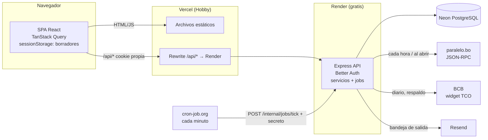
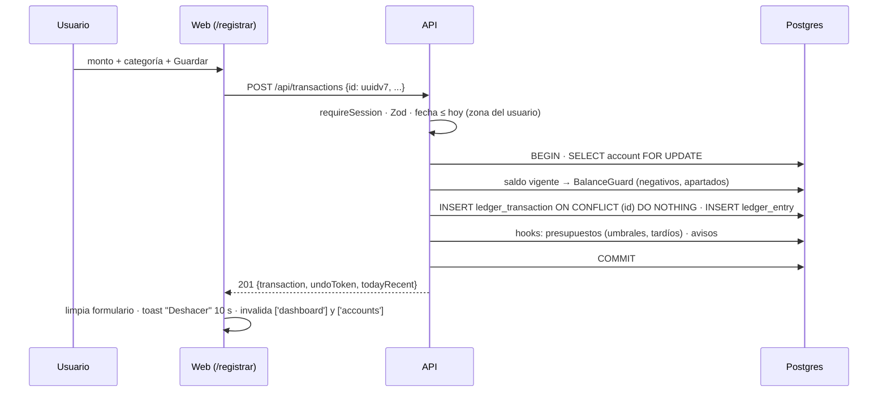
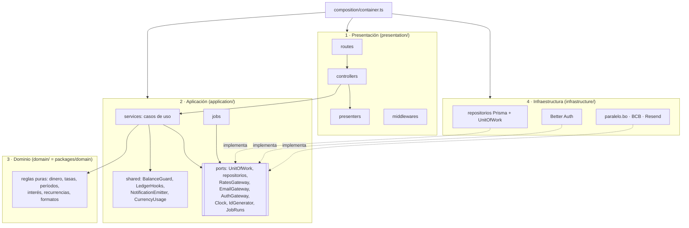
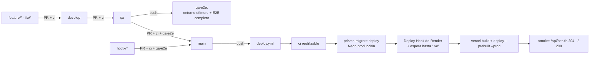

# Plan de Diseño Técnico — App de Finanzas Personales

**Versión:** 1.3 · **Fecha:** 2026-10-19 · **Estado:** Aprobado (2026-10-16)
**Insumos:** `docs/constitution.md` v1.2.0 · `001-appFinanzas-mvp/spec.md` v1.4
**Alcance:** V1 completa (V1.0, V1.1, V1.2). Este documento define el **cómo**. Las tareas se definen en `tasks.md`.

Convenciones de este documento:
- El código, las tablas y las columnas están en inglés. Las rutas de la interfaz y los textos están en español (constitución §5).
- "Bloqueo por usuario" es `pg_advisory_xact_lock(hashtext('user:' || user_id))`.
- "Idempotente" significa que la creación lleva un `id` UUID v7 generado por el cliente (ADR-11).
- Todos los montos y tasas viajan como texto decimal (ADR-03).

---

## 1. Visión Arquitectónica y Flujo del Sistema

### 1.1 Capas

| Capa | Tecnología (constitución §2) | Responsabilidad |
|---|---|---|
| Cliente | React + Vite, Tailwind + shadcn/ui, TanStack Query, React Router, react-hook-form | Interfaz, borradores, navegación, estado de cliente, validación previa con los mismos schemas Zod |
| Contratos | Zod en `packages/contracts` | Única definición de entradas, salidas y códigos de error. La usan la web y el API |
| Dominio | TypeScript puro en `packages/domain`, decimal.js, date-fns + @date-fns/tz | Reglas de negocio sin E/S: dinero, conversiones, períodos, interés, recurrencias, formatos. Las comparten web y API |
| API | Node.js + Express, en 4 capas (1.4) | Presentación HTTP, casos de uso y jobs, reglas de dominio, infraestructura (Prisma, Better Auth, integraciones) |
| Persistencia | Prisma + PostgreSQL (Neon) | Esquema, restricciones de integridad, bloqueos, migraciones |
| Integraciones | paralelo.bo (JSON-RPC), BCB (widget público), Resend | Tasas de cambio y correos de la cuenta |

Principios de diseño:
1. **La identidad sale de la sesión.** Ningún endpoint acepta `userId` del cliente (constitución §4).
2. **Las reglas viven una sola vez.** Lo calculable va en `packages/domain`; el API siempre vuelve a validar y es la autoridad.
3. **Toda mutación es una transacción de base de datos.** Los saldos se validan dentro de ella con bloqueo de fila (RNF-10).
4. **La historia no se reescribe.** Los movimientos guardan sus tasas. Los períodos decididos guardan su resultado. El interés nunca se recalcula hacia atrás (constitución §3, RNF-19).

### 1.2 Despliegue y flujo principal



**Guardar un gasto (camino crítico, RNF-01 y RNF-02):**



**Cómo se conectan las tres partes.** La web, el API y la base de datos son tres despliegues separados, cada uno en su servicio. Cada despliegue verifica los tres enlaces con pruebas de humo (1.5):

| Enlace | Cómo se conecta | Dónde se configura | Prueba de humo |
|---|---|---|---|
| Web (Vercel) → API (Render) | Rewrite de `/api/*` hacia la URL pública del API. El navegador solo ve el dominio de la web: no hace falta CORS y la cookie funciona también en Safari (ADR-02). | `vercel.json` | `GET $WEB_URL/api/health/ready` = 204 |
| API (Render) → BD (Neon) | `DATABASE_URL`, con el pooler de Neon, en tiempo de ejecución. Las migraciones usan `DATABASE_URL_DIRECT`, sin pooler. | Variables de Render y secreto del Environment `production` | `GET $API_URL/api/health/ready` = 204 |
| API ← Web (origen permitido) | `checkOrigin` rechaza las mutaciones cuyo `Origin` no sea la web. | `WEB_ORIGIN` en Render | — |

`GET /api/health` solo dice que el API está vivo. `GET /api/health/ready` hace además una consulta a la base de datos (4.2.2). Si esa consulta responde 204 llamando por el dominio de la web, quedan probadas la web, el API y la base de datos, de punta a punta.

### 1.3 Registro de decisiones (ADR)

| ID | Decisión | Motivo | Alternativas descartadas |
|---|---|---|---|
| ADR-01 | Jobs: API en Render gratis. cron-job.org llama cada minuto a `POST /internal/jobs/tick` (secreto en un encabezado, directo a Render). Jobs idempotentes que se ponen al día. Respaldo: la primera petición de cada usuario ejecuta lo vencido para él. | Costo 0. El ping mantiene despierto el servidor (sin arranque en frío). Los atrasos se recuperan solos (RF-M14-12, RNF-13). | pg-boss o node-cron (necesitan un servidor siempre encendido), GitHub Actions (mínimo cada 5 min y con retrasos), Railway Hobby (USD 5/mes). |
| ADR-02 | Sesión entre dominios: Vercel hace de proxy de `/api/*`. Cookie propia `HttpOnly; Secure; SameSite=Lax` + verificación de `Origin`. | Safari bloquea las cookies de terceros. Sin dominio propio ni CORS. | Subdominios con dominio propio, `SameSite=None`. |
| ADR-03 | Dinero: `NUMERIC` en Postgres, `Prisma.Decimal` (decimal.js) en el servidor, texto `"1234.56"` en el JSON, decimal.js en la web. Solo los gráficos convierten a `number`, para dibujar. `ROUND(numeric, 2)` de Postgres = mitad alejándose del cero = RN-06. | Constitución §3: nunca punto flotante. | `number` en el JSON. |
| ADR-04 | Libro contable: `ledger_transaction` (cabecera) + `ledger_entry` (asientos con signo). Saldo = inicial + Σ asientos. | Transferencias, comisiones y ajustes con un solo modelo; un `SUM` uniforme. | Una fila por movimiento con columnas de origen y destino. |
| ADR-05 | Aislamiento: los repositorios reciben `userId` de la sesión; una extensión de Prisma inyecta y verifica `user_id`; claves foráneas compuestas `(user_id, x_id)` hacen imposible referenciar datos de otro usuario. Un test de aislamiento por repositorio. Sin RLS. | Defensa en dos capas sin el costo operativo de RLS con el pooler de Neon. | RLS en Postgres. |
| ADR-06 | Tasas: paralelo.bo por JSON-RPC (`get_current_rate`, `get_historical_rate`, `convert_currency` official). "Venta" = el mayor de buy/sell, "compra" = el menor. TCO: paralelo.bo, con respaldo en el widget del BCB. Carga única del histórico. Atribución CC-BY-4.0 (RNF-27). | Fuentes reales verificadas el 2026-10-16. El BCB solo publica un TCO desde el 27/06/2026. | Extraer compra y venta oficiales del sitio del BCB (ya no existen). |
| ADR-07 | Deshacer: `deleted_at` + token de un solo uso (`undo_action`, vence a los 12 s). Un job purga. | Restaura lo vinculado de forma atómica; las consultas filtran `deleted_at IS NULL`. | Borrado real + recrear desde el cliente. |
| ADR-08 | Autenticación: endpoints propios `/api/auth/*` sobre la API de servidor de Better Auth (usuario, hash scrypt, sesiones, cookie). Enlaces, bloqueos y correos son propios. El manejador HTTP genérico de Better Auth no se expone. | Better Auth no permite invalidar el enlace anterior, ni dar mensajes neutros, ni bloquear correos sin cuenta. | Solo hooks y plugins. |
| ADR-09 | Errores: `application/problem+json` (RFC 9457) con `code` estable y datos seguros; la web los traduce con i18next. Errores inesperados: `INTERNAL_ERROR` + `traceId`. | Constitución §4. | Formato propio con el mensaje en español desde el servidor. |
| ADR-10 | Esquema: `schema.prisma` para modelos y relaciones. Las migraciones SQL agregan lo que Prisma no expresa: índices únicos parciales, `CHECK`, triggers, la función `user_rate_on`, la extensión `unaccent`. | Prisma es la puerta de acceso (§2); la integridad vive en la base. | Solo validaciones en el servicio. |
| ADR-11 | Idempotencia: toda creación lleva un `id` UUID v7 generado por el cliente. `INSERT … ON CONFLICT (id) DO NOTHING`: 201 si es nuevo, 200 con el existente si coincide, `IDEMPOTENCY_CONFLICT 409` si difiere. Las decisiones únicas usan `UPDATE … WHERE status = <esperado>`. | RN-10, RNF-11 y EC-M2-02 sin tabla de llaves. | Tabla de idempotency keys. |
| ADR-12 | Datos de mercado globales (`market_rate`) sin `user_id`; los escriben solo los jobs. | Son públicos e iguales para todos. Única excepción a la regla del `user_id`. | Copiar las tasas por usuario. |
| ADR-13 | Los estados que dependen del tipo de cambio o del tiempo se derivan al leer: meta (en curso, cumplida, vencida), deuda vencida. | Siguen al progreso sin jobs ni carreras (RF-M12-02, EC-M12-03). | Columnas de estado mantenidas por jobs. |
| ADR-14 | Interés de deudas como foto: `capital_outstanding`, `interest_unpaid NUMERIC(24,10)`, `accrued_through`. Cada evento primero lleva el interés hasta hoy. | El interés nunca se recalcula hacia atrás (RF-M13-04) y no acumula error de redondeo (RNF-18). | Recalcular por tramos desde el inicio. |
| ADR-15 | Tablas del libro contable: `ledger_transaction` y `ledger_entry` en lugar de `transaction` y `transaction_entry`. | `TRANSACTION` es palabra clave de SQL. | Comillas en todas las consultas. |
| ADR-16 | Navegación: React Router. El mes, los filtros y el detalle van en la URL, validados con Zod (`useValidatedSearch`). La memoria de cada pestaña es por módulo, en sessionStorage. | RF-M2-04 y RF-M2-06 con el botón Atrás nativo. | TanStack Router. |
| ADR-17 | Estado de cliente: store mínimo propio (`useSyncExternalStore`). Borradores en sessionStorage (`draft:{userId}:{formKey}`). | Muy poco estado; sobrevive a que el celular descarte la pestaña y se borra al cerrarla (RF-M2-10). | Zustand, solo memoria. |
| ADR-18 | Entregas: variable `RELEASE` del API, devuelta en `GET /api/me`. Las rutas de módulos no liberados responden 404 y sus jobs no corren. | Una sola fuente; liberar no exige recompilar el frontend (RF-M2-03). | Variable de compilación en cada app. |
| ADR-19 | Backend en capas: presentación → aplicación → dominio. La infraestructura implementa los puertos que define la aplicación, y una raíz de composición los une. dependency-cruiser verifica las reglas en CI (1.4). | Separa HTTP, reglas e infraestructura; los casos de uso se prueban sin Express ni Prisma; las reglas de dependencia no se rompen sin que CI lo note. | Organización por módulos con rutas, servicio y repositorio juntos, sin reglas verificadas. |
| ADR-20 | CI/CD con GitHub Actions. CI en cada push y PR. QA efímero en CI para la rama `qa` (Postgres, API y web dentro del runner, con E2E completo). Despliegue automático solo desde `main`, después de que CI pase: migraciones → Deploy Hook de Render → Vercel CLI → pruebas de humo. Render y Vercel no despliegan solos desde Git (1.5). | Ningún cambio llega a producción sin pasar CI; el orden migración → API → web es seguro; costo USD 0 sin arriesgar las horas gratis de Render. | Auto-deploy nativo en cada push (despliega aunque CI falle); entorno QA desplegado (consume horas gratis de Render). |

**Librerías además del stack de la constitución.** Ninguna reemplaza ni duplica una tecnología del stack (constitución §2).

| Uso | Librerías |
|---|---|
| Interfaz | react-router, react-hook-form + @hookform/resolvers, recharts, i18next + react-i18next, lucide-react (íconos de shadcn/ui), @dnd-kit (reordenar arrastrando) |
| Fechas e ids | date-fns + @date-fns/tz, uuidv7 (ids del cliente) |
| Servidor | archiver (ZIP de la exportación) |
| Desarrollo y CI | supertest, @axe-core/playwright, eslint-plugin-i18next, dependency-cruiser (reglas de capas), @commitlint/cli + config-conventional (§7), vercel (CLI de despliegue) |

La integración y el despliegue continuos corren en GitHub Actions (1.5, ADR-20).

**Pruebas técnicas previas a implementar:**
- **S-1:** confirmar que la API de servidor de Better Auth permite crear una sesión y su cookie desde un endpoint propio, marcar el correo verificado y hashear y verificar contraseñas.
- **S-2:** confirmar los límites de uso de `https://paralelo.bo/mcp` y la estabilidad del widget del BCB.

### 1.4 Arquitectura por capas del backend (ADR-19)



| Capa | Contiene | Puede depender de | NO puede depender de |
|---|---|---|---|
| Presentación | Rutas Express, controladores, middlewares, presentadores (entidad → DTO) y el endpoint interno del tick | Aplicación (servicios y errores), `packages/contracts` | Infraestructura, Prisma, Better Auth |
| Aplicación | Servicios (un caso de uso por método), servicios compartidos, jobs, puertos (interfaces) y catálogo de errores | Dominio, `packages/contracts` (tipos), sus propios puertos | Presentación, infraestructura, `express`, `@prisma/client`, `better-auth` |
| Dominio | `packages/domain` (funciones puras) y tipos de entidad | decimal.js, date-fns | Todo lo demás |
| Infraestructura | Cliente Prisma con la extensión de aislamiento, `UnitOfWork` (transacción + `withUserLock`), repositorios, Better Auth, integraciones y sus *fakes*, configuración, exportación CSV/ZIP | Puertos y tipos de aplicación, dominio | Presentación |
| Composición | `container.ts`: crea las implementaciones y las inyecta en los servicios y controladores | Todas | — |

**Reglas de diseño:**
- **Controladores delgados.** Un controlador solo valida con el schema de `contracts`, arma el contexto `{ userId, timezone, now, traceId }` a partir de la sesión, llama a un solo método de servicio y presenta el resultado. Toda regla de negocio vive en aplicación o dominio.
- **Transacciones solo en aplicación.** Un servicio abre la transacción con `uow.run(fn, { userLock?: userId })`, y los repositorios que recibe ya están ligados a esa transacción y a ese `userId` (ADR-05). Los repositorios nunca abren transacciones.
- **Errores en una sola dirección.** Aplicación lanza `AppError(code, data)`; el `errorHandler` de presentación lo traduce a problem+json (ADR-09). Ningún error de Prisma o de Better Auth cruza hacia la presentación.
- **Fakes de integraciones.** La infraestructura incluye `paralelo-bo.fake`, `bcb.fake` y `resend.fake`, activados con `INTEGRATIONS=fake`. La validación de `env` lo prohíbe en producción.

**Ejemplo, `POST /api/transactions`:** `transactions.routes` → `TransactionsController.create` (valida `CreateTransactionInput` y arma el contexto) → `TransactionsService.create(ctx, input)`. El servicio abre `uow.run` y, dentro de esa transacción:
1. `accounts.lockForUpdate`;
2. `RatesService.resolveUsdRate` (dominio);
3. `BalanceGuard.apply`;
4. `transactions.insert`;
5. `LedgerHooks.afterChange`;
6. `undoActions.create`.

Al final, `TransactionPresenter.toDto` arma la respuesta `201`.

**Cumplimiento automático:** `.dependency-cruiser.cjs` define las reglas `presentation-not-to-infrastructure`, `application-not-to-presentation`, `application-not-to-infrastructure`, `application-no-framework` (sin `express`, `@prisma/client` ni `better-auth`), `domain-pure` e `infrastructure-not-to-presentation`. CI falla ante cualquier violación.

**Tests por capa:**

| Capa | Cómo se prueba |
|---|---|
| Dominio | Unitarios puros. |
| Aplicación | Unitarios con repositorios en memoria y `Clock` falso para la lógica de orquestación, más integración con la infraestructura real para la concurrencia. |
| Infraestructura | Integración contra Postgres en Docker, incluidos los tests de aislamiento (§5). |
| Presentación | Contratos HTTP con supertest. |

### 1.5 Integración y despliegue continuos (ADR-20)

**Entornos:**

| Entorno | Rama | Backend | Base de datos | Frontend | Cómo se actualiza |
|---|---|---|---|---|---|
| Producción | `main` | Render (plan gratis, `autoDeploy: false`) | Neon, rama `main` | Vercel, producción (despliegue por Git desactivado) | `deploy.yml`, automático en cada push a `main` con CI en verde |
| QA (efímero) | `qa` | API dentro del runner de GitHub Actions | Postgres 16 como *service* del job | `vite build` + `vite preview` con proxy al API | `qa-e2e.yml` en cada push a `qa` y en cada PR hacia `main` |
| Integración | `develop` | — | — | — | Solo CI (`ci.yml`) |

**Flujo (Git Flow de la constitución §7):**



**Workflows (`.github/workflows/`):**

| Archivo | Disparador | Pasos |
|---|---|---|
| `ci.yml` | `push` a cualquier rama y `pull_request` hacia `develop`, `qa` y `main`. También es reutilizable (`workflow_call`). | 1) `pnpm install --frozen-lockfile` con caché y generación del cliente Prisma (`pnpm --filter @finanzas/db generate`): el lint con tipos y el typecheck leen sus tipos, y sin generarlo valen `any`. 2) commitlint de los commits del PR. 3) lint (ESLint, i18n, sin literales). 4) typecheck estricto. 5) dependency-cruiser (reglas de capas). 6) Unitarios (`domain`, `contracts`, aplicación). 7) Integración del API contra Postgres 16 como *service* (`prisma migrate deploy` + Vitest), incluidos aislamiento y concurrencia. 8) Build de `api` y `web`. |
| `qa-e2e.yml` | `push` a `qa` y `pull_request` hacia `main` | Levanta el entorno efímero: Postgres como *service*, migraciones, `seed:e2e` (usuarios de prueba, 5.000 movimientos, tasas fijas), API con `INTEGRATIONS=fake` (los correos se capturan en un buzón de prueba para leer los enlaces), web compilada en `vite preview`. Corre Playwright en la matriz Chromium/WebKit/Firefox × 360/1280 px (en paralelo), axe y la suite de rendimiento (RNF-01 a RNF-03). Publica el reporte, las trazas y los videos de los fallos como artefactos. |
| `deploy.yml` | `push` a `main` (incluye merges de `qa` y `hotfix/*`) y `workflow_dispatch`, para volver a desplegar sin un commit | `concurrency: production` (sin cancelar despliegues en curso). Hay dos jobs. El primero, `uses: ./.github/workflows/ci.yml`: si CI falla, no se despliega. El segundo, `deploy`, corre en el *GitHub Environment* `production` y en un runner propio, así que prepara su entorno: checkout, `pnpm/action-setup`, `setup-node` con `.nvmrc` y `pnpm install --frozen-lockfile`. 1) `prisma migrate deploy` con `DATABASE_URL` y `DATABASE_URL_DIRECT` iguales a la conexión directa de Neon: Prisma exige la variable de `url` aunque migre por `directUrl`. 2) `curl -X POST $RENDER_DEPLOY_HOOK_URL`. Toma el ID del deploy de la respuesta (si no viene, busca el deploy cuyo `commit.id` es `github.sha`) y consulta `GET /v1/services/{id}/deploys/{deployId}` cada 15 s hasta `live`. Falla ante cualquier estado final distinto (`build_failed`, `update_failed`, `pre_deploy_failed`, `canceled` o `deactivated`) o a los 15 min; Render conserva la versión anterior. No usa `deploys?limit=1`, que puede devolver el deploy anterior y dar un falso verde. 3) `vercel pull --yes --environment=production` → `vercel build --prod` → `vercel deploy --prebuilt --prod`, todos con `--token`. Sin `--yes`, `vercel pull` pide confirmación y el job se cuelga. 4) Pruebas de humo, una por enlace (1.2), con las variables `API_URL` y `WEB_URL` del Environment: `GET $API_URL/api/health` = 204 (el API está vivo), `GET $API_URL/api/health/ready` = 204 (el API llega a la BD), `GET $WEB_URL/` = 200 (la web está viva) y `GET $WEB_URL/api/health/ready` = 204 (web → API → BD). |
| `fx-backfill.yml` | Manual (`workflow_dispatch`) | Ejecuta una vez `packages/db/scripts/fx-backfill.ts` contra producción (ADR-06). |

**Configuración versionada en el repo:**
- **`render.yaml` (Blueprint):** define el servicio `finanzas-api` con estos valores:
  - plan gratis y `autoDeploy: false`;
  - `buildCommand`: `corepack enable && pnpm install --frozen-lockfile --prod=false && pnpm --filter @finanzas/db generate && pnpm --filter api build`. Hacen falta las devDependencies porque `start` corre con `tsx`, y el cliente de Prisma se genera en el build. El `build` del API solo verifica tipos: no emite JS;
  - `startCommand`: `pnpm --filter api start`;
  - `healthCheckPath`: `/api/health`;
  - variables con valor fijo: `NODE_ENV=production` (`env.ts` lo exige) y `NODE_VERSION=22`, igual que `.nvmrc`, para que Render no elija otra versión por el `engines: >=22`;
  - variables con `sync: false`, que se cargan en el panel de Render y no en el repo: `DATABASE_URL` (con pooler), `AUTH_SECRET`, `HMAC_SECRET`, `JOBS_SECRET`, `RESEND_API_KEY`, `RELEASE`, `WEB_ORIGIN` e `INTEGRATIONS=real`. `RESEND_API_KEY` es obligatoria desde el primer arranque, porque `env.ts` la valida aunque todavía no se manden correos.
- **`vercel.json`** (en la raíz del monorepo):
  - `"git": { "deploymentEnabled": false }`, así solo despliega `deploy.yml`;
  - `installCommand: "pnpm install --frozen-lockfile"`, `buildCommand: "pnpm --filter web build"` y `outputDirectory: "apps/web/dist"`;
  - los rewrites, en este orden: primero `/api/:path*` → `<URL pública del API en Render>/api/:path*` (ADR-02), después el de la SPA, `/(.*)` → `/index.html`;
  - `.vercel/`, que crea `vercel link`, va al `.gitignore`.
- **`commitlint.config.cjs`** y **`.dependency-cruiser.cjs`**.

**Secretos:**
- Los de despliegue viven en el *GitHub Environment* `production`, restringido a la rama `main`: `DATABASE_URL_DIRECT`, `RENDER_DEPLOY_HOOK_URL`, `RENDER_API_KEY`, `RENDER_SERVICE_ID`, `VERCEL_TOKEN`, `VERCEL_ORG_ID`, `VERCEL_PROJECT_ID`. Las URLs públicas, `WEB_URL` y `API_URL`, son variables del Environment, no secretos.
- Los de ejecución viven solo en Render.
- Ningún secreto aparece en logs (constitución §4): los pasos usan `::add-mask::`.

**Protección de ramas (§7):**
- `develop`, `qa` y `main` solo aceptan cambios por PR y exigen el check `ci`, desde el primer despliegue.
- `main` exige además `qa-e2e` cuando ese workflow exista (TASK-172). Hasta entonces, `ci` alcanza para desplegar.
- Nadie, ni los agentes de IA, empuja directo a esas ramas.
- Un `hotfix/*` sale de `main`, entra a `main` por PR y después se integra en `qa` y en `develop` con dos PR más.

**Migraciones seguras:**
- Las migraciones siguen el patrón *expand–contract*: cada migración es compatible con la versión anterior del API. Por eso migrar antes de desplegar no rompe la versión que sigue en línea, y volver atrás la app no exige revertir la base.
- Los cambios destructivos (borrar o renombrar columnas) se hacen en dos despliegues.
- No hay migraciones *down* automáticas.

**Vuelta atrás:**
- **API:** "Rollback" al despliegue anterior en Render.
- **Web:** `vercel rollback` o *Instant Rollback* desde el panel de Vercel.
- **Base de datos:** gracias a *expand–contract*, no hace falta tocarla.

**Jobs durante un despliegue:** cron-job.org sigue llamando al tick de producción. Un tick que cae mientras Render reinicia simplemente falla, y el siguiente minuto se pone al día, porque los jobs son idempotentes (ADR-01).

**Costo:** USD 0. GitHub Actions es gratis en repos públicos, y en privados da 2.000 min al mes; cada corrida de CI toma unos 8 min y `qa-e2e` unos 20 min, en paralelo. Render y Vercel siguen en sus planes gratis.

**Puesta en marcha (una sola vez).** Lo que una persona hace a mano: los agentes no pueden crear cuentas ni cargar secretos. El paso a paso está en los «Pasos manuales» de TASK-171, TASK-172, TASK-173 y TASK-174, y reunido en el README.
1. **Neon:** el proyecto, su rama `main` y las URLs con pooler y directa.
2. **Resend:** la cuenta y la API key.
3. **Secretos de la app:** `AUTH_SECRET`, `HMAC_SECRET` y `JOBS_SECRET`, aleatorios.
4. **Vercel:** el proyecto vinculado con `vercel link`, el token y `WEB_URL`.
5. **Render:** el Blueprint desde `render.yaml` en `main`, sus variables, el Deploy Hook, la API key, el ID del servicio y `API_URL`.
6. **GitHub:** el Environment `production` con sus secretos y variables, y la protección de ramas.
7. **cron-job.org:** `POST $API_URL/internal/jobs/tick` cada minuto, con `x-jobs-secret`, `Content-Type: application/json` y el cuerpo `{}` (`requireJson` responde 415 a un POST sin JSON).
8. **Primer despliegue:** la promoción `develop` → `qa` → `main` por PR.

---

## 2. Estructura del Proyecto (Árbol de Directorios)

```
/
├─ README.md                              # qué es, despliegues, cómo correrlo, CI/CD, SDD, puesta en marcha
├─ docs/
│  ├─ constitution.md
│  └─ execution-protocol.md               # pipeline de tareas con agentes (constitución §8)
├─ .claude/                               # settings.json (hooks), agents/ (test-author, implementer,
│                                         # sdd-auditor), skills/implement-task/
├─ .githooks/pre-push                     # control antes de subir (tools/sdd/pre-push.mjs)
├─ tools/sdd/                             # scripts del pipeline: preflight, gate, check, close, state…
├─ 001-appFinanzas-mvp/
│  ├─ spec.md
│  ├─ plan.md
│  └─ tasks.md
├─ apps/
│  ├─ api/
│  │  ├─ src/
│  │  │  ├─ main.ts                          # arranque: valida env, arma el contenedor, levanta Express
│  │  │  ├─ composition/
│  │  │  │  └─ container.ts                  # raíz de composición: une puertos con implementaciones
│  │  │  ├─ presentation/                    # CAPA 1 · HTTP
│  │  │  │  ├─ app.ts                        # middlewares globales y montaje de rutas
│  │  │  │  ├─ middlewares/                  # requireSession, trackActivity, requireJson, checkOrigin,
│  │  │  │  │                                # releaseGate, validate(schema), errorHandler (problem+json)
│  │  │  │  ├─ routes/                       # <modulo>.routes.ts (auth, me, settings, onboarding, fx, accounts,
│  │  │  │  │                                # categories, transactions, register, dashboard, budgets, goals,
│  │  │  │  │                                # debts, recurring, notifications)
│  │  │  │  ├─ controllers/                  # <modulo>.controller.ts: valida, arma el contexto, llama al servicio
│  │  │  │  ├─ presenters/                   # <modulo>.presenter.ts: entidad → DTO (Decimal → string)
│  │  │  │  └─ internal/jobs.controller.ts   # POST /internal/jobs/tick
│  │  │  ├─ application/                     # CAPA 2 · casos de uso
│  │  │  │  ├─ services/                     # <modulo>.service.ts (+ export.service.ts)
│  │  │  │  ├─ shared/                       # balance-guard.ts, ledger-hooks.ts, notification-emitter.ts,
│  │  │  │  │                                # currency-usage.ts, email-links.ts, login-throttle.ts
│  │  │  │  ├─ jobs/                         # tick.ts, fx.ts, outbox.ts, recurring.ts, budgets.ts,
│  │  │  │  │                                # notifications.ts, maintenance.ts
│  │  │  │  ├─ ports/                        # unit-of-work.ts, repositories.ts, rates-gateway.ts,
│  │  │  │  │                                # email-gateway.ts, auth-gateway.ts, clock.ts, id-generator.ts,
│  │  │  │  │                                # job-runs.ts, readiness.ts
│  │  │  │  └─ errors.ts                     # AppError + catálogo de códigos (ADR-09)
│  │  │  ├─ domain/                          # CAPA 3 · reexporta packages/domain + tipos de entidad
│  │  │  └─ infrastructure/                  # CAPA 4 · detalles técnicos
│  │  │     ├─ config/env.ts                 # variables validadas con Zod (INTEGRATIONS=fake prohibido en producción)
│  │  │     ├─ persistence/
│  │  │     │  ├─ prisma-client.ts           # cliente + extensión de aislamiento (ADR-05)
│  │  │     │  ├─ unit-of-work.ts            # transacción, withUserLock, repositorios ligados a tx y userId
│  │  │     │  ├─ job-runs.ts                # lease de los jobs en job_run (implementa ports/job-runs.ts)
│  │  │     │  ├─ readiness.ts               # SELECT 1 de /api/health/ready (implementa ports/readiness.ts)
│  │  │     │  └─ repositories/              # <entidad>.repository.ts (implementan ports/repositories.ts)
│  │  │     ├─ auth/better-auth.ts           # implementa AuthGateway (ADR-08)
│  │  │     ├─ integrations/                 # paralelo-bo.ts, bcb.ts, resend.ts y sus .fake.ts (CI)
│  │  │     └─ export/csv-zip.ts             # archiver + CSV neutralizado
│  │  ├─ test/
│  │  │  ├─ unit/                            # aplicación con repositorios en memoria y Clock falso
│  │  │  ├─ integration/                     # infraestructura + aislamiento + concurrencia (Postgres en Docker)
│  │  │  ├─ http/                            # contratos HTTP con supertest
│  │  │  └─ factories/
│  │  └─ package.json
│  └─ web/
│     ├─ src/
│     │  ├─ main.tsx · App.tsx
│     │  ├─ app/
│     │  │  ├─ router.tsx                 # rutas, guardas (RequireSession, RequireOnboardingDone, ReleaseGate)
│     │  │  ├─ layout/                    # AppShell, BottomTabBar, Sidebar, Header, MoreMenu
│     │  │  └─ providers/                 # QueryClient, i18n, tema
│     │  ├─ features/
│     │  │  ├─ auth/ · profile/ · navigation/ · fx/ · accounts/ · categories/ · transactions/
│     │  │  ├─ register/ · dashboard/ · settings/ · onboarding/ · budgets/ · goals/
│     │  │  └─ debts/ · recurring/ · notifications/
│     │  │      # cada feature: components/ · hooks/ (TanStack Query) · api.ts · routes.tsx
│     │  ├─ components/ui/                # shadcn/ui
│     │  ├─ lib/
│     │  │  ├─ api-client.ts              # fetch tipado, problem+json, X-Background, SESSION_EXPIRED
│     │  │  ├─ drafts.ts                  # useDraft
│     │  │  ├─ ui-store.ts                # store mínimo (pestañas, bloqueo, sesión vencida)
│     │  │  ├─ online.ts                  # detección sin conexión + onlineManager
│     │  │  └─ search-params.ts           # useValidatedSearch
│     │  └─ locales/es-BO/*.json          # textos (i18next)
│     └─ package.json
├─ packages/
│  ├─ contracts/src/                      # schemas Zod + tipos por módulo, errores, releases.ts
│  ├─ domain/src/                         # money · fx · format · balance · budget · goals · debts
│  │                                      # recurrence · dashboard · dates (todo puro, con tests)
│  ├─ db/
│  │  ├─ prisma/schema.prisma
│  │  ├─ prisma/migrations/               # SQL generado + SQL manual (ADR-10)
│  │  ├─ seed/                            # catálogos (íconos, paleta, categorías precargadas)
│  │  ├─ scripts/fx-backfill.ts           # carga única del histórico (ADR-06)
│  │  └─ src/client.ts                    # PrismaClient + extensión de aislamiento
│  └─ config/                             # tsconfig base, eslint, vitest base
├─ e2e/                                   # Playwright (escenarios Gherkin, accesibilidad, rendimiento)
├─ .github/workflows/                     # ci.yml · qa-e2e.yml · deploy.yml · fx-backfill.yml (1.5)
├─ render.yaml                            # Blueprint del API en Render (autoDeploy: false)
├─ vercel.json                            # rewrites /api y SPA; despliegue por Git desactivado
├─ .dependency-cruiser.cjs                # reglas de capas del backend (1.4)
├─ commitlint.config.cjs                  # Conventional Commits (§7)
├─ docker-compose.yml                     # Postgres para desarrollo y tests
├─ pnpm-workspace.yaml
└─ package.json
```

---

## 3. Esquema de Datos y Persistencia Global

### 3.1 Convenciones
- Toda tabla de negocio tiene `user_id uuid NOT NULL REFERENCES auth_user ON DELETE CASCADE`. Eliminar la cuenta borra todo con un `DELETE` (RF-M1-15, RNF-16).
- Las tablas referenciables declaran `UNIQUE (user_id, id)` y se referencian con claves foráneas compuestas `(user_id, x_id)` (ADR-05).
- Montos y tasas: `numeric(14,2)`. Interés interno: `numeric(24,10)`. Fechas de negocio: `date`, día local del usuario (RN-07). Instantes: `timestamptz`.
- Estados: enums de Postgres. Archivado: `status` + `archived_at`. Borrado deshacible: solo en `ledger_transaction` (`deleted_at`).
- `updated_at` lo mantiene el trigger `set_updated_at()`.
- Extensiones: `unaccent`.
- Orden de la migración: las claves foráneas que apuntan a tablas definidas más abajo en este documento (por ejemplo `user_settings → account` o `ledger_transaction → recurring_rule`) se crean con `ALTER TABLE … ADD CONSTRAINT` al final de la migración inicial.

### 3.2 Tipos enumerados

```sql
CREATE TYPE email_link_purpose     AS ENUM ('confirm_email','reset_password');
CREATE TYPE email_kind             AS ENUM ('confirm','register_attempt','reset','password_changed','login_alert','account_deleted');
CREATE TYPE outbox_status          AS ENUM ('pending','sent','failed');
CREATE TYPE number_format          AS ENUM ('dot_comma','comma_dot');           -- Bs 1.234,56 | Bs 1,234.56
CREATE TYPE date_format            AS ENUM ('dmy','iso','short_text');
CREATE TYPE week_start             AS ENUM ('monday','sunday');
CREATE TYPE theme_mode             AS ENUM ('system','light','dark');
CREATE TYPE market_rate_kind       AS ENUM ('parallel_bid','parallel_ask','parallel_median','official');
CREATE TYPE rate_source            AS ENUM ('paralelo_bo','bcb','seed');
CREATE TYPE currency_status        AS ENUM ('active','inactive');
CREATE TYPE fx_event_kind          AS ENUM ('reference_set','manual_usd_on','manual_usd_off','custom_rate');
CREATE TYPE account_type           AS ENUM ('cash','bank','ewallet','credit_card','savings','other');
CREATE TYPE lifecycle_status       AS ENUM ('active','archived');               -- cuentas y categorías
CREATE TYPE category_kind          AS ENUM ('expense','income');
CREATE TYPE system_category_key    AS ENUM ('debts','debts_interest');
CREATE TYPE transaction_kind       AS ENUM ('expense','income','transfer','adjustment');
CREATE TYPE transaction_origin     AS ENUM ('manual','recurring','debt_initial','debt_payment','fee','goal_transfer');
CREATE TYPE undo_kind              AS ENUM ('delete','recategorize','create');
CREATE TYPE entry_kind             AS ENUM ('expense','income','transfer');     -- atajos y reglas
CREATE TYPE budget_scope           AS ENUM ('category','general');
CREATE TYPE budget_status          AS ENUM ('active','paused','finalizing','finalized');
CREATE TYPE budget_default_action  AS ENUM ('discard','carry');
CREATE TYPE budget_period_status   AS ENUM ('open','closed_pending','decided','defaulted');
CREATE TYPE allocation_origin      AS ENUM ('manual','budget','confirmed_spend','use_and_close','adjustment');
CREATE TYPE debt_direction         AS ENUM ('i_owe','owed_to_me');
CREATE TYPE debt_status            AS ENUM ('active','paid','forgiven');
CREATE TYPE interest_period        AS ENUM ('monthly','yearly');
CREATE TYPE rule_frequency         AS ENUM ('daily','weekly','monthly','yearly');
CREATE TYPE rule_end_type          AS ENUM ('none','until','count');
CREATE TYPE rule_mode              AS ENUM ('auto','confirm');
CREATE TYPE rule_status            AS ENUM ('active','paused','finished');
CREATE TYPE occurrence_status      AS ENUM ('pending','registered','skipped','omitted');
CREATE TYPE notification_type      AS ENUM ('payment_upcoming','budget_alert','period_close','recurring_pending','log_day','goal_progress');
CREATE TYPE decision_status        AS ENUM ('waiting','resolved');
```

### 3.3 Cuenta de usuario y seguridad (M1)

```sql
CREATE TABLE auth_user (                                   -- Better Auth (modelo "user")
  id                uuid PRIMARY KEY,
  name              varchar(60)  NOT NULL CHECK (name = btrim(name) AND char_length(name) BETWEEN 1 AND 60),
  email             varchar(254) NOT NULL UNIQUE CHECK (email = lower(btrim(email))),
  email_verified    boolean      NOT NULL DEFAULT false,   -- false = Sin confirmar · true = Activa
  image             text,
  timezone          varchar(64)  NOT NULL DEFAULT 'America/La_Paz',
  locale            varchar(10)  NOT NULL DEFAULT 'es-BO' CHECK (locale = 'es-BO'),
  terms_accepted_at timestamptz  NOT NULL,
  registered_at     timestamptz  NOT NULL,                  -- reinicia con cada registro (RF-M1-06)
  created_at        timestamptz  NOT NULL DEFAULT now(),
  updated_at        timestamptz  NOT NULL DEFAULT now()
);
CREATE INDEX auth_user_unconfirmed_idx ON auth_user (registered_at) WHERE NOT email_verified;

CREATE TABLE auth_session (                                -- Better Auth (modelo "session")
  id               uuid PRIMARY KEY,
  token            text NOT NULL UNIQUE,
  user_id          uuid NOT NULL REFERENCES auth_user ON DELETE CASCADE,
  expires_at       timestamptz NOT NULL,
  last_activity_at timestamptz NOT NULL,                    -- RF-M1-07
  ip_address       text,
  user_agent       text,
  created_at       timestamptz NOT NULL DEFAULT now(),
  updated_at       timestamptz NOT NULL DEFAULT now()
);
CREATE INDEX ON auth_session (user_id);

CREATE TABLE auth_account (                                -- Better Auth (credencial)
  id uuid PRIMARY KEY, user_id uuid NOT NULL REFERENCES auth_user ON DELETE CASCADE,
  account_id text NOT NULL, provider_id text NOT NULL, password text,
  access_token text, refresh_token text, id_token text, access_token_expires_at timestamptz,
  refresh_token_expires_at timestamptz, scope text,
  created_at timestamptz NOT NULL DEFAULT now(), updated_at timestamptz NOT NULL DEFAULT now(),
  UNIQUE (provider_id, account_id)
);
CREATE TABLE auth_verification (                           -- requerida por Better Auth; no se usa para enlaces
  id uuid PRIMARY KEY, identifier text NOT NULL, value text NOT NULL, expires_at timestamptz NOT NULL,
  created_at timestamptz NOT NULL DEFAULT now(), updated_at timestamptz NOT NULL DEFAULT now()
);

CREATE TABLE email_link (
  id             uuid PRIMARY KEY,
  user_id        uuid NOT NULL REFERENCES auth_user ON DELETE CASCADE,
  purpose        email_link_purpose NOT NULL,
  token_hash     char(64) NOT NULL UNIQUE,                  -- SHA-256 del token; el token solo viaja en el correo
  expires_at     timestamptz NOT NULL,                      -- 24 h confirmación · 1 h recuperación
  used_at        timestamptz,
  invalidated_at timestamptz,
  created_at     timestamptz NOT NULL DEFAULT now(),
  CHECK (used_at IS NULL OR invalidated_at IS NULL)
);
CREATE UNIQUE INDEX email_link_one_active ON email_link (user_id, purpose)
  WHERE used_at IS NULL AND invalidated_at IS NULL;

CREATE TABLE login_throttle (
  email_hmac           char(64) PRIMARY KEY,                -- HMAC-SHA256(email normalizado, secreto)
  consecutive_failures integer NOT NULL DEFAULT 0 CHECK (consecutive_failures >= 0),
  last_failure_at      timestamptz,
  locked_until         timestamptz,
  last_alert_sent_at   timestamptz
);

CREATE TABLE email_outbox (                                -- transitoria: la fila se borra al enviarse
  id              uuid PRIMARY KEY,
  to_address      varchar(254) NOT NULL,
  kind            email_kind NOT NULL,
  payload         jsonb NOT NULL,
  status          outbox_status NOT NULL DEFAULT 'pending',
  attempts        integer NOT NULL DEFAULT 0,
  next_attempt_at timestamptz NOT NULL DEFAULT now(),
  last_error      text,
  created_at      timestamptz NOT NULL DEFAULT now()
);
CREATE INDEX ON email_outbox (next_attempt_at) WHERE status = 'pending';

CREATE TABLE email_send_log (                              -- límites de envío; sin el correo en claro; purga a 24 h
  id         bigint GENERATED ALWAYS AS IDENTITY PRIMARY KEY,
  email_hmac char(64) NOT NULL,
  kind       email_kind NOT NULL,
  sent_at    timestamptz NOT NULL DEFAULT now()
);
CREATE INDEX ON email_send_log (email_hmac, kind, sent_at DESC);
```

### 3.4 Ajustes y tipo de cambio (M3, M9, M10)

```sql
CREATE TABLE market_rate (                                 -- global (ADR-12)
  kind        market_rate_kind NOT NULL,
  rate_date   date NOT NULL,                               -- día calendario de Bolivia (RF-M3-13)
  value       numeric(14,2) NOT NULL CHECK (value >= 0.01),
  observed_at timestamptz NOT NULL,
  source      rate_source NOT NULL,
  PRIMARY KEY (kind, rate_date)
);

CREATE TABLE currency (
  user_id   uuid NOT NULL REFERENCES auth_user ON DELETE CASCADE,
  code      char(3) NOT NULL CHECK (code ~ '^[A-Z]{3}$'),
  symbol    varchar(5) NOT NULL CHECK (char_length(btrim(symbol)) BETWEEN 1 AND 5),
  is_system boolean NOT NULL DEFAULT false,                 -- BOB y USD
  status    currency_status NOT NULL DEFAULT 'active',
  created_at timestamptz NOT NULL DEFAULT now(),
  PRIMARY KEY (user_id, code),
  CHECK (NOT is_system OR status = 'active')                -- RF-M3-01
);

CREATE TABLE user_fx_event (
  id            uuid PRIMARY KEY,
  user_id       uuid NOT NULL REFERENCES auth_user ON DELETE CASCADE,
  kind          fx_event_kind NOT NULL,
  currency_code char(3),
  reference     market_rate_kind,
  value         numeric(14,2) CHECK (value >= 0.01),
  effective_at  timestamptz NOT NULL DEFAULT now(),
  FOREIGN KEY (user_id, currency_code) REFERENCES currency (user_id, code),
  CHECK (
    (kind = 'reference_set'  AND reference IS NOT NULL AND value IS NULL) OR
    (kind = 'manual_usd_on'  AND currency_code = 'USD' AND value IS NOT NULL) OR
    (kind = 'manual_usd_off' AND currency_code = 'USD' AND value IS NULL) OR
    (kind = 'custom_rate'    AND currency_code IS NOT NULL AND value IS NOT NULL)
  )
);
CREATE INDEX ON user_fx_event (user_id, kind, currency_code, effective_at DESC);

CREATE TABLE user_settings (
  user_id                 uuid PRIMARY KEY REFERENCES auth_user ON DELETE CASCADE,
  number_format           number_format NOT NULL DEFAULT 'dot_comma',
  date_format             date_format   NOT NULL DEFAULT 'dmy',
  week_start              week_start    NOT NULL DEFAULT 'monday',
  theme                   theme_mode    NOT NULL DEFAULT 'system',
  sidebar_collapsed       boolean NOT NULL DEFAULT false,
  base_currency           char(3) NOT NULL DEFAULT 'BOB',
  usd_reference           market_rate_kind NOT NULL DEFAULT 'parallel_median',
  manual_usd_value        numeric(14,2) CHECK (manual_usd_value >= 0.01),
  manual_usd_since        timestamptz,
  default_account_id      uuid,
  always_show_note        boolean NOT NULL DEFAULT false,
  dashboard_blocks        jsonb NOT NULL,                   -- [{key, visible}] ordenado (bloques 3 a 8)
  onboarding_step         smallint NOT NULL DEFAULT 1 CHECK (onboarding_step BETWEEN 1 AND 3),
  onboarding_completed_at timestamptz,
  updated_at              timestamptz NOT NULL DEFAULT now(),
  FOREIGN KEY (user_id, base_currency) REFERENCES currency (user_id, code),
  FOREIGN KEY (user_id, default_account_id) REFERENCES account (user_id, id) ON DELETE SET NULL (default_account_id),
  CHECK ((manual_usd_value IS NULL) = (manual_usd_since IS NULL))
);

CREATE TABLE favorite_category (
  user_id     uuid NOT NULL REFERENCES auth_user ON DELETE CASCADE,
  category_id uuid NOT NULL,
  kind        category_kind NOT NULL,
  position    smallint NOT NULL CHECK (position BETWEEN 1 AND 8),
  PRIMARY KEY (user_id, category_id),
  UNIQUE (user_id, kind, position) DEFERRABLE INITIALLY DEFERRED,
  FOREIGN KEY (user_id, category_id) REFERENCES category (user_id, id) ON DELETE CASCADE
);

-- Tasa de una moneda agregada al final de un día, en la zona horaria del usuario (base X, presupuestos y metas en X).
CREATE FUNCTION user_rate_on(p_user uuid, p_code char(3), p_date date) RETURNS numeric LANGUAGE sql STABLE AS $$
  SELECT COALESCE(
    (SELECT e.value FROM user_fx_event e JOIN auth_user u ON u.id = e.user_id
      WHERE e.user_id = p_user AND e.kind = 'custom_rate' AND e.currency_code = p_code
        AND e.effective_at < ((p_date + 1)::timestamp AT TIME ZONE u.timezone)
      ORDER BY e.effective_at DESC LIMIT 1),
    (SELECT e.value FROM user_fx_event e                    -- antes del primer dato: el primer valor conocido
      WHERE e.user_id = p_user AND e.kind = 'custom_rate' AND e.currency_code = p_code
      ORDER BY e.effective_at ASC LIMIT 1))
$$;
```

### 3.5 Cuentas, categorías y libro contable (M4 a M7)

```sql
CREATE TABLE account (
  id                   uuid PRIMARY KEY,
  user_id              uuid NOT NULL REFERENCES auth_user ON DELETE CASCADE,
  type                 account_type NOT NULL,
  name                 varchar(40) NOT NULL CHECK (name = btrim(name) AND char_length(name) BETWEEN 1 AND 40),
  currency_code        char(3) NOT NULL,
  initial_balance      numeric(14,2) NOT NULL DEFAULT 0 CHECK (abs(initial_balance) <= 999999999.99),
  initial_balance_date date NOT NULL,
  color                varchar(16) NOT NULL,
  icon                 varchar(32) NOT NULL,
  card_cut_day         smallint CHECK (card_cut_day BETWEEN 1 AND 31),
  card_pay_day         smallint CHECK (card_pay_day BETWEEN 1 AND 31),
  card_limit           numeric(14,2) CHECK (card_limit > 0),
  status               lifecycle_status NOT NULL DEFAULT 'active',
  archived_at          timestamptz,
  sort_order           integer NOT NULL,
  created_at           timestamptz NOT NULL DEFAULT now(),
  updated_at           timestamptz NOT NULL DEFAULT now(),
  UNIQUE (user_id, id),
  FOREIGN KEY (user_id, currency_code) REFERENCES currency (user_id, code),
  CHECK (type = 'credit_card' OR (card_cut_day IS NULL AND card_pay_day IS NULL AND card_limit IS NULL)),
  CHECK (type NOT IN ('cash','ewallet') OR initial_balance >= 0),
  CHECK ((status = 'archived') = (archived_at IS NOT NULL))
);
CREATE UNIQUE INDEX account_active_name ON account (user_id, lower(name)) WHERE status = 'active';
CREATE INDEX ON account (user_id, status, sort_order);
-- trigger account_initial_immutable: BEFORE UPDATE → error si cambian initial_balance o initial_balance_date (RF-M4-07)

CREATE TABLE category (
  id          uuid PRIMARY KEY,
  user_id     uuid NOT NULL REFERENCES auth_user ON DELETE CASCADE,
  kind        category_kind NOT NULL,
  parent_id   uuid,
  name        varchar(30) NOT NULL CHECK (name = btrim(name) AND char_length(name) BETWEEN 1 AND 30),
  color       varchar(16) NOT NULL,
  icon        varchar(32) NOT NULL,
  is_system   boolean NOT NULL DEFAULT false,
  system_key  system_category_key,
  seed_order  smallint,
  status      lifecycle_status NOT NULL DEFAULT 'active',
  archived_at timestamptz,
  sort_order  integer NOT NULL,
  created_at  timestamptz NOT NULL DEFAULT now(),
  updated_at  timestamptz NOT NULL DEFAULT now(),
  UNIQUE (user_id, id),
  FOREIGN KEY (user_id, parent_id) REFERENCES category (user_id, id) ON DELETE RESTRICT,
  CHECK (is_system = (system_key IS NOT NULL)),
  CHECK ((status = 'archived') = (archived_at IS NOT NULL))
);
CREATE UNIQUE INDEX category_active_name ON category (user_id, kind, parent_id, lower(name))
  NULLS NOT DISTINCT WHERE status = 'active';
CREATE UNIQUE INDEX category_system_key ON category (user_id, kind, system_key) WHERE system_key IS NOT NULL;
-- trigger category_guard (BEFORE INSERT/UPDATE): un solo nivel; padre del mismo tipo y activo;
-- una categoría con hijas no pasa a hija; el tipo no cambia; la del sistema solo cambia color e ícono.

CREATE TABLE ledger_transaction (
  id                    uuid PRIMARY KEY,
  user_id               uuid NOT NULL REFERENCES auth_user ON DELETE CASCADE,
  kind                  transaction_kind NOT NULL,
  date                  date NOT NULL,
  note                  varchar(140),
  category_id           uuid,
  origin                transaction_origin NOT NULL DEFAULT 'manual',
  origin_id             uuid,                               -- deuda, pago, meta: destino de "Ir a…"
  parent_transaction_id uuid REFERENCES ledger_transaction ON DELETE CASCADE,  -- comisión → transferencia
  recurring_rule_id     uuid,
  recurring_label       varchar(40),
  rate_cur_bob          numeric(14,2) NOT NULL CHECK (rate_cur_bob >= 0.01),     -- 1.00 si es BOB
  rate_usd_bob          numeric(14,2) CHECK (rate_usd_bob >= 0.01),              -- NULL solo sin ninguna tasa
  declared_rate         numeric(14,2) CHECK (declared_rate >= 0.01),
  created_at            timestamptz NOT NULL DEFAULT now(),
  updated_at            timestamptz NOT NULL DEFAULT now(),
  deleted_at            timestamptz,
  UNIQUE (user_id, id),
  FOREIGN KEY (user_id, category_id) REFERENCES category (user_id, id) ON DELETE RESTRICT,
  FOREIGN KEY (user_id, recurring_rule_id) REFERENCES recurring_rule (user_id, id) ON DELETE SET NULL (recurring_rule_id),
  CHECK ((kind IN ('expense','income')) = (category_id IS NOT NULL)),
  CHECK (declared_rate IS NULL OR kind = 'transfer'),
  CHECK ((origin = 'fee') = (parent_transaction_id IS NOT NULL))
);
CREATE INDEX ledger_tx_list ON ledger_transaction (user_id, date DESC, created_at DESC, id) WHERE deleted_at IS NULL;
CREATE INDEX ON ledger_transaction (user_id, category_id, date) WHERE deleted_at IS NULL;
CREATE INDEX ON ledger_transaction (deleted_at) WHERE deleted_at IS NOT NULL;

CREATE TABLE ledger_entry (
  id             uuid PRIMARY KEY,
  user_id        uuid NOT NULL REFERENCES auth_user ON DELETE CASCADE,
  transaction_id uuid NOT NULL REFERENCES ledger_transaction ON DELETE CASCADE,
  account_id     uuid NOT NULL,
  amount         numeric(14,2) NOT NULL CHECK (amount <> 0),   -- con signo
  date           date NOT NULL,                                -- copia de la cabecera
  FOREIGN KEY (user_id, account_id) REFERENCES account (user_id, id) ON DELETE RESTRICT
);
CREATE INDEX ledger_entry_balance ON ledger_entry (user_id, account_id, date);
CREATE INDEX ON ledger_entry (transaction_id);

CREATE TABLE undo_action (
  id          uuid PRIMARY KEY,                               -- undoToken
  user_id     uuid NOT NULL REFERENCES auth_user ON DELETE CASCADE,
  kind        undo_kind NOT NULL,
  payload     jsonb NOT NULL,                                 -- ids afectados / categorías anteriores
  expires_at  timestamptz NOT NULL,                           -- creación + 12 s
  consumed_at timestamptz
);
CREATE INDEX ON undo_action (expires_at);

CREATE TABLE shortcut (
  id              uuid PRIMARY KEY,
  user_id         uuid NOT NULL REFERENCES auth_user ON DELETE CASCADE,
  name            varchar(30) NOT NULL CHECK (name = btrim(name) AND char_length(name) BETWEEN 1 AND 30),
  kind            entry_kind NOT NULL,
  amount          numeric(14,2) CHECK (amount BETWEEN 0.01 AND 999999999.99),
  account_id      uuid NOT NULL,
  dest_account_id uuid,
  category_id     uuid,
  note            varchar(140),
  sort_order      integer NOT NULL,
  created_at      timestamptz NOT NULL DEFAULT now(),
  updated_at      timestamptz NOT NULL DEFAULT now(),
  FOREIGN KEY (user_id, account_id)      REFERENCES account (user_id, id)  ON DELETE CASCADE,
  FOREIGN KEY (user_id, dest_account_id) REFERENCES account (user_id, id)  ON DELETE CASCADE,
  FOREIGN KEY (user_id, category_id)     REFERENCES category (user_id, id) ON DELETE CASCADE,
  CHECK ((kind = 'transfer') = (dest_account_id IS NOT NULL AND category_id IS NULL)),
  CHECK (kind = 'transfer' OR category_id IS NOT NULL)
);
```

### 3.6 Planificación (M11 a M14)

```sql
CREATE TABLE budget (
  id               uuid PRIMARY KEY,
  user_id          uuid NOT NULL REFERENCES auth_user ON DELETE CASCADE,
  scope            budget_scope NOT NULL,
  category_id      uuid,
  amount           numeric(14,2) NOT NULL CHECK (amount BETWEEN 0.01 AND 999999999.99),
  currency_code    char(3) NOT NULL,
  start_day        smallint NOT NULL CHECK (start_day BETWEEN 1 AND 28),
  next_start_day   smallint CHECK (next_start_day BETWEEN 1 AND 28),
  default_action   budget_default_action NOT NULL DEFAULT 'discard',
  thresholds       smallint[] NOT NULL DEFAULT '{80,100}'
                   CHECK (cardinality(thresholds) <= 3 AND 1 <= ALL (thresholds) AND 150 >= ALL (thresholds)),
  status           budget_status NOT NULL DEFAULT 'active',
  frozen_carryover numeric(14,2),
  created_at       timestamptz NOT NULL DEFAULT now(),
  updated_at       timestamptz NOT NULL DEFAULT now(),
  UNIQUE (user_id, id),
  FOREIGN KEY (user_id, category_id)   REFERENCES category (user_id, id) ON DELETE RESTRICT,
  FOREIGN KEY (user_id, currency_code) REFERENCES currency (user_id, code),
  CHECK ((scope = 'general') = (category_id IS NULL))
);
CREATE UNIQUE INDEX budget_one_per_category ON budget (user_id, category_id)
  WHERE scope = 'category' AND status IN ('active','paused','finalizing');
CREATE UNIQUE INDEX budget_one_general ON budget (user_id)
  WHERE scope = 'general' AND status IN ('active','paused','finalizing');
-- los umbrales sin repetir y ordenados se validan en el servicio (Zod + domain)

CREATE TABLE budget_period (
  id                 uuid PRIMARY KEY,
  user_id            uuid NOT NULL REFERENCES auth_user ON DELETE CASCADE,
  budget_id          uuid NOT NULL REFERENCES budget ON DELETE CASCADE,
  start_date         date NOT NULL,
  end_date           date NOT NULL CHECK (end_date >= start_date),
  amount             numeric(14,2) NOT NULL,               -- copia del monto vigente del período
  carryover_in       numeric(14,2) NOT NULL DEFAULT 0,
  status             budget_period_status NOT NULL DEFAULT 'open',
  spent_at_decision  numeric(14,2),
  result_at_decision numeric(14,2),
  decision           jsonb,
  decision_deadline  timestamptz,
  decided_at         timestamptz,
  UNIQUE (budget_id, start_date),
  CHECK ((status IN ('decided','defaulted')) = (decided_at IS NOT NULL))
);
CREATE INDEX ON budget_period (user_id, status, end_date);

CREATE TABLE budget_late_adjustment (
  id               uuid PRIMARY KEY,
  user_id          uuid NOT NULL REFERENCES auth_user ON DELETE CASCADE,
  period_id        uuid NOT NULL REFERENCES budget_period ON DELETE CASCADE,  -- período en curso
  source_period_id uuid NOT NULL REFERENCES budget_period ON DELETE CASCADE,  -- período cerrado de origen
  amount           numeric(14,2) NOT NULL,
  voided_at        timestamptz,                                               -- "Reiniciar arrastre"
  created_at       timestamptz NOT NULL DEFAULT now()
);

CREATE TABLE budget_threshold_hit (
  period_id  uuid NOT NULL REFERENCES budget_period ON DELETE CASCADE,
  threshold  smallint NOT NULL,
  created_at timestamptz NOT NULL DEFAULT now(),
  PRIMARY KEY (period_id, threshold)                                          -- un aviso por umbral y período
);

CREATE TABLE goal (
  id                   uuid PRIMARY KEY,
  user_id              uuid NOT NULL REFERENCES auth_user ON DELETE CASCADE,
  name                 varchar(40) NOT NULL CHECK (name = btrim(name) AND char_length(name) BETWEEN 1 AND 40),
  target               numeric(14,2) NOT NULL CHECK (target BETWEEN 0.01 AND 999999999.99),
  currency_code        char(3) NOT NULL,
  target_date          date,
  icon                 varchar(32) NOT NULL,
  color                varchar(16) NOT NULL,
  dedicated_account_id uuid UNIQUE,
  celebrated_at        timestamptz,
  archived_at          timestamptz,
  created_at           timestamptz NOT NULL DEFAULT now(),
  updated_at           timestamptz NOT NULL DEFAULT now(),
  UNIQUE (user_id, id),
  FOREIGN KEY (user_id, currency_code)        REFERENCES currency (user_id, code),
  FOREIGN KEY (user_id, dedicated_account_id) REFERENCES account (user_id, id) ON DELETE RESTRICT,
  CHECK (archived_at IS NULL OR dedicated_account_id IS NULL)
);

CREATE TABLE goal_allocation_event (                       -- apartados (+) y retiros (−)
  id                     uuid PRIMARY KEY,
  user_id                uuid NOT NULL REFERENCES auth_user ON DELETE CASCADE,
  goal_id                uuid NOT NULL,
  account_id             uuid NOT NULL,
  amount                 numeric(14,2) NOT NULL CHECK (amount <> 0),
  origin                 allocation_origin NOT NULL,
  related_transaction_id uuid,
  created_at             timestamptz NOT NULL DEFAULT now(),
  FOREIGN KEY (user_id, goal_id)    REFERENCES goal (user_id, id)    ON DELETE CASCADE,
  FOREIGN KEY (user_id, account_id) REFERENCES account (user_id, id) ON DELETE RESTRICT
);
CREATE INDEX ON goal_allocation_event (user_id, account_id);
CREATE INDEX ON goal_allocation_event (goal_id, created_at);

CREATE TABLE debt (
  id                     uuid PRIMARY KEY,
  user_id                uuid NOT NULL REFERENCES auth_user ON DELETE CASCADE,
  direction              debt_direction NOT NULL,
  person                 varchar(40) NOT NULL CHECK (person = btrim(person) AND char_length(person) BETWEEN 1 AND 40),
  person_key             varchar(40) NOT NULL,             -- lower(unaccent(person))
  principal              numeric(14,2) NOT NULL CHECK (principal BETWEEN 0.01 AND 999999999.99),
  currency_code          char(3) NOT NULL,
  start_date             date NOT NULL,
  due_date               date,
  note                   varchar(140),
  interest_rate          numeric(7,4) CHECK (interest_rate BETWEEN 0.01 AND 100),
  interest_period        interest_period,
  status                 debt_status NOT NULL DEFAULT 'active',
  forgiven_amount        numeric(14,2),
  initial_transaction_id uuid REFERENCES ledger_transaction ON DELETE SET NULL,
  capital_outstanding    numeric(14,2) NOT NULL CHECK (capital_outstanding >= 0),
  interest_unpaid        numeric(24,10) NOT NULL DEFAULT 0 CHECK (interest_unpaid >= 0),
  accrued_through        date NOT NULL,
  created_at             timestamptz NOT NULL DEFAULT now(),
  updated_at             timestamptz NOT NULL DEFAULT now(),
  UNIQUE (user_id, id),
  FOREIGN KEY (user_id, currency_code) REFERENCES currency (user_id, code),
  CHECK ((interest_rate IS NULL) = (interest_period IS NULL)),
  CHECK ((status = 'forgiven') = (forgiven_amount IS NOT NULL))
);
CREATE INDEX ON debt (user_id, status, due_date);
CREATE INDEX ON debt (user_id, person_key);

CREATE TABLE debt_payment (
  id                      uuid PRIMARY KEY,
  user_id                 uuid NOT NULL REFERENCES auth_user ON DELETE CASCADE,
  debt_id                 uuid NOT NULL REFERENCES debt ON DELETE CASCADE,
  amount                  numeric(14,2) NOT NULL CHECK (amount > 0),
  interest_part           numeric(14,2) NOT NULL CHECK (interest_part >= 0),
  capital_part            numeric(14,2) NOT NULL CHECK (capital_part >= 0),
  date                    date NOT NULL,
  account_id              uuid,
  declared_rate           numeric(14,2) CHECK (declared_rate >= 0.01),
  account_amount          numeric(14,2),
  capital_transaction_id  uuid REFERENCES ledger_transaction ON DELETE SET NULL,
  interest_transaction_id uuid REFERENCES ledger_transaction ON DELETE SET NULL,
  note                    varchar(140),
  created_at              timestamptz NOT NULL DEFAULT now(),
  FOREIGN KEY (user_id, account_id) REFERENCES account (user_id, id) ON DELETE RESTRICT,
  CHECK (amount = interest_part + capital_part)
);
CREATE INDEX ON debt_payment (debt_id, created_at DESC);

CREATE TABLE recurring_rule (
  id                  uuid PRIMARY KEY,
  user_id             uuid NOT NULL REFERENCES auth_user ON DELETE CASCADE,
  name                varchar(40) NOT NULL CHECK (name = btrim(name) AND char_length(name) BETWEEN 1 AND 40),
  kind                entry_kind NOT NULL,
  amount              numeric(14,2) CHECK (amount BETWEEN 0.01 AND 999999999.99),
  account_id          uuid NOT NULL,
  dest_account_id     uuid,
  category_id         uuid,
  note                varchar(140),
  frequency           rule_frequency NOT NULL,
  weekday             smallint CHECK (weekday BETWEEN 0 AND 6),
  day_of_month        smallint CHECK (day_of_month BETWEEN 1 AND 31),
  month               smallint CHECK (month BETWEEN 1 AND 12),
  start_date          date NOT NULL,
  end_type            rule_end_type NOT NULL DEFAULT 'none',
  end_date            date,
  end_count           smallint CHECK (end_count BETWEEN 1 AND 999),
  mode                rule_mode NOT NULL,
  status              rule_status NOT NULL DEFAULT 'active',
  paused_at           timestamptz,
  generated_count     integer NOT NULL DEFAULT 0,
  last_generated_date date,
  created_at          timestamptz NOT NULL DEFAULT now(),
  updated_at          timestamptz NOT NULL DEFAULT now(),
  UNIQUE (user_id, id),
  FOREIGN KEY (user_id, account_id)      REFERENCES account (user_id, id)  ON DELETE RESTRICT,
  FOREIGN KEY (user_id, dest_account_id) REFERENCES account (user_id, id)  ON DELETE RESTRICT,
  FOREIGN KEY (user_id, category_id)     REFERENCES category (user_id, id) ON DELETE RESTRICT,
  CHECK (amount IS NOT NULL OR mode = 'confirm'),
  CHECK ((kind = 'transfer') = (dest_account_id IS NOT NULL AND category_id IS NULL)),
  CHECK (kind = 'transfer' OR category_id IS NOT NULL),
  CHECK ((frequency = 'weekly')  = (weekday IS NOT NULL)),
  CHECK ((frequency IN ('monthly','yearly')) = (day_of_month IS NOT NULL)),
  CHECK ((frequency = 'yearly')  = (month IS NOT NULL)),
  CHECK ((end_type = 'until') = (end_date IS NOT NULL) AND (end_date IS NULL OR end_date >= start_date)),
  CHECK ((end_type = 'count') = (end_count IS NOT NULL)),
  CHECK ((status = 'paused') = (paused_at IS NOT NULL))
);
CREATE INDEX ON recurring_rule (user_id, status);

CREATE TABLE recurring_occurrence (
  id             uuid PRIMARY KEY,
  user_id        uuid NOT NULL REFERENCES auth_user ON DELETE CASCADE,
  rule_id        uuid NOT NULL REFERENCES recurring_rule ON DELETE CASCADE,
  scheduled_date date NOT NULL,
  status         occurrence_status NOT NULL,
  transaction_id uuid REFERENCES ledger_transaction ON DELETE SET NULL,
  pending_since  timestamptz,
  decided_at     timestamptz,
  UNIQUE (rule_id, scheduled_date)                                            -- RF-M14-12
);
CREATE INDEX ON recurring_occurrence (user_id, status, pending_since);
```

### 3.7 Avisos e infraestructura (M15)

```sql
CREATE TABLE notification (
  id              uuid PRIMARY KEY,
  user_id         uuid NOT NULL REFERENCES auth_user ON DELETE CASCADE,
  type            notification_type NOT NULL,
  event_key       varchar(200) NOT NULL,                    -- p. ej. debt:{id}:due:2026-10-20:d-3
  params          jsonb NOT NULL,                           -- datos para el texto i18n
  target_route    varchar(200) NOT NULL,
  decision_kind   varchar(32),                              -- 'budget_period' | 'occurrence'
  decision_ref    uuid,
  decision_status decision_status,
  read_at         timestamptz,
  created_at      timestamptz NOT NULL DEFAULT now(),
  UNIQUE (user_id, event_key),                              -- RN-10, RNF-12
  CHECK ((decision_ref IS NULL) = (decision_status IS NULL))
);
CREATE INDEX ON notification (user_id, created_at DESC);
CREATE INDEX ON notification (user_id) WHERE read_at IS NULL;

CREATE TABLE notification_preference (
  user_id   uuid NOT NULL REFERENCES auth_user ON DELETE CASCADE,
  type      notification_type NOT NULL,
  enabled   boolean NOT NULL,
  hour      smallint CHECK (hour BETWEEN 0 AND 23),
  lead_days smallint CHECK (lead_days BETWEEN 0 AND 7),
  weekdays  smallint[],
  PRIMARY KEY (user_id, type)
);

CREATE TABLE job_run (                                     -- monitoreo y exclusión entre corridas (lease, §4.0)
  job              varchar(64) PRIMARY KEY,
  last_started_at  timestamptz,
  last_finished_at timestamptz,
  last_error       text,
  locked_until     timestamptz                             -- lease vigente; NULL = libre (migración 0011_job_run_lease)
);
```

### 3.8 Integridad y cascadas
- **Al eliminar al usuario:** cascada total desde `auth_user`. Antes se encola el correo de confirmación en `email_outbox`, que no tiene clave foránea al usuario.
- **Cuentas y categorías:** `RESTRICT` desde movimientos, asientos, presupuestos y reglas. Por eso no se pueden borrar si tienen historia (RN-08, constitución §3); se archivan.
- **Atajos:** se borran en cascada con su cuenta o categoría (R1, RF-M4-13).
- **Comisión:** se borra en cascada con su transferencia (RF-M6-05).
- **Regla eliminada:** sus pendientes caen en cascada y sus movimientos quedan con `recurring_rule_id = NULL` y conservan `recurring_label` (RF-M14-11).
- **Período de presupuesto:** sus ajustes tardíos y umbrales caen en cascada al eliminar el presupuesto ("desaparece con su historia").

### 3.9 Seguridad a nivel de datos
- **Aislamiento (ADR-05, RN-09, RNF-14):**
  - La extensión de Prisma agrega `where: { userId }` a todo `find*`, `update*`, `delete*` y `count`, y valida `data.userId === ctx.userId` en todo `create`.
  - Las claves foráneas compuestas impiden apuntar a un recurso de otro usuario.
  - Un recurso ajeno responde `NOT_FOUND 404`, igual que uno inexistente.
- **Secretos:** el hash de la contraseña lo calcula Better Auth (scrypt). Los tokens de los enlaces se guardan solo como SHA-256. Los correos de los intentos fallidos se guardan como HMAC-SHA256. Los secretos (`AUTH_SECRET`, `HMAC_SECRET`, `JOBS_SECRET`, `RESEND_API_KEY`, `DATABASE_URL`) viven en variables de entorno validadas con Zod.
- **En tránsito y en reposo:** TLS en Vercel, Render y Neon. Neon cifra en reposo.
- **Logs:** se registra `traceId`, la ruta, el código y la duración. Nunca se registran cuerpos con contraseñas ni tokens, ni montos asociados a correos (constitución §4).
- **CSRF:** cookie `SameSite=Lax` + `requireJson` + verificación de `Origin` contra la URL de Vercel.
- **Auditoría:** no hay historial de ediciones por movimiento (RNF-24). Los eventos de seguridad se notifican por correo (RNF-25).
- **Retención (RNF-26):** avisos a 90 días, excepto los que esperan una decisión; registros sin confirmar a 7 días; `email_send_log` a 24 h; `login_throttle` sin actividad a 1 h; la cuenta eliminada se borra de inmediato.

---

## 4. Diseño Técnico por Módulo

### 4.0 Elementos transversales

**Cliente fetch tipado (`apps/web/src/lib/api-client.ts`):**

```ts
type Endpoint<I, O> = { method: 'GET'|'POST'|'PATCH'|'PUT'|'DELETE'; path: string; input: ZodType<I>; output: ZodType<O> };
function call<I, O>(e: Endpoint<I, O>, input: I, opts?: { background?: boolean; signal?: AbortSignal }): Promise<O>;
// background → encabezado X-Background: 1 (no renueva la sesión, RF-M1-07)
// problem+json → lanza ApiError { code, status, data, traceId }
// SESSION_EXPIRED → ui-store.openSessionExpired() sin navegar (RF-M2-08)
// TypeError de red → online.setOffline() (RF-M2-07)
```

**Formato de error (ADR-09):**

```json
{ "type": "https://errors.app/NEGATIVE_BALANCE", "title": "NEGATIVE_BALANCE", "status": 422,
  "code": "NEGATIVE_BALANCE", "data": { "accountId": "…", "resultingBalance": "-5.00" }, "traceId": "…" }
```

**Catálogo común de errores:** `VALIDATION_ERROR 400` · `SESSION_EXPIRED 401` · `NOT_FOUND 404` · `IDEMPOTENCY_CONFLICT 409` · `LIMIT_REACHED 409` · `RELEASE_NOT_AVAILABLE 404` · `INTERNAL_ERROR 500` · `UNSUPPORTED_MEDIA_TYPE 415` (mutación sin cuerpo JSON, `requireJson`) · `ORIGIN_NOT_ALLOWED 403` (`Origin` ajeno a `WEB_ORIGIN`, `checkOrigin`). Con estos dos, el catálogo completo tiene 81 códigos. Una mutación sin cabecera `Origin` (cliente que no es un navegador) no se rechaza: la sesión viaja en cookie `SameSite=Lax`. Los errores del parser JSON (cuerpo mal formado, demasiado grande o con charset inválido) responden `VALIDATION_ERROR 400`.

**Servicios compartidos del API** (capa de aplicación; la transacción y el bloqueo los da el puerto `UnitOfWork`, implementado en infraestructura):

```ts
// application/ports/unit-of-work.ts (lo implementa infrastructure/persistence/unit-of-work.ts)
interface UnitOfWork {
  run<T>(fn: (repos: Repositories) => Promise<T>,
         opts?: { userLock?: string; readOnly?: boolean }): Promise<T>;   // transacción + pg_advisory_xact_lock
}
interface Repositories { accounts: AccountRepository; transactions: TransactionRepository; /* … uno por entidad */ }
interface Clock { now(): Instant; todayFor(timezone: string): LocalDate } // fecha local (RN-07, RNF-20)
assertLimit(repos, entity, max): Promise<void>;                           // RNF-28 → LIMIT_REACHED

interface BalanceDelta { accountId: string; amount: Decimal }             // con signo
interface EarmarkWithdrawal { goalId: string; accountId: string; amount: Decimal }
BalanceGuard.apply(tx, userId, deltas: BalanceDelta[],
  opts: { earmarkWithdrawals?: EarmarkWithdrawal[]; mode: 'interactive' | 'automatic' | 'batch' }): Promise<void>;
// 1) SELECT account FOR UPDATE ordenadas por id · 2) saldo vigente
// 3) efectivo o billetera < 0 → NEGATIVE_BALANCE 422 {accountId, resultingBalance}
// 4) (V1.1) saldo < Σ apartados en una cuenta no dedicada:
//      interactive → EARMARK_CONFIRMATION_REQUIRED 409 {shortfall, proposal}, salvo que las withdrawals cubran el faltante
//      automatic (recurrentes) → AutoBlocked (el llamador crea un pendiente) · batch → Skip
LedgerHooks.afterChange(tx, userId, change: { dates: LocalDate[]; categoryIds: string[]; accountIds: string[] }): Promise<void>;
// → presupuestos (tardíos, umbrales) · metas (hitos) · avisos
```

**Tick de jobs (`POST /internal/jobs/tick`):** exige el encabezado `x-jobs-secret`, responde en menos de 25 s y procesa por lotes con este orden:
1. `fx.fetchParallel`
2. `fx.fetchOfficial`
3. `outbox.send`
4. `recurring.generate`
5. `budgets.close`
6. `budgets.defaultDecision`
7. `recurring.expirePending`
8. `notifications.scheduled`
9. `maintenance` (purga de borrados y deshacer vencidos, descarte de registros sin confirmar, retención de avisos y logs)

Cada job:
- toma su *lease* en `job_run` con `JobRuns.tryAcquire(job, now)`: `INSERT … ON CONFLICT (job) DO NOTHING` y después `UPDATE job_run SET locked_until = now + 5 min, last_started_at = now WHERE job = $1 AND (locked_until IS NULL OR locked_until < now)`. Si no se actualizó ninguna fila, otra corrida lo tiene y lo salta. Al terminar, con éxito o con error, `JobRuns.finish(job, now, error?)` vuelve `locked_until` a NULL y registra el fin y el error. Si el proceso muere, el lease vence solo a los 5 minutos;
- recorre a los usuarios por lotes, con `withUserLock` por usuario;
- es idempotente gracias a claves únicas y transiciones condicionadas;
- registra su ejecución en `job_run`.

**Por qué un lease y no `pg_try_advisory_lock`:** un *advisory lock* de sesión vive en una conexión. Con el pool de Prisma, y en producción con el pooler de Neon (PgBouncer en modo transacción), tomarlo y soltarlo pueden caer en conexiones distintas: el bloqueo queda tomado y el job se salta para siempre. El lease es una fila con vencimiento y funciona con cualquier conexión. Los bloqueos de transacción (`pg_advisory_xact_lock`, el bloqueo por usuario) no tienen este problema, porque se liberan con su transacción.

La primera petición autenticada de cada usuario en el día ejecuta `catchUpUser(userId)`, que corre los mismos jobs solo para él (ADR-01).

---

### 4.1 M1 — Acceso y cuenta de usuario (V1.0)

#### 4.1.1 Contratos y schemas de validación

```ts
const Email    = z.string().trim().toLowerCase().email().max(254);           // RF-M1-02
const Password = z.string().min(8).max(128);
const PersonName = z.string().trim().min(1).max(60);
const Timezone = z.string().refine(isIanaTimezone).catch('America/La_Paz');  // RF-M1-11

SignUpInput        = z.object({ name: PersonName, email: Email, password: Password, acceptTerms: z.literal(true), timezone: Timezone.optional() });
SignInInput        = z.object({ email: Email, password: z.string().min(1).max(128) });
ResendInput        = z.union([z.object({ email: Email }), z.object({ token: z.string().min(32) })]);
ConfirmInput       = z.object({ token: z.string().min(32) });
ForgotInput        = z.object({ email: Email });
ResetInput         = z.object({ token: z.string().min(32), newPassword: Password });
ChangePwdInput     = z.object({ currentPassword: z.string().min(1), newPassword: Password });
UpdateMeInput      = z.object({ name: PersonName.optional(), timezone: Timezone.optional() });
DeleteAccountInput = z.object({ password: z.string().min(1), confirmation: z.literal('ELIMINAR') });

MeDto = { id, name, email, timezone, locale: 'es-BO', release: '1.0'|'1.1'|'1.2', onboarding: { step, completed } }
```

#### 4.1.2 Endpoints

| Método y ruta | Sesión | Comportamiento transaccional | Respuestas y errores |
|---|---|---|---|
| `POST /api/auth/sign-up` | No | Iguala el tiempo de respuesta. Correo nuevo → crea `auth_user` sin confirmar + `email_link` (24 h) + bandeja de salida. Correo Sin confirmar → reemplaza nombre y contraseña, `registered_at = now()`, invalida el enlace vigente y crea otro. Correo Activo → bandeja de salida `register_attempt` (máximo 1/h, RF-M1-17). | `202 {status:'check_email'}` siempre (RF-M1-03) |
| `POST /api/auth/sign-in` | No | Si hay espera vigente → `LOGIN_LOCKED`. Verifica la contraseña (hash de prueba si el correo no existe). Fallo → `throttle.fail()` (atómico) → aviso al dueño como máximo 1/h. Éxito → `throttle.reset()`; sin confirmar → sin sesión. | `200 {me, next}` + cookie · `INVALID_CREDENTIALS 401` · `EMAIL_NOT_CONFIRMED 403` · `LOGIN_LOCKED 429 {retryAfterSeconds}` |
| `POST /api/auth/confirmation/resend` | No | Con correo o con token (busca por hash aunque esté vencido). Límites: 60 s y 5/h (`email_send_log`). Invalida el enlace anterior. | `202` siempre |
| `POST /api/auth/confirm` | No | Consume el enlace (`UPDATE … RETURNING`) + `email_verified = true` + crea la sesión. Si había otra sesión en el dispositivo, la cierra. | `200 {next:'onboarding'}` · `LINK_INVALID 410 {canResend}` · `LINK_ALREADY_USED 409` |
| `POST /api/auth/password/forgot` | No | Enlace de 1 h, invalida el anterior, bandeja de salida. | `202` siempre |
| `POST /api/auth/password/reset` | No | Consume el enlace + nuevo hash + borra todas las sesiones + crea una + confirma el correo si no lo estaba (EC-M1-10) + bandeja de salida `password_changed`. | `200 {next}` · `LINK_INVALID 410` |
| `POST /api/auth/password/change` | Sí | Verifica la actual + nuevo hash + borra las demás sesiones + bandeja de salida. | `204` · `INVALID_CURRENT_PASSWORD 401` |
| `POST /api/auth/sign-out` · `/sign-out-all` | Sí | Borra la sesión actual o todas. | `204` |
| `GET /api/me` · `PATCH /api/me` | Sí | El cambio de zona horaria no toca fechas (RF-M1-12). | `MeDto` |
| `GET /api/me/export` | Sí | Streaming con `archiver` de los exportadores de cada módulo (CSV en UTF-8, coma, `1234.56`, celdas neutralizadas). | `200 application/zip` |
| `POST /api/me/delete` | Sí | Verifica la contraseña → `withUserLock` → bandeja de salida `account_deleted` → `DELETE auth_user` (cascada). | `204` · `INVALID_PASSWORD 401` · `CONFIRMATION_MISMATCH 422` |

**Middlewares:**
- `requireSession`: valida la cookie con Better Auth y rechaza con `SESSION_EXPIRED` si `last_activity_at < now() − 30 d`.
- `trackActivity`: actualiza `last_activity_at` en las peticiones sin `X-Background`, como máximo cada 5 min.
- `requireJson` y `checkOrigin`.

#### 4.1.3 Ciclo de vida y concurrencia
- **Enlace de un solo uso (RF-M1-09):** `UPDATE email_link SET used_at = now() WHERE token_hash = $1 AND used_at IS NULL AND invalidated_at IS NULL AND expires_at > now() RETURNING user_id, purpose`. Si no actualiza ninguna fila, se consulta el motivo (EC-M1-01 o EC-M1-02). Ante un doble clic gana una sola petición.
- **Un enlace vigente por usuario y propósito:** índice único parcial. Crear un enlace nuevo invalida el vigente en la misma transacción (RF-M1-05).
- **Sin confirmar → Activa:** `UPDATE auth_user SET email_verified = true WHERE id = $1 AND NOT email_verified`.
- **Descarte (RF-M1-06):** job `maintenance` → `DELETE FROM auth_user WHERE NOT email_verified AND registered_at < now() − 7 d`. El bloqueo de fila lo serializa con una confirmación simultánea.
- **Registro simultáneo del mismo correo:** `UNIQUE(email)`. El perdedor se reintenta por el camino de "Sin confirmar".
- **Espera tras intentos fallidos (RF-M1-08):** `INSERT INTO login_throttle … ON CONFLICT (email_hmac) DO UPDATE SET consecutive_failures = CASE WHEN last_failure_at < now() − 1 h THEN 1 ELSE consecutive_failures + 1 END, last_failure_at = now() RETURNING consecutive_failures`. Con 5 fallos, `locked_until` = ahora + 1 min; con 10 o más, ahora + 15 min.
- **Revocación (RF-M1-10, EC-M1-05, EC-M1-06):** `DELETE FROM auth_session WHERE user_id = $1 AND id <> $actual`. El otro dispositivo recibe `SESSION_EXPIRED` en su siguiente acción.
- **Eliminación (RF-M1-15):** usa `withUserLock`, que también toman los jobs, así ningún job crea datos después.
- **Correo caído (EC-M1-07):** la respuesta sigue siendo la neutra. `outbox.send` reintenta con espera exponencial (1, 5, 15 y 60 min). El usuario puede reenviar respetando los límites.

#### 4.1.4 UI y estado
- **Rutas públicas:** `/registro` (SignUpForm), `/entrar` (SignInForm con cuenta regresiva desde `retryAfterSeconds`), `/revisa-tu-correo` (CheckEmail con reenvío cada 60 s), `/confirmar` (ConfirmLink), `/olvide-mi-contrasena`, `/restablecer`.
- **Rutas privadas:** `/perfil` (ProfileForm: nombre, zona horaria, idioma fijo, correo en solo lectura con su explicación, cambio de contraseña, cerrar sesión, cerrar todas, exportar) y `/perfil/eliminar` (DeleteAccount con la palabra ELIMINAR y la opción de exportar antes).
- **Servidor:** `useMe()`, con la clave `['me']`.
- **Cliente:** formularios con react-hook-form y los schemas de `contracts`; la cuenta regresiva vive en el componente.
- **Exportar:** descarga con `fetch` + `blob`, con un indicador de progreso.

---

### 4.2 M2 — Navegación y estructura (V1.0)

#### 4.2.1 Contratos

```ts
HealthOutput = void                                         // GET /api/health → 204, público
ReadyOutput  = void                                         // GET /api/health/ready → 204 o 503, público
UpdateSettingsInput.pick({ sidebarCollapsed: true })        // definido en M9
ModuleRelease = Record<ModuleKey, '1.0'|'1.1'|'1.2'>        // packages/contracts/releases.ts
```

#### 4.2.2 Endpoints
- `GET /api/health`: `204`, sin sesión. No toca la base de datos. Lo usan la detección sin conexión y el *health check* de Render.
- `GET /api/health/ready`: sin sesión. Hace `SELECT 1` en la base de datos con un límite de 2 s y responde `204` si contesta o `503` sin cuerpo si no, sin detalles internos (constitución §4). La presentación lo recibe como un puerto `ReadinessProbe` (`application/ports/readiness.ts`), implementado en `infrastructure/persistence/readiness.ts` (ADR-19). Lo usan las pruebas de humo de `deploy.yml` para verificar los enlaces API → BD y web → API → BD (1.2).
- `PATCH /api/settings {sidebarCollapsed}` (RF-M2-09). El contrato completo está en M9.
- `releaseGate(module)`: middleware del API. Si el módulo no está en `RELEASE`, responde `RELEASE_NOT_AVAILABLE 404` (RF-M2-03).

#### 4.2.3 Ciclo de vida y concurrencia

| Estado de la app | Mecanismo |
|---|---|
| Normal → Sin conexión | Evento `offline`, o error de red en `api-client` → `online.setOffline()` → `onlineManager.setOnline(false)` (pausa TanStack Query) + `<OfflineOverlay>` sin desmontar nada (RF-M2-07). |
| Sin conexión → Normal | Evento `online`, o `GET /api/health` (cada 5 s mientras dura) devuelve 204 → `setOnline(true)` → `queryClient.invalidateQueries()`. Una mutación que estaba en vuelo se reenvía una vez con el mismo `id` (ADR-11): el usuario ve "Guardado" o el error real, nunca un duplicado (EC-M2-02). |
| Normal → Sesión vencida | `SESSION_EXPIRED` → `<SessionExpiredDialog>` con SignInForm encima de la pantalla. Mismo usuario → se cierra y se reintentan las consultas. Otro usuario (EC-M2-01) → `drafts.clearAll()`, `queryClient.clear()`, navega a `/`. |

- **Disposición (EC-M2-03):** `<BottomTabBar>` (`lg:hidden`) y `<Sidebar>` (`hidden lg:flex`) están siempre montadas en el mismo árbol. Girar la tablet no pierde estado.
- **Memoria por módulo (RF-M2-04, RF-M2-05):** `ui-store.tabMemory[moduleKey] = { url, scrollY }`, guardada en sessionStorage.
  - En el celular, "Más" recuerda el último módulo abierto desde ella.
  - Tocar la pestaña activa lleva a la raíz del módulo; en Registrar no borra el borrador.
- **Botón Atrás (RF-M2-06):** los detalles son rutas hijas, y los diálogos usan `useBackToClose`.
- **Borradores (RF-M2-10, RF-M2-11):**

```ts
function useDraft<T extends FieldValues>(formKey: string, form: UseFormReturn<T>, opts: {
  schema: ZodType<Partial<T>>;
  validateRefs?: (v: Partial<T>) => Partial<Record<keyof T, 'reselect'>>;   // cuenta o categoría no activa → se vacía
}): { clear(): void; restoredWithIssues: boolean };
// clave sessionStorage: draft:{userId}:{formKey} · se guarda 300 ms después del último cambio
// se borra al guardar, con Limpiar o Cancelar, al cerrar sesión y cuando entra otro usuario
```

#### 4.2.4 UI y estado
- **Árbol:**
  - `<AppShell>` contiene `<Header>` (título, `<RateChip>`, `<BellButton>` desde V1.1) y `<Sidebar>` (lg+, contraíble, con tooltips y foco por teclado).
  - Dentro, `<main><Outlet/></main>`, `<BottomTabBar>` (menos de lg) y `<MoreMenu>` en `/mas`, con PLANIFICAR, ORGANIZAR y CUENTA y las secciones vacías ocultas (RF-M2-12).
  - Encima de todo: `<OfflineOverlay>`, `<SessionExpiredDialog>` y `<UndoToast>`.
- **Guardas:** `RequireSession` → `RequireOnboardingDone` → `ReleaseGate(module)`.
- **Estado:** `ui-store` (useSyncExternalStore) con `offline`, `sessionExpired`, `tabMemory` y `undo`. `<RateChip>` y `<BellButton>` se refrescan con `background: true`.

---

### 4.3 M3 — Monedas y tipo de cambio (V1.0)

#### 4.3.1 Contratos

```ts
const Money   = z.string().regex(/^-?\d{1,12}(\.\d{1,2})?$/);              // ADR-03
const Rate    = z.string().regex(/^\d{1,12}(\.\d{1,2})?$/).refine(v => new Decimal(v).gte('0.01'));  // RF-M3-02
const CurrencyCode = z.string().regex(/^[A-Z]{3}$/);
const UsdReference = z.enum(['parallel_bid','parallel_ask','parallel_median','official']);

RatesCurrentDto = {
  references: Record<UsdReference, { value: Rate; observedAt: string; source: 'paralelo_bo'|'bcb'|'seed' } | null>,
  inUse: { kind: UsdReference | 'manual'; value: Rate | null; since?: string },
  gap: { pct: string; bs: Money; comparedKind: UsdReference | 'manual' } | null,   // RF-M3-12
  base: CurrencyCode, other: CurrencyCode
}
RateHistoryQuery = z.object({ kind: UsdReference, range: z.enum(['7d','30d','90d','1y']) });
FxSettingsInput  = z.object({ usdReference: UsdReference.optional(), baseCurrency: CurrencyCode.optional() });
ManualUsdInput   = z.object({ value: Rate });
CreateCurrencyInput = z.object({ code: CurrencyCode, symbol: z.string().trim().min(1).max(5), rate: Rate });
UpdateCurrencyInput = z.object({ symbol: z.string().trim().min(1).max(5).optional(), rate: Rate.optional() });
```

**Funciones de `packages/domain/fx`:**

```ts
// Tipos de entrada (se declaran y exportan desde packages/domain/src/fx.ts; no dependen de Prisma)
type FxEvent = {                      // fila de user_fx_event (§3.4), ya en camelCase
  kind: 'reference_set' | 'manual_usd_on' | 'manual_usd_off' | 'custom_rate';
  currencyCode: string | null;        // 'USD' en manual_usd_*; la moneda agregada en custom_rate
  reference: UsdReference | null;     // solo en reference_set
  value: Decimal | null;              // null en reference_set y manual_usd_off
  effectiveAt: Instant;
};
type MarketSeries = Record<UsdReference, ReadonlyArray<{ rateDate: LocalDate; value: Decimal }>>; // filas de market_rate por kind, orden libre
// Estado del usuario al final del día D = eventos con effectiveAt < startOfDayInstant(D + 1, tz). Hoy y fechas pasadas usan
// la misma regla (no hay eventos futuros). Sin reference_set, la referencia es 'parallel_median'. D se usa tal cual como
// rate_date (calendario de Bolivia). Los eventos pueden llegar sin ordenar.

classifyBidAsk(a: Decimal, b: Decimal): { bid: Decimal; ask: Decimal };     // compra = menor, venta = mayor
resolveUsdRate(input: { events: FxEvent[]; series: MarketSeries; date: LocalDate; tz: string; now: Instant }): Decimal | null;
// hoy: referencia en uso o manual activo · fecha pasada: estado del usuario al final de D (manual si estaba activo;
// si no, la referencia de ese día) → valor de D en el calendario de Bolivia → si falta compra o venta, mediana de D
// → si D no tiene datos, el día anterior más cercano → antes del primer dato, el primer valor conocido (RF-M3-06, RF-M3-13)
transferPrefill(input: { from: CurrencyCode; to: CurrencyCode; date: LocalDate; manual: Decimal | null;
  parallel: { bid: Decimal; ask: Decimal } | null; customRates: Record<CurrencyCode, Decimal> }): Decimal | null;   // RF-M3-07
// Quien llama resuelve lo de `date` (manual activo ese día, bid/ask del día, tasas con customRateOn); la función no consulta nada.
// Devuelve la tasa declarada (§4.6.1) o null si falta alguna. Bs por unidad: BOB = 1; USD = manual, o ask si se compra USD (to) y bid si se
// vende (from); otra moneda = customRates[code]. De BOB a X: Bs(X). De X a BOB: Bs(X). Entre dos monedas no BOB: Bs(from) ÷ Bs(to), round2.
// from = to → null.
amountInFrom(amountOut: Decimal, rate: Decimal, from: CurrencyCode): Decimal;             // from BOB: amountOut ÷ rate; si no: amountOut × rate; round2
rateFromAmounts(amountOut: Decimal, amountIn: Decimal, from: CurrencyCode): Decimal;      // inversa: from BOB: amountOut ÷ amountIn; si no: amountIn ÷ amountOut; round2
// La tasa recalculada se redondea a 2 decimales (RN-06), así que no siempre reproduce el monto que llega: el error de amountInFrom(amountOut, rate)
// puede llegar a amountOut × 0,005. La diferencia máxima de 0,01 de RF-M3-08 solo se garantiza para montos pequeños (amountOut ≤ 2 en la moneda
// de origen no BOB); las pruebas no deben exigirla con montos grandes. El monto que llega que el usuario editó es el que se guarda.
customRateOn(events: FxEvent[], code: CurrencyCode, date: LocalDate, tz: string): Decimal | null;
// Equivale a user_rate_on (§3.4): último custom_rate de `code` con effectiveAt antes del inicio de D+1 en tz; si ninguno, el primero conocido;
// null si la moneda no tiene ningún custom_rate.
convert(amount: Decimal, rateCurBob: Decimal, rateBaseBob: Decimal): Decimal; // ROUND_HALF_UP alejado del cero, 2 decimales
gap(parallel: Decimal, official: Decimal): { pct: Decimal; bs: Decimal };
```

#### 4.3.2 Endpoints

| Método y ruta | Comportamiento | Errores |
|---|---|---|
| `GET /api/rates/current` | Responde al instante con lo guardado. Si la última captura del paralelo tiene más de 1 min, dispara `fx.fetchParallel` en segundo plano (RNF-04). | — |
| `GET /api/rates/history?kind&range` | Un punto por día, desde `market_rate`. | `VALIDATION_ERROR` |
| `PATCH /api/fx-settings` | Actualiza `user_settings` e inserta `reference_set` si cambia la referencia. La base debe ser una moneda activa. | `CURRENCY_INACTIVE 422` |
| `PUT /api/fx/manual` · `DELETE /api/fx/manual` | Actualiza `manual_usd_value` y `since`, e inserta `manual_usd_on` o `manual_usd_off`. | — |
| `GET /api/currencies` · `POST /api/currencies` | Crea la moneda + `custom_rate` (con bloqueo por usuario). | `CURRENCY_CODE_TAKEN 409` · `RATE_BELOW_MINIMUM 422` |
| `PATCH /api/currencies/:code` | Un cambio de tasa inserta `custom_rate`. BOB y USD no tienen tasa propia. | `SYSTEM_CURRENCY 422` |
| `POST /api/currencies/:code/deactivate` · `/activate {rate}` | Ver 4.3.3. | `CURRENCY_IN_USE 409 {usedBy[]}` · `SYSTEM_CURRENCY 422` · `BASE_CURRENCY 422` |

**Jobs:**
- `fx.fetchParallel`: corre si la última captura tiene más de 60 min, o a pedido. Llama a `get_current_rate`, valida (> 0, ≤ 2 decimales, ≥ 0,01; EC-M3-04), clasifica compra y venta y hace `INSERT … ON CONFLICT (kind, rate_date) DO UPDATE … WHERE excluded.observed_at > market_rate.observed_at`.
- `fx.fetchOfficial`: una vez al día. Usa `convert_currency direction=official`; si falla, el widget del BCB. Guarda en la fecha de vigencia y reintenta en cada tick hasta lograrlo.
- Script `fx-backfill` (una vez): la mediana diaria desde el 01/01/2024 (1 consulta por segundo) y el oficial (6,96 hasta el 26/06/2026; la serie del BCB desde el 27/06/2026).

**Script `fx-backfill` (`packages/db/scripts/fx-backfill.ts`).** `packages/db` no puede importar de `apps/api`, así que el script define su propio cliente y escribe con SQL propio:

```ts
interface BackfillClient {
  parallelMedianOn(date: LocalDate): Promise<Decimal | null>;                          // null si la fuente no tiene dato ese día
  officialSeries(): Promise<ReadonlyArray<{ effectiveDate: LocalDate; value: Decimal }>>;  // TCO del BCB desde el 27/06/2026, una entrada por vigencia
}
runFxBackfill(input: { db: PrismaClient; client: BackfillClient; from: LocalDate; to: LocalDate; now?: () => Date;
                       sleep?: (ms: number) => Promise<void> }): Promise<{ parallel: number; official: number }>;
```
- Una fila por día de `from` a `to` para cada tipo. `parallel_median`: `parallelMedianOn(día)` (se omite el día si da `null`), fuente `paralelo_bo`. Entre consultas espera 1 s con `sleep` (el valor por defecto es el real; las pruebas lo reemplazan).
- `official`: hasta el 26/06/2026 es 6,96 con fuente `seed`. Desde el 27/06/2026, el valor de la serie con la `effectiveDate` más reciente que sea ≤ al día, con fuente `bcb`; si la serie no tiene ninguna anterior, se omite el día.
- `observed_at` determinista: el menor entre `now()` y el inicio del día siguiente en La Paz. Se escribe con `INSERT … ON CONFLICT (kind, rate_date) DO UPDATE … WHERE excluded.observed_at > market_rate.observed_at`, así que correrlo dos veces no duplica nada y no pisa lo que ya escribieron los jobs.
- Cliente real (solo en la ejecución desde la línea de comandos, sin pruebas): `parallelMedianOn` llama a `get_historical_rate` de paralelo.bo; `officialSeries` lee la fila «BANCOS (MEDIANA PONDERADA POR MONTO)» de la primera tabla de `https://www.bcb.gob.bo/bcb_tco_publico_evolutivo.php` (cabeceras `d-mes` por fecha de corte; el año sale del título «Fecha de corte dd/mm/aaaa → dd/mm/aaaa») y fija `effectiveDate` = día siguiente a la fecha de corte.

**Puerto `RatesGateway` (`application/ports/rates-gateway.ts`) y sus adaptadores.** Una fuente que falla no lanza: devuelve un resultado.

```ts
type RateFailure = 'TIMEOUT' | 'INVALID_VALUE' | 'SOURCE_ERROR';   // SOURCE_ERROR: red, HTTP no 200, error JSON-RPC o isError
type RateResult<T> = { ok: true; value: T } | { ok: false; reason: RateFailure };
type ParallelQuote = { median: Decimal; bid: Decimal | null; ask: Decimal | null; observedAt: Date };  // bid/ask ya con classifyBidAsk
type OfficialQuote = { value: Decimal; effectiveDate: LocalDate | null; observedAt: Date };            // vigencia de la tasa, si la fuente la dice
interface RatesGateway {
  fetchParallel(): Promise<RateResult<ParallelQuote>>;
  fetchOfficial(): Promise<RateResult<OfficialQuote>>;
  fetchParallelOn(date: LocalDate): Promise<RateResult<{ median: Decimal; date: LocalDate }>>;          // para fx-backfill
}
createParaleloBoGateway(opts: { url: string; timeoutMs: number; fetch?: typeof fetch; now?: () => Date }): RatesGateway;
createFakeRatesGateway(opts?: { parallel?: ParallelQuote; official?: OfficialQuote; failure?: RateFailure | null; delayMs?: number }):
  RatesGateway & { configure(patch: Partial<NonNullable<typeof opts>>): void; calls: { parallel: number; official: number; parallelOn: number } };
```

Respuestas reales de `https://paralelo.bo/mcp` (JSON-RPC 2.0 por POST, sin sesión ni autenticación; cabeceras `Content-Type: application/json` y `Accept: application/json, text/event-stream`; verificadas el 2026-10-19). Los datos útiles vienen en `result.structuredContent`; el texto de `result.content[0].text` solo se lee para la vigencia del oficial:
- `get_current_rate {}` → `{ median: 11.83, buy: 11.85, sell: 11.81, timestamp: "2026-10-19T23:04:58.836Z", … }`. Números JSON. `buy` puede ser mayor que `sell`, por eso se clasifica con `classifyBidAsk`. `observedAt` = `timestamp`. La mediana debe ser válida (si no, `INVALID_VALUE`); si `buy` o `sell` no es válido, `bid` y `ask` quedan en `null` y se usa la mediana (RF-M3-13).
- `get_historical_rate { date: "YYYY-MM-DD" }` → `{ date, median, requestedDate, illustrative: false }`. Si `illustrative` es `true`, se trata como `INVALID_VALUE`. Con un parámetro inválido responde `result.isError: true`.
- `convert_currency { amount: 1, from: "USD", to: "BOB", direction: "official" }` → `{ result: 11.69, rate: 11.69, … }`, y el texto trae «(vigencia 2026-10-17)», de donde sale `effectiveDate` (expresión `vigencia (\d{4}-\d{2}-\d{2})`; `null` si no aparece). `observedAt` = ahora. El valor es `rate`.
- Valor válido: número finito, ≥ 0,01 y con a lo sumo 2 decimales (EC-M3-04). Si no, `INVALID_VALUE`. El *timeout* da `TIMEOUT`.

**Respaldo del BCB (`infrastructure/integrations/bcb.ts`).** `createBcbGateway(opts: { url: string; timeoutMs: number; fetch?: typeof fetch; now?: () => Date }): Pick<RatesGateway, 'fetchOfficial'>` y `createFakeBcbGateway(opts?: { official?: OfficialQuote; failure?: RateFailure | null; delayMs?: number })` con la misma forma que el *fake* de paralelo.bo (`configure`, `calls.official`). La URL es `https://www.bcb.gob.bo/bcb_tco_publico_ultima_cotizacion.php`: un `GET` que devuelve un fragmento de HTML (sin autenticación), verificado el 2026-10-19. Se lee con expresiones regulares, sin analizador de HTML:
- Valor: el texto de `<div class="tco-public-value">Bs 11,69/$us</div>`; la coma decimal se convierte en punto y se valida como en paralelo.bo.
- Vigencia: `<span class="tco-public-vigencia">VIGENCIA: DEL SÁBADO 17 DE OCTUBRE DE 2026 AL LUNES 19 DE OCTUBRE DE 2026</span>`. `effectiveDate` es la primera fecha («17 de octubre de 2026» → `2026-10-17`), con los meses en español sin importar mayúsculas o acentos; `null` si no se puede leer.
- Si falta el elemento del valor (HTML inesperado) → `SOURCE_ERROR`; si está pero no es un valor válido → `INVALID_VALUE`. HTTP distinto de 200 o error de red → `SOURCE_ERROR`; *timeout* → `TIMEOUT`. `observedAt` = ahora.

#### 4.3.3 Ciclo de vida y concurrencia
- **Moneda Activa → Inactiva:** `SELECT … FOR UPDATE` sobre `currency` → cada módulo responde a `currencyUsage.check(tx, userId, code)` (cuentas activas, metas no archivadas, presupuestos activos o pausados, deudas activas, reglas no eliminadas) → `UPDATE … SET status = 'inactive'`. Toda creación con esa moneda toma `FOR SHARE` y verifica `status = 'active'`, así no hay carreras.
- **Inactiva → Activa:** exige una tasa nueva → inserta `custom_rate`.
- **Valor manual:** se activa o desactiva con una transacción que actualiza `user_settings` e inserta el evento. Nunca vence solo.
- **Una sola actualización a la vez:** el lease `fx_refresh` de `job_run` (§4.0), también cuando la actualización es a pedido. Si la fuente falla, se conserva el último valor (EC-M3-01).
- **Sin ninguna tasa (EC-M3-02):** si `resolveUsdRate` devuelve null y el movimiento no es en BOB → `RATE_REQUIRED 409`. El cliente reenvía con `manualUsdRate`, que en la misma transacción activa el valor manual y queda como tasa del movimiento. Sin tasa, los equivalentes se muestran como "Sin tipo de cambio" (EC-M8-04).
- **Cambiar la referencia o la base (RF-M3-11):** nada se reescribe. El cliente invalida todas las consultas.

#### 4.3.4 UI y estado
- **`/tipo-de-cambio`:**
  - `<CurrentRatesCard>`: las 4 referencias, "actualizado hace X" y la fuente enlazada (RF-M3-05, RNF-27);
  - `<GapCard>`, `<ReferenceSelector>` y `<ManualValueCard>` (con `<ManualValueBanner>` "Usando tu valor manual…");
  - `<RateHistoryChart>` (Recharts, pestañas 7d/30d/90d/1a; los `number` solo dentro del gráfico);
  - `<CurrenciesList>` y `<AddCurrencyDialog>`.
- **`/ajustes/monedas`:** `<BaseCurrencySelect>` + el mismo panel.
- **`<RateChip>`** en la cabecera, con un distintivo si el valor manual está activo y "$ —" si no hay tasa.
- **Estado:** `useCurrentRate()` (`['rates','current']`, cada 60 s en segundo plano) y `useRateHistory(kind, range)`. Toda mutación de M3 llama a `invalidateQueries()` global.

---

### 4.4 M4 — Cuentas (V1.0)

#### 4.4.1 Contratos

```ts
AccountType = z.enum(['cash','bank','ewallet','credit_card','savings','other']);
const AccountName = z.string().trim().min(1).max(40);
const AmountAbs = Money.refine(v => new Decimal(v).abs().lte('999999999.99'));
CardFields = z.object({ cutDay: z.number().int().min(1).max(31).nullable(), payDay: z.number().int().min(1).max(31).nullable(), limit: Money.nullable() });
CreateAccountInput = z.object({
  id: z.string().uuid(), type: AccountType, name: AccountName, currencyCode: CurrencyCode,
  initialBalance: z.union([AmountAbs, z.object({ kind: z.enum(['debt','credit']), amount: AmountAbs })]),  // la tarjeta usa la forma objeto
  initialBalanceDate: LocalDate,                 // ≤ hoy
  color: PaletteKey, icon: IconKey, card: CardFields.optional()
});
UpdateAccountInput = z.object({ name: AccountName, type: AccountType, color: PaletteKey, icon: IconKey, card: CardFields, currencyCode: CurrencyCode }).partial().strict();
AdjustInput  = z.object({ transactionId: z.string().uuid(), realBalance: z.union([Money, z.object({ kind: z.enum(['debt','credit']), amount: AmountAbs })]), note: Note.optional() });
ArchiveInput = z.object({ confirmNonZero: z.boolean().default(false) });
RestoreInput = z.object({ newName: AccountName.optional() });
ReorderInput = z.object({ ids: z.array(z.string().uuid()).min(1) });

AccountDto = { id, type, name, currencyCode, color, icon, status, sortOrder, initialBalance, initialBalanceDate,
  card?: { cutDay, payDay, limit, creditAvailable, overLimit }, balance, balanceInBase, balanceInOther,
  earmarked, free, dedicatedGoal?: { id, name } }
AccountsSummaryDto = { netWorth: { base, other }, breakdown: { liquid, savings, cardDebt, earmarked } }   // RF-M4-10
```

#### 4.4.2 Endpoints

| Método y ruta | Comportamiento | Errores |
|---|---|---|
| `GET /api/accounts?status=active\|archived` | Saldos con un `SUM` agrupado por cuenta. Total neto y desglose con la tasa vigente, redondeado por cuenta y sumado. | — |
| `POST /api/accounts` | Idempotente. `withUserLock` + `assertLimit(50)` + `FOR SHARE` sobre la moneda. La tarjeta guarda la deuda como negativa. | `NAME_TAKEN 409` · `LIMIT_REACHED 409` · `CURRENCY_INACTIVE 422` · `VALIDATION_ERROR` |
| `PATCH /api/accounts/:id` | Cambio de tipo: valida RF-M4-02 contra el saldo inicial, RF-M4-04 contra el saldo actual, y que una cuenta dedicada o con apartados no pase a tarjeta; al dejar de ser tarjeta, borra sus campos. La moneda cambia solo sin asientos. | `IMMUTABLE_FIELD 422` · `TYPE_CHANGE_INVALID 422 {reason}` · `CURRENCY_LOCKED 409` · `NAME_TAKEN 409` |
| `PUT /api/accounts/order` | Reasigna `sort_order` en una transacción. | `VALIDATION_ERROR` (ids ajenos o faltantes) |
| `POST /api/accounts/:id/adjust` | Bajo `FOR UPDATE`: delta = real − actual. Si es 0, `200 {created:false}` (EC-M4-08). Si no, `ledger_transaction(kind=adjustment, date=hoy)` + un asiento + `BalanceGuard`. | `NEGATIVE_BALANCE 422` · `EARMARK_CONFIRMATION_REQUIRED 409` |
| `POST /api/accounts/:id/archive` | `UPDATE … WHERE status='active'`. Con saldo distinto de 0 sin confirmar, pide confirmación. Rechaza si tiene apartados o es dedicada (V1.1). Quita la cuenta por defecto y pausa sus reglas con aviso (V1.2). | `ARCHIVE_CONFIRMATION_REQUIRED 409 {balance}` · `ACCOUNT_HAS_EARMARKS 409 {goals}` · `ACCOUNT_DEDICATED 409` |
| `POST /api/accounts/:id/restore` | `UPDATE … WHERE status='archived'`. | `NAME_TAKEN 409` · `CURRENCY_INACTIVE 422` |
| `DELETE /api/accounts/:id` | Sin asientos (incluidos los que están dentro de la ventana de deshacer) y no dedicada. Limpieza de RF-M4-13. | `ACCOUNT_HAS_MOVEMENTS 409` · `ACCOUNT_DEDICATED 409` |
| `GET /api/accounts/:id/balance-series?from&to` | Saldo inicial + suma acumulada (`SUM … OVER (ORDER BY date)`) por día del rango. | — |

#### 4.4.3 Ciclo de vida y concurrencia
- **Estados** Activa ⇄ Archivada → Eliminada, con actualizaciones condicionadas. Un trigger impide editar el saldo inicial (RF-M4-07).
- **Bloqueo de negativos (RF-M4-04, EC-M4-01, EC-M7-02):** solo con `BalanceGuard`, con el saldo vigente bajo `FOR UPDATE` (RNF-10). No se validan días pasados: la guarda compara el saldo actual total.
- **Banco con saldo negativo (EC-M4-06):** se permite, porque la guarda solo aplica a efectivo y billetera.
- **Movimiento anterior al saldo inicial (RF-M4-03, RN-12):** no entra en el `SUM` del saldo. La lista lo marca con `date < account.initial_balance_date`.
- **Pago de tarjeta:** es una transferencia, así que no cuenta como gasto (RN-02).
- **Sin cuentas activas (EC-M4-05):** Registrar e Inicio muestran `<QuickAccountForm>` o una invitación a crear una.

#### 4.4.4 UI y estado
- **`/cuentas`:** `<NetWorthSummary>` y `<AccountGroups>` (agrupadas por tipo y ordenadas por `sort_order`; reordenables con dnd-kit y con botones Subir/Bajar). Enlace a `/cuentas?archivadas=1`.
- **`/cuentas/:id`:**
  - `<AccountHeader>`: saldo y equivalente; en tarjetas, "Debes X" o "A favor X", límite, crédito disponible y aviso de límite superado;
  - `<BalanceChart>` y `<MovementsByDay>`, que comparten `?from&to` (por defecto el mes actual) y reutilizan la lista de M6;
  - acciones Ajustar, Editar, Archivar, Restaurar y Eliminar.
- **Formularios:** `<AccountForm>` con useDraft y el subformulario de tarjeta; `<AdjustBalanceDialog>`.
- **Estado:** `['accounts', status]` y `['account', id]`. Toda mutación de movimientos invalida `['accounts']` y `['dashboard']`.

---

### 4.5 M5 — Categorías (V1.0)

#### 4.5.1 Contratos

```ts
const CategoryName = z.string().trim().min(1).max(30);
CreateCategoryInput = z.object({ id: z.string().uuid(), kind: z.enum(['expense','income']), parentId: z.string().uuid().nullable(), name: CategoryName, color: PaletteKey.optional(), icon: IconKey });
UpdateCategoryInput = z.object({ name: CategoryName, color: PaletteKey, icon: IconKey, parentId: z.string().uuid().nullable() }).partial().strict();
ReorderCategoriesInput = z.object({ kind: z.enum(['expense','income']), parentId: z.string().uuid().nullable(), ids: z.array(z.string().uuid()) });
RestoreCategoryInput   = z.object({ childIds: z.array(z.string().uuid()).default([]), newName: CategoryName.optional() });
MergeInput             = z.object({ fromId: z.string().uuid(), toId: z.string().uuid() });
CategoryNode = { id, kind, name, color, icon, isSystem, status, children: CategoryNode[] }
ArchiveImpactDto = { children: {id,name}[], budgets: {id}[], recurring: {id,name}[], shortcuts: {id,name}[] }
MergePreviewDto  = { movements: number, budgetEffect: 'moved'|'kept_target'|'none' }
```

Catálogos fijos en `contracts`: `PaletteKey` (12 colores con su valor en claro y oscuro, contraste AA) e `IconKey` (unos 60 íconos de lucide-react, que ya viene con shadcn). Si no se elige color, una subcategoría hereda el del padre (RF-M5-04).

Forma exportada por `catalogs.ts`: `PaletteKey` (`z.enum` de 12 claves), `PALETTE: Record<PaletteKey, { light: '#rrggbb'; dark: '#rrggbb' }>`, `THEME_BACKGROUND = { light: '#ffffff', dark: '#020817' }`, `IconKey` (`z.enum` en kebab-case) e `ICON_KEYS` (arreglo de nombres). Los fondos son los de la web (`--background` en `apps/web/src/index.css`: `0 0% 100%` y `222.2 84% 4.9%`) y el contraste AA (≥ 4,5:1) se mide contra ellos.

#### 4.5.2 Endpoints

| Método y ruta | Comportamiento | Errores |
|---|---|---|
| `GET /api/categories?kind&status` | Árbol de dos niveles. | — |
| `POST /api/categories` | Idempotente, con tope de 300. El trigger `category_guard` valida la jerarquía. | `NAME_TAKEN 409` · `HIERARCHY_INVALID 422` · `PARENT_ARCHIVED 409` · `LIMIT_REACHED 409` |
| `PATCH /api/categories/:id` | Renombrar, cambiar ícono o color, mover de padre o pasar a principal (EC-M5-03, EC-M5-05). | `SYSTEM_CATEGORY 422` · `NAME_TAKEN 409` · `HIERARCHY_INVALID 422` |
| `PUT /api/categories/order` | Reasigna `sort_order` dentro del mismo tipo y padre. | — |
| `GET /api/categories/:id/archive-impact` → `POST /api/categories/:id/archive` | Archiva el padre y sus hijas. El presupuesto pasa a `finalizing` (M11), las reglas se pausan con aviso (M14) y los atajos se ocultan por filtro (RF-M5-07). | `SYSTEM_CATEGORY 422` |
| `POST /api/categories/:id/restore` | Restaura con las hijas elegidas. Una hija con el padre archivado necesita que se restaure el padre. | `NAME_TAKEN 409` · `PARENT_ARCHIVED 409` |
| `DELETE /api/categories/:id` | Solo sin movimientos (incluidos los que están dentro de la ventana de deshacer) y sin presupuesto ni regla que la use. Sus atajos se borran en cascada (R1). | `CATEGORY_HAS_MOVEMENTS 409` · `CATEGORY_IN_USE 409 {budgets, recurring}` · `SYSTEM_CATEGORY 422` |
| `GET /api/categories/merge-preview?from&to` → `POST /api/categories/merge` | `withUserLock`. Valida mismo tipo, A sin hijas, B activa, ninguna del sistema y A sin cierre pendiente. Mueve a B los movimientos, reglas y atajos de A; resuelve el presupuesto según RF-M5-08 con aviso; elimina A. | `MERGE_INVALID 422 {reason}` · `MERGE_PENDING_CLOSE 409` · `CATEGORY_NOT_FOUND 404` (fusión ya hecha) |

#### 4.5.3 Ciclo de vida y concurrencia
- **Estados** Activa ⇄ Archivada → Eliminada, con actualizaciones condicionadas.
- **Protecciones** (trigger `category_guard` + validaciones del servicio): un solo nivel, el tipo nunca cambia (RF-M5-01), la categoría del sistema solo cambia color e ícono (RF-M5-05) y una categoría con hijas no pasa a ser hija.
- **Totales por categoría:** se calculan con la jerarquía actual al leer, así que fusionar o mover cambia los totales de meses pasados en el Inicio y en la lista (RF-M5-09, RN-11). Los presupuestos decididos guardan `spent_at_decision`, así que sus períodos cerrados no cambian.
- **Fusión:** atómica e irreversible. Repetirla devuelve `CATEGORY_NOT_FOUND`, que el cliente trata como ya hecha.
- **Definición del seed:** `packages/db/seed/preset-categories.ts` exporta `PRESET_CATEGORIES: readonly PresetCategory[]`, un árbol en el orden de spec §2.5.1 (gastos, luego ingresos), con `PresetCategory = { kind: 'expense' | 'income'; name: string; icon: IconKey; color: PaletteKey; seedOrder: number; systemKey?: 'debts' | 'debts_interest'; children?: PresetCategory[] }`. `seedOrder` empieza en 0 y cuenta por tipo entre las raíces y por padre entre las hijas. Las hijas usan el color de su padre. Las del sistema son "Deudas y préstamos" (`debts`) con su hija "Intereses" (`debts_interest`), repetidas en gasto y en ingreso. `IconKey` y `PaletteKey` vienen de `@finanzas/contracts`, que `@finanzas/db` declara como dependencia.
- **Seed:** al crear el usuario se crean las precargadas (con `seed_order`) y las del sistema. Al terminar el paso 3 del Onboarding se borran las desmarcadas, que no tienen movimientos.

#### 4.5.4 UI y estado
- **`/categorias`:** pestañas Gastos e Ingresos. `<CategoryTree>` (padres desplegables, reordenables con arrastre y con botones Subir/Bajar), distintivo "del sistema" y enlace a las archivadas.
- **Formularios y diálogos:** `<CategoryForm>` (`<IconGallery>`, `<ColorPalette>`, selector de padre); `<ArchiveCategoryDialog>`, que lista el impacto; `<RestoreCategoryDialog>`, que elige las hijas; `<MergeDialog>`, que muestra la previsualización.
- **Estado:** `['categories', kind]`. Archivar, fusionar o mover invalida `['categories']`, `['transactions']`, `['dashboard']` y `['budgets']`.

---

### 4.6 M6 — Transacciones (V1.0)

#### 4.6.1 Contratos

```ts
const Amount = Money.refine(v => { const d = new Decimal(v); return d.gte('0.01') && d.lte('999999999.99'); });  // RF-M6-01
const Note   = z.string().trim().max(140);                                                                     // RF-M6-03
const LocalDate = z.string().regex(/^\d{4}-\d{2}-\d{2}$/);              // el servidor valida ≤ hoy (RN-07)
const EarmarkWithdrawals = z.array(z.object({ goalId: z.string().uuid(), accountId: z.string().uuid(), amount: Amount }));

CreateTransactionInput = z.discriminatedUnion('kind', [
  z.object({ kind: z.literal('expense'), id, accountId, categoryId, amount: Amount, date: LocalDate, note: Note.optional(),
             earmarkWithdrawals: EarmarkWithdrawals.optional(), manualUsdRate: Rate.optional() }),
  z.object({ kind: z.literal('income'),  /* igual que expense */ }),
  z.object({ kind: z.literal('transfer'), id, fromAccountId, toAccountId, amountOut: Amount, amountIn: Amount.optional(),
             declaredRate: Rate.optional(), date: LocalDate, note: Note.optional(),
             fee: z.object({ id: z.string().uuid(), amount: Amount, categoryId: z.string().uuid().optional() }).optional(),
             earmarkWithdrawals: EarmarkWithdrawals.optional() })
]).refine(t => t.kind !== 'transfer' || t.fromAccountId !== t.toAccountId, 'SAME_ACCOUNT');                  // RF-M6-04
UpdateTransactionInput = z.object({ amount: Amount, accountId: z.string().uuid(), amountInNewCurrency: Amount,
  fromAccountId: z.string().uuid(), toAccountId: z.string().uuid(),                  // solo transferencias (RF-M6-07)
  categoryId: z.string().uuid(), date: LocalDate, note: Note.nullable(), rateUsdBob: Rate, rateCurBob: Rate,
  declaredRate: Rate, earmarkWithdrawals: EarmarkWithdrawals }).partial().strict()
  .refine(t => !t.fromAccountId || t.fromAccountId !== t.toAccountId, 'SAME_ACCOUNT');                      // RF-M6-04
ListQuery = z.object({ month: z.string().regex(/^\d{4}-\d{2}$/).optional(), from: LocalDate.optional(), to: LocalDate.optional(),
  accountId: z.string().uuid().optional(), categoryId: z.string().uuid().optional(),
  kind: z.enum(['expense','income','transfer','adjustment']).optional(), q: z.string().trim().max(60).optional(),
  cursor: z.string().optional(), limit: z.number().int().min(1).max(100).default(50) });
BatchDeleteInput      = z.object({ ids: z.array(z.string().uuid()).min(1).max(200) });
BatchRecategorizeInput = BatchDeleteInput.extend({ categoryId: z.string().uuid() });
UndoInput = z.object({ undoToken: z.string().uuid() });

TransactionDto = { id, kind, date, note, category?, entries: { accountId, amount, currencyCode }[], origin, originId?,
  linkedLocked: boolean, recurringLabel?, beforeInitialBalance: boolean, rateUsdBob?, rateCurBob, declaredRate?,
  amountInBase, createdAt, fee?: TransactionDto }
```

**Convención de la tasa declarada:** "1 unidad de la moneda que no es BOB = X Bs". Entre dos monedas que no son BOB: "1 unidad de origen = X de destino". En BOB↔USD, `rate_usd_bob` = la tasa declarada (RF-M3-09).

#### 4.6.2 Endpoints

| Método y ruta | Comportamiento transaccional | Errores |
|---|---|---|
| `POST /api/transactions` | Idempotente (ADR-11). Valida la cuenta y la categoría (activas, del mismo tipo), la fecha ≤ hoy y el monto. Tasas: `resolveUsdRate`; en una transferencia entre monedas distintas, la tasa declarada (con `amountIn` calculado; si el usuario editó el monto que llega, ese manda y la tasa se recalcula, RF-M3-08). Asientos con `BalanceGuard` (interactive) junto con la comisión. Luego `LedgerHooks.afterChange` y la creación de un `undo_action(create)`. | `NEGATIVE_BALANCE 422` · `EARMARK_CONFIRMATION_REQUIRED 409` · `RATE_REQUIRED 409` · `ACCOUNT_ARCHIVED 409` · `CATEGORY_ARCHIVED 409` · `CATEGORY_KIND_MISMATCH 422` · `FUTURE_DATE 422` · `IDEMPOTENCY_CONFLICT 409` |
| `GET /api/transactions` | Paginación por cursor `(date, created_at, id)`. La búsqueda `q` es por nota (`unaccent(lower(note)) LIKE unaccent(lower('%q%'))`) o, si `q` es un monto, por monto exacto en la moneda original. `categoryId` incluye las hijas. Incluye `dayNets` de los días de la página, sin RN-02 (RF-M6-12). | — |
| `GET /api/transactions/summary` | Los mismos filtros → `{income, expense, net}` en la base, con las tasas guardadas, sin RN-02. | — |
| `GET /api/transactions/:id` | Detalle con su comisión y el origen para "Ir a…". | `NOT_FOUND 404` |
| `PATCH /api/transactions/:id` | Gana la última edición (EC-M6-01). La tasa se conserva aunque cambien la fecha o la cuenta; solo cambia si llega `rateUsdBob` o `rateCurBob` (RF-M3-10). Cambio a una cuenta de otra moneda: exige `amountInNewCurrency`, que el cliente precarga con la tasa guardada (RF-M6-07). Transferencias: las cuentas cambian con `fromAccountId` y `toAccountId` (no con `accountId`), cada una a una cuenta activa de la misma moneda que la que reemplaza y distinta de la otra (RF-M6-04, RF-M6-07); la comisión acompaña la fecha y el origen, y su monto no se edita (RF-M6-05). Vinculados: monto, cuenta y fecha bloqueados (RF-M6-09). Recalcula los asientos con `BalanceGuard` y los hooks. | `NOT_FOUND 404` (EC-M6-02, RNF-09) · `LINKED_FIELD_LOCKED 422 {originType, originId}` · `NEGATIVE_BALANCE` · `EARMARK_CONFIRMATION_REQUIRED` · `AMOUNT_OUT_OF_RANGE 422` · `ACCOUNT_ARCHIVED 409` · `VALIDATION_ERROR 400` (`SAME_ACCOUNT`, `CURRENCY_MISMATCH` o un campo que no corresponde al tipo) |
| `DELETE /api/transactions/:id` | `deleted_at = now()` en la transacción y su comisión (EC-M6-05), con `BalanceGuard` (quitar un ingreso puede dejar el efectivo en negativo, EC-M4-01) y los hooks → `undo_action(delete)`. Un vinculado (pago de deuda, transferencia de meta) solo se elimina desde su origen. | `LINKED_DELETE_FORBIDDEN 422` · `NEGATIVE_BALANCE` · `EARMARK_CONFIRMATION_REQUIRED` |
| `POST /api/transactions/undo` | `UPDATE undo_action SET consumed_at = now() WHERE id = $1 AND consumed_at IS NULL AND expires_at > now()` (un solo uso). Revierte según el tipo: delete → `deleted_at = NULL`; create → eliminación; recategorize → restaura las categorías. Pasa por `BalanceGuard` y los hooks. | `UNDO_EXPIRED 410` · `NEGATIVE_BALANCE 422` (EC-M6-03) |
| `POST /api/transactions/batch-delete` · `/batch-recategorize` | Por cada id: omite los vinculados (al eliminar), las transferencias, los ajustes y los de la categoría del sistema (al recategorizar), y los que violarían un negativo o un apartado (`BalanceGuard` en modo batch). Un solo `undo_action` (RF-M6-13). | `MIXED_KINDS 422` · `CATEGORY_KIND_MISMATCH 422` |

#### 4.6.3 Ciclo de vida y concurrencia
- **Registrado → Eliminado (deshacible) → Eliminado definitivo:** `deleted_at` + `undo_action` (12 s). El job `maintenance` borra de verdad las transacciones con `deleted_at` de más de 1 minuto (sus asientos caen en cascada). Cambiar de pantalla oculta el "Deshacer" en el cliente (EC-M6-06).
- **Pendiente → Registrado:** está en M14 (`recurring_occurrence`). Los pendientes nunca están en `ledger_transaction` (RF-M6-11).
- **El tipo nunca cambia (RF-M6-06):** el contrato de PATCH no acepta `kind`.
- **Doble toque (RF-M6-14, RNF-11):** el `id` lo genera el cliente → `ON CONFLICT (id) DO NOTHING`. Un `undo` repetido no hace nada (`consumed_at`).
- **Concurrencia de saldo (RNF-10):** cada mutación toma `FOR UPDATE` sobre las cuentas antes de validar. Dos gastos simultáneos desde el mismo efectivo se serializan, y el segundo ve el saldo del primero.
- **Comisión (RF-M6-05):** es otra `ledger_transaction(kind=expense, origin=fee, parent_transaction_id)` en "Servicios › Comisiones bancarias". Si esa categoría no existe o está archivada, se pide `fee.categoryId` (`FEE_CATEGORY_REQUIRED 422`, EC-M6-08). Se valida junto con la transferencia.
- **Recurrentes (RF-M6-10):** `origin = recurring` + `recurring_label`. Son movimientos normales, editables y eliminables.

#### 4.6.4 UI y estado
- **`/movimientos`:**
  - `<MonthSelector>` y `<FiltersBar>`, ambos en la URL vía `useValidatedSearch`;
  - `<TotalsBar>`, que usa summary;
  - `<DayGroups>` con `<DayHeader neto>` y `<TransactionRow>` (distintivos "anterior al saldo inicial" y "De recurrente: X"), con scroll infinito vía `useInfiniteQuery`;
  - `<BatchToolbar>`: pulsación larga en el celular o casillas en escritorio, más la tecla espacio para seleccionar.
- **`/movimientos/:id`:** `<TransactionDetail>` (con "Ir a…") y `<TransactionEditForm>` con `useDraft('transaction-edit:'+id)`. Si el movimiento pasa a otra moneda, `<CurrencyChangeConfirm>`.
- **Global:** `<UndoToast>` con 10 s y cuenta regresiva.
- **Optimismo:** eliminar es optimista (la fila desaparece al instante y vuelve si hay error). Crear y editar no son optimistas: se espera la respuesta para mostrar los errores de saldo. Toda mutación invalida `['transactions']`, `['accounts']`, `['dashboard']` y `['budgets']`.

---

### 4.7 M7 — Registrar (V1.0)

#### 4.7.1 Contratos

```ts
RegisterContextDto = {
  defaultAccountId: string | null,
  lastUsed: { expense: string | null; income: string | null; transferPair: { from: string; to: string } | null },
  grid: { expense: CategoryChip[8]; income: CategoryChip[8] },   // RF-M7-04
  shortcuts: ShortcutDto[],                                        // visibles, en orden
  todayRecent: TransactionDto[3],                                  // los 3 últimos creados hoy (RF-M7-07)
  accounts: Pick<AccountDto, 'id'|'name'|'type'|'currencyCode'|'free'|'card'|'dedicatedGoal'>[]
}
CreateShortcutInput = z.object({ id: z.string().uuid(), name: z.string().trim().min(1).max(30), kind: z.enum(['expense','income','transfer']),
  amount: Amount.optional(), accountId, destAccountId: z.string().uuid().optional(), categoryId: z.string().uuid().optional(), note: Note.optional() });
UpdateShortcutInput = CreateShortcutInput.omit({ id: true }).partial();
parseAmountInput(raw: string): Decimal | null   // domain: solo dígitos; "." o "," seguidos de 1 o 2 dígitos al final = decimal; sin miles (RF-M7-02)
```

#### 4.7.2 Endpoints

| Método y ruta | Comportamiento | Errores |
|---|---|---|
| `GET /api/register/context` | Una sola consulta compuesta. Grilla: favoritas en su orden → más usadas en 60 días por categoría exacta (con empate por el uso más reciente) → precargadas por `seed_order`; nunca archivadas. "Última cuenta usada": la del último movimiento creado de ese tipo, si sigue activa. Si no hay, la primera cuenta activa por `sort_order` (RF-M7-03). | — |
| `POST /api/transactions` | Igual que en M6. La respuesta incluye `undoToken` y `todayRecent`. | Igual que en M6 |
| `POST /api/shortcuts` · `PATCH` · `PUT /api/shortcuts/order` · `DELETE /api/shortcuts/:id` | Tope de 12, contando los ocultos (RF-M7-09). | `LIMIT_REACHED 409` (EC-M7-06) |

#### 4.7.3 Ciclo de vida y concurrencia
- **Formulario Vacío → Con borrador → Listo → Guardado:**
  - Al montarse o limpiarse genera un `id` (UUID v7) que viaja en el borrador `register`.
  - "Guardar" se habilita según RF-M7-06; en una transferencia exige además monto > 0.
  - Al guardar con éxito: `drafts.clear('register')`, un nuevo `id`, el toast con "Deshacer" y el foco en el monto.
- **Al entrar a Registrar (RF-M7-02):** con el formulario vacío, tipo Gasto y foco en el monto. Con borrador, se restaura tal cual, con su tipo.
- **Errores (EC-M7-02, EC-M7-03):** `NEGATIVE_BALANCE` muestra el error y no limpia el formulario. `EARMARK_CONFIRMATION_REQUIRED` abre `<EarmarkConfirmDialog>` con la propuesta; al confirmar se reenvía con el mismo `id` y `earmarkWithdrawals`; al cancelar, el formulario queda intacto.
- **Sin tasa (EC-M7-04):** `RATE_REQUIRED` abre `<AskRateDialog>` "¿A cuánto lo tomamos?" y se reenvía con `manualUsdRate`.
- **Atajo Visible ⇄ Oculto:** se calcula al leer (su cuenta o categoría está activa). Se elimina en cascada con su cuenta o su categoría.
- **Cuenta por defecto archivada (EC-M7-05):** `user_settings.default_account_id` pasa a NULL en la misma transacción del archivado.

#### 4.7.4 UI y estado
- **`/registrar`:**
  - `<KindToggle>` (Gasto · Ingreso · Transferencia), `<AmountInput inputMode="decimal" autoFocus>`, `<AccountChip>` (saldo libre; en tarjetas, el crédito disponible o la deuda; y el aviso "Esto resta a tu meta X" si es dedicada, RF-M7-14);
  - `<CategoryGrid>` con 8 categorías, `<AllCategoriesSheet>` (padres desplegables) y `<DateChips>` (Hoy · Ayer · Calendario, sin fechas futuras);
  - `<SecondLevel>`: nota (en el primer nivel si `always_show_note`), otra cuenta, otra fecha, comisión, "Guardar como atajo";
  - `<ShortcutChips>` (rellenan el formulario sin guardar), `<TodayRecent>` y `<QuickAccountForm>` si no hay cuentas (EC-M7-01).
- **Teclado (RF-M7-12):** orden de Tab lineal; Enter en el monto con el formulario listo equivale a "Guardar".
- **Rendimiento (RNF-01, RNF-02):** el contexto se precarga en cuanto la sesión está lista (`prefetchQuery`). La pantalla no hace ninguna petición antes de que el usuario escriba. Guardar es una sola transacción.
- **Estado:** `['register','context']`, que se actualiza con la respuesta de guardar, sin una petición extra.

---

### 4.8 M8 — Inicio (V1.0)

#### 4.8.1 Contratos

```ts
DashboardQuery = z.object({ month: z.string().regex(/^\d{4}-\d{2}$/) });
DashboardDto = {
  range: { firstMonth: string; currentMonth: string },                         // RF-M8-01
  cards: { income: Money; expense: Money; balance: Money; savingsRatePct: number | null;   // RF-M8-03
           variations: { income: string|null; expense: string|null; balance: Money|null; savingsRatePp: number|null } },
  budgets?: BudgetBarDto[],                                                     // V1.1 (RF-M8-08)
  byCategory: { top: { categoryId; name; amount: Money; pct: number }[5]; others: { amount: Money; pct: number } | null },
  pace: { current: { day: number; cumulative: Money }[]; previous: { day: number; cumulative: Money }[] },   // RF-M8-06
  upcoming?: UpcomingItemDto[],                                                 // V1.1 (RF-M8-09)
  balances: { netWorth: { base: Money; other: Money | null }; top: AccountDto[5]; asOfToday: true },          // RF-M8-07
  recent: TransactionDto[5]
}
```

**`packages/domain/dashboard`:** `comparisonWindow(month, today)` (tramo del mes en curso o mes completo, EC-M8-03), `pctChange` (entero redondeado con la mitad hacia arriba; anterior = 0 → null), `savingsRate` (null si no hay ingresos o el balance es negativo).

#### 4.8.2 Endpoints
- `GET /api/dashboard?month` responde con una sola consulta SQL por bloque, dentro de una transacción de solo lectura:
  - ingresos y gastos excluyen RN-02 y se convierten con las tasas guardadas (RF-M8-02);
  - el gasto por categoría suma las hijas a su padre;
  - el ritmo es la suma acumulada por día;
  - los saldos son los de hoy.
- Los bloques no liberados se omiten según `RELEASE`, y los ocultos se omiten según `dashboard_blocks`.
- **Objetivo:** p95 por debajo de 1,2 s con 5.000 movimientos (RNF-03), con los índices `ledger_tx_list` y `ledger_entry_balance`.

#### 4.8.3 Ciclo de vida y concurrencia
- **Estados de cada bloque:** Con datos, Vacío ("Aún no tienes gastos este mes · Registrar"), No disponible (no liberado: no se renderiza) y Oculto (por el ajuste).
- **Sin cuentas (EC-M8-01):** invitación a crear la primera cuenta.
- **Mes sin movimientos (EC-M8-02):** las tarjetas en 0, la tasa de ahorro oculta y los gráficos vacíos.
- **Sin tasa (EC-M8-04):** `other: null` y la leyenda "Sin tipo de cambio".
- **Lectura sin bloqueos:** basta con `READ COMMITTED`.

#### 4.8.4 UI y estado
- **`/` (Inicio):**
  - `<MonthSelector>` y `<SummaryCards>` (con variaciones: gastos que suben en rojo; ingresos, balance y tasa de ahorro que suben en verde);
  - luego, en el orden de `dashboard_blocks`: `<BudgetBlock>` (V1.1), `<CategoryBars>`, `<PaceChart>` (Recharts), `<UpcomingBlock>` (V1.1), `<BalancesBlock>` ("Saldos al día de hoy") y `<RecentBlock>`.
- **Navegación (RF-M8-10):** cada tarjeta o categoría navega a `/movimientos?month=…&kind=…` o `&categoryId=…`.
- **Estado (RF-M8-11):** `['dashboard', month]`, con `staleTime` 0 e invalidado por toda mutación.

---

### 4.9 M9 — Ajustes y personalización (V1.0)

#### 4.9.1 Contratos

```ts
UpdateSettingsInput = z.object({
  numberFormat: z.enum(['dot_comma','comma_dot']), dateFormat: z.enum(['dmy','iso','short_text']),
  weekStart: z.enum(['monday','sunday']), theme: z.enum(['system','light','dark']), sidebarCollapsed: z.boolean(),
  defaultAccountId: z.string().uuid().nullable(), alwaysShowNote: z.boolean(),
  dashboardBlocks: z.array(z.object({ key: z.enum(['budget','byCategory','pace','upcoming','balances','recent']), visible: z.boolean() })).length(6),
  favoriteCategories: z.object({ kind: z.enum(['expense','income']), ids: z.array(z.string().uuid()).max(8) })
}).partial().strict();
ResetSettingsInput = z.object({ section: z.enum(['general','currencies','register','dashboard','reminders']) });
SettingsDto = { …todos los campos, favorites: { expense: string[]; income: string[] } }
```

**`packages/domain/format`:** `formatMoney(amount, symbol, numberFormat)` → "Bs 1.234,56" o "Bs 1,234.56" (RF-M9-02); `formatDate(date, dateFormat)`; `relativeDay(date, today, weekStart, dateFormat)` → "Hoy", "Ayer", "Lun 13", y fuera de la semana la fecha con `formatDate` (RF-M9-03); `weekDays(weekStart)` da el orden de los días del calendario (RF-M9-04).

#### 4.9.2 Endpoints

| Método y ruta | Comportamiento | Errores |
|---|---|---|
| `GET /api/settings` | — | — |
| `PATCH /api/settings` | Parcial. Gana la última escritura (EC-M9-01). `defaultAccountId` debe ser una cuenta activa. `favoriteCategories` reemplaza las del tipo en `favorite_category` dentro de una transacción. | `ACCOUNT_ARCHIVED 409` · `CATEGORY_ARCHIVED 409` · `VALIDATION_ERROR` |
| `POST /api/settings/reset` | Devuelve la sección a sus valores por defecto. `currencies` solo cambia la referencia a la mediana y desactiva el valor manual (con su evento); `register` deja la cuenta por defecto en NULL, borra las favoritas y apaga la nota siempre visible. Nunca toca datos (RF-M9-05). | — |

#### 4.9.3 Ciclo de vida y concurrencia
- Cada ajuste está en su valor por defecto o en uno personalizado. Se guarda al instante: la web guarda 300 ms después del último cambio, con actualización optimista y revirtiendo si hay error (RF-M9-01).
- **Otros dispositivos:** reflejan el cambio al reenfocar la ventana (`refetchOnWindowFocus`) o al recargar (EC-M9-01).
- **Primer pintado del tema:** usa la copia en localStorage para evitar un parpadeo; el valor del servidor prevalece al cargar.

#### 4.9.4 UI y estado
- **Rutas:**
  - `/ajustes/general`: formatos, primer día de la semana, tema;
  - `/ajustes/monedas`: M3;
  - `/ajustes/registrar`: cuenta por defecto, `<FavoritesPicker>` con hasta 8 por tipo, atajos reordenables, nota siempre visible;
  - `/ajustes/inicio`: `<BlocksOrderList>` con interruptores de visibilidad;
  - `/ajustes/recordatorios`: V1.2, M15.
- **"Restablecer valores por defecto":** cada sección tiene el suyo, con confirmación.
- **Estado:** `useSettings()` con la clave `['settings']`. `I18nProvider` y `ThemeProvider` leen de ahí.

---

### 4.10 M10 — Onboarding (V1.0)

#### 4.10.1 Contratos

```ts
OnboardingDto = { step: 1|2|3; completed: boolean; presets: { accounts: AccountPreset[]; categories: CategoryNode[] }; rate: RatesCurrentDto['inUse'] | null }
Step1Input = z.object({ baseCurrency: z.enum(['BOB','USD']) });
Step2Input = z.object({ accounts: z.array(z.object({ id: z.string().uuid(), name: AccountName, type: AccountType,
  currencyCode: CurrencyCode, balance: AmountAbs })).max(20) });   // fecha = hoy (RF-M10-04)
Step3Input = z.object({ removeCategoryIds: z.array(z.string().uuid()), newCategories: z.array(CreateCategoryInput) });
SkipInput  = z.object({ step: z.union([z.literal(1), z.literal(2), z.literal(3)]) });
```

#### 4.10.2 Endpoints

| Método y ruta | Comportamiento | Errores |
|---|---|---|
| `GET /api/onboarding` | — | `ONBOARDING_DONE 409` si ya terminó |
| `POST /api/onboarding/step1` | `UPDATE user_settings SET base_currency = …, onboarding_step = 2 WHERE onboarding_step = 1`. | `STEP_MISMATCH 409 {currentStep}` |
| `POST /api/onboarding/step2` | Crea las cuentas (idempotente, RF-M4-01 y RF-M4-02) + `onboarding_step = 3`. | `NAME_TAKEN 409` (EC-M10-02) · `VALIDATION_ERROR` (EC-M10-01) · `STEP_MISMATCH` |
| `POST /api/onboarding/step3` | Borra las precargadas desmarcadas (al quitar un padre se quitan sus hijas; la del sistema no se puede quitar → `SYSTEM_CATEGORY`, RF-M10-05), crea las nuevas y marca `onboarding_completed_at`. | `SYSTEM_CATEGORY 422` · `STEP_MISMATCH` |
| `POST /api/onboarding/skip` · `/skip-all` | Saltar el paso 1 deja BOB; el 2 no crea cuentas; el 3 conserva todas las categorías (RF-M10-02, 03, 06). `skip-all` → terminado. | `STEP_MISMATCH` |

#### 4.10.3 Ciclo de vida y concurrencia
- **En paso N → N+1 → Terminado:** cada transición es `UPDATE … WHERE onboarding_step = N AND onboarding_completed_at IS NULL`. Así un doble envío o dos dispositivos no avanzan dos veces, y se retoma donde quedó en cualquier dispositivo (RF-M10-01).
- **Una vez Terminado:** la guarda `RequireOnboardingDone` nunca vuelve a mostrarlo, y los endpoints responden `ONBOARDING_DONE`.

#### 4.10.4 UI y estado
- **`/bienvenida`:** `<OnboardingStepper>` ("Paso N de 3", "Saltar paso", "Saltar todo") con tres pasos:
  - `<BaseCurrencyStep>`: muestra "Usaremos el dólar paralelo: Bs 10,25…", o "Aún no pudimos obtener el dólar…" si no hay tasa;
  - `<AccountsStep>`: fichas marcables con nombre y "saldo de hoy", y "+ Otra cuenta";
  - `<CategoriesStep>`: árbol con casillas, la del sistema bloqueada, y "+ Agregar".
- **Al terminar:** navega a `/` en el mes actual.
- **Borradores:** `useDraft('onboarding-step2')` y `useDraft('onboarding-step3')`.

---

### 4.11 M11 — Presupuestos (V1.1)

#### 4.11.1 Contratos

```ts
CreateBudgetInput = z.object({ id: z.string().uuid(), scope: z.enum(['category','general']), categoryId: z.string().uuid().optional(),
  amount: Amount, currencyCode: CurrencyCode, startDay: z.number().int().min(1).max(28).default(1),
  defaultAction: z.enum(['discard','carry']).default('discard'),
  thresholds: z.array(z.number().int().min(1).max(150)).max(3).default([80, 100])
    .refine(t => new Set(t).size === t.length).transform(t => [...t].sort((a, b) => a - b)) });
UpdateBudgetInput = z.object({ amount: Amount, defaultAction, thresholds, startDay }).partial().strict();   // la moneda no cambia
DecisionInput = z.discriminatedUnion('result', [
  z.object({ result: z.literal('surplus'), carry: Money, discard: Money,
             toGoal: z.object({ goalId, accountId, amount: Amount, mode: z.enum(['earmark','transfer']) }).optional() }),
  z.object({ result: z.literal('deficit'), mode: z.enum(['carry','absorb']) })
]);
BudgetDto = { id, scope, category?, amount, currencyCode, startDay, nextStartDay?, defaultAction, thresholds, status,
  current?: { periodId, start, end, spent, available, carryover, lateAdjustments: { sourceLabel, amount }[],
              todayShouldBe: Money, pace: { kind: 'daily'|'over'|'exceeded'; amount: Money; days?: number } },
  pendingClose?: { periodId, label, result: Money, deadline }, childrenExceedParent: boolean }
```

**`packages/domain/budget`:**
- `periodFor(startDay, nextStartDay, date)`: un período mensual que empieza en `startDay`. Si hay `nextStartDay`, el período en curso se alarga hasta el día anterior al próximo día de inicio (RF-M11-07).
- `available = amount + carryover_in + Σ ajustes tardíos no anulados` (RF-M11-05).
- `result = available − spent`.
- `validateSplit(result, carry, toGoal, discard)`: la suma tiene que ser exacta (RF-M11-08).
- `thresholdsCrossed(spent, amount, thresholds, alreadyHit, isPeriodStart)`: se mide sobre el monto; al crear o al empezar un período ya superado, solo cuenta el más alto (RF-M11-13).
- `paceText(...)`: "Puedes gastar X/día durante N días" no se muestra si el disponible es ≤ 0.

#### 4.11.2 Endpoints

| Método y ruta | Comportamiento | Errores |
|---|---|---|
| `GET /api/budgets` · `GET /api/budgets/:id` | Gasto del período: Σ de los gastos del alcance (con hijas; general = todos los gastos menos RN-02), convertidos a la moneda del presupuesto con las tasas guardadas (RF-M11-03). El detalle trae los 12 últimos períodos. | — |
| `POST /api/budgets` | Idempotente, con tope de 100. Valida la categoría (de gasto y activa; no "Deudas y préstamos", sí "Intereses"). Crea el período en curso y evalúa los umbrales (solo el más alto). | `BUDGET_EXISTS 409 {budgetId}` (EC-M11-06) · `CATEGORY_NOT_BUDGETABLE 422` · `LIMIT_REACHED` |
| `PATCH /api/budgets/:id` | El monto, la acción y los umbrales aplican al período en curso (RF-M11-06). `startDay` se guarda en `next_start_day` y la respuesta trae la fecha de fin del período alargado. | `CURRENCY_IMMUTABLE 422` |
| `POST /api/budgets/:id/pause` · `/resume` · `/reset-carryover` | Ver 4.11.3. | `INVALID_STATE 409` |
| `DELETE /api/budgets/:id` | Cascada con su historia. Resuelve sus avisos de decisión. | — |
| `POST /api/budgets/:id/periods/:periodId/decision` | `UPDATE budget_period … WHERE id = $1 AND status = 'closed_pending' RETURNING`, luego aplica la decisión (ver 4.11.3). "Enviar a meta" solo en el presupuesto general o, si no existe, en los de categorías principales (RF-M11-09). | `DECISION_ALREADY_MADE 409` · `SPLIT_MISMATCH 422` · `TO_GOAL_NOT_ALLOWED 422` · `EARMARK_EXCEEDS_FREE 422` (EC-M11-02) · `GOAL_NOT_AVAILABLE 409` (EC-M11-03) |

#### 4.11.3 Ciclo de vida y concurrencia

| Transición | Mecanismo |
|---|---|
| Período open → closed_pending | Job `budgets.close` (con `withUserLock`): si `end_date < hoy` (zona del usuario) → `UPDATE … WHERE status = 'open'`, `decision_deadline = now() + 7 d` (cuenta desde que se genera, aunque el sistema haya estado caído) + crea el período siguiente (`carryover_in = 0`, aplicando `next_start_day`) + aviso `period_close:{periodId}` con su decisión. Si el presupuesto está `finalizing`, no crea período siguiente y pasa a `finalized`. |
| closed_pending → decided | Endpoint de decisión. Guarda `spent_at_decision` y `result_at_decision`. Sobrante: `carry` → `carryover_in` del período siguiente (reemplaza, no suma); `toGoal` → `goal_allocation_event(origin=budget)` con la cuenta bajo `FOR UPDATE`, o una transferencia real si la meta tiene cuenta dedicada (`origin=goal_transfer`). Exceso: `carry` → `carryover_in` negativo; `absorb` → nada. El aviso queda resuelto. |
| closed_pending → defaulted | Job `budgets.defaultDecision`: si `decision_deadline < now()`, aplica `default_action` (descartar = absorber ante un exceso). Un período finalizado no ofrece arrastrar. |
| Activo → Pausado → Activo | Pausar: `frozen_carryover = arrastre vigente`, el período en curso se elimina si no tiene decisión (no se renueva ni alerta). Reanudar: crea el período que contiene hoy con `carryover_in = frozen_carryover` (EC-M11-08). |
| Activo o Pausado → finalizing → finalized | Lo dispara archivar la categoría (RF-M5-07, EC-M11-04). La decisión pendiente sigue disponible hasta su plazo. |
| Reiniciar arrastre (RF-M11-12) | `carryover_in = 0` + `voided_at` en los ajustes tardíos del período en curso, con confirmación que muestra el monto. |

- **Movimientos tardíos (RF-M11-11, EC-M11-05):** `LedgerHooks.afterChange` encuentra los presupuestos cuyo alcance incluye las categorías afectadas y cuyos períodos cerrados contienen las fechas afectadas:
  - si la decisión está pendiente, no hace nada (el resultado se calcula en vivo);
  - si se decidió con arrastre, inserta un `budget_late_adjustment` con la diferencia en el período en curso;
  - si se decidió descartar, absorber o enviar a meta, o si el presupuesto está pausado, finalizado o eliminado, no hace nada.
- **Umbrales (RF-M11-13, RNF-12):** el mismo hook recalcula el % del período en curso → `INSERT INTO budget_threshold_hit … ON CONFLICT DO NOTHING RETURNING` → solo si se insertó una fila crea el aviso `budget_alert:{periodId}:{threshold}`. Un presupuesto pausado no alerta.
- **Un solo presupuesto por categoría (RF-M11-01):** índices únicos parciales.
- **Presupuestos anidados (RF-M11-02):** un gasto cuenta en su subcategoría, en su padre y en el general, porque cada uno suma su propio alcance. El aviso "los hijos suman más que el padre" se calcula al leer, sin bloquear.

#### 4.11.4 UI y estado
- **`/presupuestos`:** `<BudgetList>` con barras y el período visible.
- **`/presupuestos/:id`:**
  - `<BudgetProgress>` con la marca "hoy deberías llevar X", `<PaceText>` y `<CarryoverBreakdown>` ("Monto ± arrastre = disponible", con los ajustes tardíos);
  - `<CloseDecisionCard>` con `<SurplusSplitForm>` (suma exacta en vivo, selector de meta y cuenta) o `<DeficitChoice>`;
  - `<PeriodHistory>` con 12 períodos.
- **Formulario:** `<BudgetForm>` con useDraft.
- **En la bandeja:** el aviso de cierre muestra los mismos botones y llama al mismo endpoint.
- **Estado:** `['budgets']` y `['budget', id]`. Toda mutación de movimientos las invalida.

---

### 4.12 M12 — Metas de ahorro (V1.1)

#### 4.12.1 Contratos

```ts
CreateGoalInput = z.object({ id: z.string().uuid(), name: z.string().trim().min(1).max(40), target: Amount, currencyCode: CurrencyCode,
  targetDate: LocalDate.optional(), icon: IconKey, color: PaletteKey, dedicatedAccountId: z.string().uuid().optional() });
UpdateGoalInput = CreateGoalInput.omit({ id: true, dedicatedAccountId: true }).partial();     // fecha ≥ hoy (RF-M12-01)
EarmarkInput  = z.object({ id: z.string().uuid(), accountId: z.string().uuid(), amount: Amount });
ReleaseInput  = z.object({ accountId: z.string().uuid(), amount: Amount });
DedicateInput = z.object({ accountId: z.string().uuid() });
GoalDto = { id, name, target, currencyCode, targetDate?, icon, color, status: 'in_progress'|'achieved'|'overdue'|'archived',
  progress: Money, pct: number, byAccount: { accountId, name, amount, dedicated: boolean }[],
  suggested: { kind: 'monthly'|'this_month'|'calculator'|'pick_new_date'|'none'; amount?: Money; untilMonth?: string },
  dedicatedAccount?: { id, name }, firstAchievement: boolean }
```

**`packages/domain/goals`:**
- `progress(dedicatedBalance, earmarks[], rates)`: el saldo de la dedicada con mínimo 0 (EC-M12-04) más los apartados de las otras cuentas, convertido a la moneda de la meta con la tasa vigente (RF-M12-02).
- `status(goal, progress, today)` (ADR-13).
- `suggestedMonthly(target, progress, targetDate, today)` (RF-M12-06).
- `earmarkProposal(shortfall, earmarksByGoal)`: primero la meta con la fecha más lejana o sin fecha (RF-M12-05).

#### 4.12.2 Endpoints

| Método y ruta | Comportamiento | Errores |
|---|---|---|
| `GET /api/goals` · `GET /api/goals/:id` | Progreso y estado calculados al leer. El historial une los `goal_allocation_event` con los asientos de la dedicada, cada uno con su origen (RF-M12-07). | — |
| `POST /api/goals` | Idempotente, con tope de 50. Si dedica una cuenta, valida lo mismo que `/dedicate`. | `LIMIT_REACHED` · `ACCOUNT_NOT_DEDICABLE 422` |
| `PATCH /api/goals/:id` | Cambiar la moneda no vuelve a avisar hitos ya cruzados. | `TARGET_DATE_IN_PAST 422` |
| `POST /api/goals/:id/earmarks` | La cuenta va bajo `FOR UPDATE`: el monto debe ser ≤ saldo libre (saldo − Σ apartados). Inserta un evento `manual`. | `EARMARK_EXCEEDS_FREE 422 {free}` (EC-M12-01) · `ACCOUNT_NOT_DEDICABLE 422` (tarjeta) |
| `POST /api/goals/:id/earmarks/release` | El monto debe ser ≤ lo apartado en esa cuenta. Inserta un evento negativo `manual`. | `RELEASE_EXCEEDS_EARMARK 422` |
| `POST /api/goals/:id/dedicate` | La cuenta no es tarjeta, no está dedicada a otra meta y no tiene apartados de otras metas. | `ACCOUNT_HAS_OTHER_EARMARKS 409` (EC-M12-06) · `ACCOUNT_ALREADY_DEDICATED 409` · `ACCOUNT_NOT_DEDICABLE 422` |
| `POST /api/goals/:id/use-and-close` | Eventos `use_and_close` que dejan cada apartado en 0, `dedicated_account_id = NULL`, `archived_at = now()` (RF-M12-09). | — |
| `POST /api/goals/:id/archive` · `/restore` · `DELETE /api/goals/:id` | Archivar y eliminar solo si la meta está vacía (sin apartados ni dedicada). | `GOAL_NOT_EMPTY 409` |
| `POST /api/goals/:id/celebrated` | Marca `celebrated_at`: la celebración se muestra una sola vez. | — |

#### 4.12.3 Ciclo de vida y concurrencia
- **Estados:** en curso, cumplida y vencida se derivan al leer (ADR-13), así que siguen solas al progreso, a los retiros y al tipo de cambio (EC-M12-03). Archivada se guarda (`archived_at`). Restaurar no recupera apartados anteriores.
- **Protección de apartados (RF-M12-05):** la aplica `BalanceGuard` con el saldo vigente bajo `FOR UPDATE`, ante cualquier operación que baje el saldo: gastos, transferencias, ediciones, eliminaciones, deshacer, ajustes, pagos de deuda y eliminación de una deuda con sus movimientos (EC-M12-07).
  - En modo interactivo pide confirmación con la propuesta precargada; al confirmar, inserta eventos `confirmed_spend` en la misma transacción del gasto.
  - Un recurrente automático no se registra y queda pendiente (EC-M12-05).
  - En las acciones en lote, el movimiento se omite.
- **Cuenta dedicada:**
  - Sus salidas no piden confirmación; Registrar muestra el aviso (RF-M7-14).
  - Su progreso es su saldo, así que ingresos, transferencias y cobros de deudas "Me deben" suman solos.
  - Un ajuste en la dedicada cambia el progreso y aparece en la historia con el origen "ajuste".
- **Hitos (RF-M15-04, V1.2):** se evalúan después de cada evento de apartado, de cada asiento de una dedicada y del job horario de tasas. El aviso `goal:{id}:milestone:{25|50|75|100}` tiene clave única, así que el tipo de cambio no puede hacerlo repetir.
- **Total neto (RF-M12-08):** no cambia por los apartados. El desglose suma la línea "Apartado para metas" (apartados + saldo positivo de las dedicadas).

#### 4.12.4 UI y estado
- **`/metas`:** `<GoalCards>` con anillo de progreso y estado.
- **`/metas/:id`:** `<GoalProgress>`, `<ProgressByAccount>`, `<GoalHistory>`, `<SuggestedBox>` (sugerido, "Faltan X este mes", calculadora o "Elige una nueva fecha") y `<Celebration>` la primera vez.
- **Diálogos:** `<GoalForm>`, `<EarmarkDialog>` (muestra el saldo libre), `<ReleaseDialog>`, `<DedicateDialog>`, `<UseAndCloseDialog>`, y `<EarmarkConfirmDialog>` (compartido con M6, M7 y M13).
- **Estado:** `['goals']` y `['goal', id]`. Toda mutación de movimientos o apartados invalida `['goals']` y `['accounts']`.

---

### 4.13 M13 — Deudas y préstamos (V1.1)

#### 4.13.1 Contratos

```ts
CreateDebtInput = z.object({ id: z.string().uuid(), direction: z.enum(['i_owe','owed_to_me']), person: z.string().trim().min(1).max(40),
  principal: Amount, currencyCode: CurrencyCode, startDate: LocalDate, dueDate: LocalDate.optional(), note: Note.optional(),
  interest: z.object({ rate: z.string().regex(/^\d{1,3}(\.\d{1,4})?$/), period: z.enum(['monthly','yearly']) }).optional(),
  initialMovement: z.object({ transactionId: z.string().uuid(), accountId: z.string().uuid(), declaredRate: Rate.optional() }).optional() });
UpdateDebtInput  = z.object({ person, note, dueDate: LocalDate.nullable(), principal: Amount }).partial().strict();
PaymentInput = z.object({ id: z.string().uuid(), amount: Amount, interestPart: Money, capitalPart: Money, date: LocalDate,
  account: z.object({ accountId: z.string().uuid(), declaredRate: Rate.optional(),
                      capitalTransactionId: z.string().uuid(), interestTransactionId: z.string().uuid() }).optional(),
  note: Note.optional(), earmarkWithdrawals: EarmarkWithdrawals.optional() });
DeleteDebtInput = z.object({ movements: z.enum(['delete','keep']).optional() });
DebtDto = { id, direction, person, principal, currencyCode, startDate, dueDate?, status: 'active'|'overdue'|'paid'|'forgiven',
  capitalOutstanding: Money, interestAccrued: Money, pending: Money, interest?: { rate, period },
  payments: PaymentDto[], canDeleteLastPayment: boolean, forgivenAmount? }
DebtsSummaryDto = { iOwe: Money; owedToMe: Money; byPerson?: { personKey; person; net: Money }[] }   // RF-M13-13
```

**`packages/domain/debts`:**
- `dailyRate(rate, period)` = rate ÷ 100 ÷ 30 (mensual) o ÷ 365 (anual).
- `accrue(capital, interestUnpaid, dailyRate, fromDate, toDate)`: precisión exacta; con capital 0 no acumula (EC-M13-02).
- `proposeSplit(amount, interestAccrued, capital)`: primero el interés (RF-M13-05).
- `validatePayment(...)`: interés ≤ acumulado, capital ≤ pendiente, suma exacta y monto ≤ saldo (RF-M13-06).

#### 4.13.2 Endpoints

| Método y ruta | Comportamiento | Errores |
|---|---|---|
| `GET /api/debts?view=debt\|person` | Interés al día calculado al leer, sin escribir. Resumen en la base con la tasa vigente; la vista por persona agrupa por `person_key` (EC-M13-06). | — |
| `POST /api/debts` | Idempotente, con tope de 200. `capital_outstanding = principal`, `accrued_through = start_date` (con fecha pasada se lleva el interés desde entonces, EC-M13-08). Movimiento inicial opcional en la categoría del sistema: ingreso si "Debo", gasto si "Me deben", con tasa declarada si la cuenta es de otra moneda; pasa por `BalanceGuard`. | `LIMIT_REACHED` · `NEGATIVE_BALANCE` · `EARMARK_CONFIRMATION_REQUIRED` |
| `PATCH /api/debts/:id` | Activa: persona, nota y fecha límite (extenderla saca la deuda de vencida); monto original ≥ capital pagado. Pagada o condonada: solo persona y nota (RF-M13-10). | `PRINCIPAL_BELOW_PAID 422` · `FIELD_LOCKED 422` |
| `POST /api/debts/:id/payments` | Ver 4.13.3. La fecha va entre el inicio y hoy (RF-M13-07). | `PAYMENT_EXCEEDS_BALANCE 422 {pending}` (EC-M13-01) · `SPLIT_INVALID 422 {reason}` · `DEBT_CLOSED 409` · `NEGATIVE_BALANCE` (EC-M13-03) · `EARMARK_CONFIRMATION_REQUIRED` (EC-M13-04) |
| `DELETE /api/debts/:id/payments/last` | Ver 4.13.3. | `NOT_LAST_PAYMENT 409` · `DEBT_FORGIVEN 409` · `NEGATIVE_BALANCE` · `EARMARK_CONFIRMATION_REQUIRED` |
| `POST /api/debts/:id/forgive` | `forgiven_amount` = saldo pendiente, `status = forgiven`, sin movimientos (RF-M13-12). | `DEBT_CLOSED 409` |
| `DELETE /api/debts/:id` | Con movimientos asociados exige `movements`: `delete` los borra (con `BalanceGuard`); `keep` los convierte en movimientos normales (`origin = manual`, misma categoría) (RF-M13-11). | `MOVEMENTS_CHOICE_REQUIRED 409 {count}` |

#### 4.13.3 Ciclo de vida y concurrencia
- **Toda operación sobre una deuda** toma `SELECT debt … FOR UPDATE`, así dos pagos simultáneos se serializan.
- **"Llevar el interés a hoy" (ADR-14):** `interest_unpaid += accrue(capital_outstanding, …, accrued_through → hoy)` y `accrued_through = hoy`. Se ejecuta antes de cada pago y antes de eliminar el último pago. Así lo ya acumulado nunca se recalcula: un pago con fecha pasada reduce el capital desde que se registra (RF-M13-04).
- **Pago:** se lleva el interés a hoy y se valida. Si tiene cuenta, se crean las transacciones vinculadas (capital en "Deudas y préstamos" e interés en "Intereses"; gastos si "Debo", ingresos si "Me deben") con `BalanceGuard`. Luego `capital_outstanding -= capital_part`, `interest_unpaid -= interest_part`, y si los dos quedan en 0, `status = paid`.
- **Eliminar el último pago (R3):** se lleva el interés a hoy, luego `capital_outstanding += capital_part` e `interest_unpaid += interest_part`. Se borran las transacciones vinculadas con `BalanceGuard`, se borra el pago, y si estaba `paid` vuelve a `active`. El "último" es el de mayor `created_at`.
- **Estados:**
  - activa → vencida se deriva al leer (fecha límite pasada y saldo > 0);
  - activa → pagada es automática;
  - pagada → activa solo al eliminar el último pago;
  - condonada y eliminada son finales. Una deuda pagada o condonada no admite pagos nuevos.
- **Avisos de vencimiento (RF-M13-14, V1.1):** los genera el job `notifications.scheduled` a las 08:00 locales para deudas activas en ambas direcciones: tres días antes, el día del vencimiento y el día siguiente si quedó vencida. La clave única `debt:{id}:due:{dueDate}:{d-3|d0|d+1}` impide repetirlos, y no insisten después.

#### 4.13.4 UI y estado
- **`/deudas`:** `<DebtsSummary>` ("Debes X · Te deben Y"), `<ViewToggle>` (por deuda o por persona) y `<DebtList>` con el saldo pendiente.
- **`/deudas/:id`:** `<DebtHeader>` (capital, interés acumulado y pendiente, mostrados por separado) y `<PaymentsList>` ("Eliminar último pago" solo en el último). Acciones Condonar y Eliminar (`<DeleteDebtDialog>` con las dos opciones).
- **Formularios:**
  - `<DebtForm>`: persona con autocompletado de `person` ya usados, interés opcional y movimiento inicial opcional;
  - `<PaymentForm>`: desglose precargado y editable, cuenta opcional y tasa si la cuenta es de otra moneda.
- **Estado:** `['debts', view]` y `['debt', id]`. Las mutaciones invalidan además `['transactions']`, `['accounts']` y `['dashboard']`.

---

### 4.14 M14 — Recurrentes (V1.2)

#### 4.14.1 Contratos

```ts
CreateRuleInput = z.object({ id: z.string().uuid(), name: z.string().trim().min(1).max(40), kind: z.enum(['expense','income','transfer']),
  amount: Amount.optional(), accountId, destAccountId: z.string().uuid().optional(), categoryId: z.string().uuid().optional(), note: Note.optional(),
  frequency: z.discriminatedUnion('type', [
    z.object({ type: z.literal('daily') }),
    z.object({ type: z.literal('weekly'), weekday: z.number().int().min(0).max(6) }),
    z.object({ type: z.literal('monthly'), day: z.number().int().min(1).max(31) }),
    z.object({ type: z.literal('yearly'), month: z.number().int().min(1).max(12), day: z.number().int().min(1).max(31) }) ]),
  startDate: LocalDate,                                                               // ≥ hoy (RF-M14-03)
  end: z.discriminatedUnion('type', [ z.object({ type: z.literal('none') }),
    z.object({ type: z.literal('until'), date: LocalDate }), z.object({ type: z.literal('count'), count: z.number().int().min(1).max(999) }) ]),
  mode: z.enum(['auto','confirm']) }).refine(r => r.amount !== undefined || r.mode === 'confirm', 'AMOUNT_REQUIRED_FOR_AUTO');  // RF-M14-14
UpdateRuleInput = CreateRuleInput.omit({ id: true }).partial();                                                // solo afecta lo futuro
ConfirmOccurrenceInput = z.object({ transactionId: z.string().uuid(), amount: Amount.optional(), date: LocalDate.optional(),
  rateUsdBob: Rate.optional(), declaredRate: Rate.optional(), accountId: z.string().uuid().optional(), categoryId: z.string().uuid().optional(),
  earmarkWithdrawals: EarmarkWithdrawals.optional() });
ResumeInput = z.object({ registerDates: z.array(LocalDate) });
RecurringOverviewDto = { rules: RuleDto[] /* nextDate, next3, "Cuota X de N" */, pending: OccurrenceDto[], upcoming30: UpcomingDto[] }  // RF-M14-13
```

**`packages/domain/recurrence`:**
- `nextDates(rule, fromDate, n)`: si el día no existe en el mes, cae el último día; el 29 de febrero pasa al 28 en años no bisiestos (RF-M14-02, EC-M14-01).
- `skippedDates(rule, pausedAt, today)`.
- `isFinished(rule, generatedCount, date)`.

#### 4.14.2 Endpoints

| Método y ruta | Comportamiento | Errores |
|---|---|---|
| `GET /api/recurring` | Reglas con su próxima fecha, pendientes y vencimientos de 30 días. | — |
| `POST /api/recurring` | Idempotente, con tope de 100. Si `startDate = hoy`, genera la ocurrencia de hoy en la misma transacción (RF-M14-03, EC-M14-07). | `AMOUNT_REQUIRED_FOR_AUTO 422` · `START_DATE_IN_PAST 422` · `LIMIT_REACHED` |
| `PATCH /api/recurring/:id` | Solo afecta las fechas futuras. Pendientes y movimientos no cambian (RF-M14-10). | — |
| `POST /api/recurring/:id/pause` · `GET /api/recurring/:id/skipped` · `POST /api/recurring/:id/resume` | Reanudar registra las fechas elegidas en orden, con su fecha y la tasa de esa fecha. Las que bloquearían un negativo o un apartado quedan como pendientes. Respeta N y la fecha de fin (EC-M14-05, EC-M14-06). | `INVALID_STATE 409` · `DATE_NOT_SKIPPED 422` |
| `DELETE /api/recurring/:id` | Los pendientes caen en cascada y sus avisos se resuelven. Los movimientos se conservan con `recurring_label` (RF-M14-11, EC-M14-04). | — |
| `POST /api/recurring/occurrences/:id/confirm` | `UPDATE recurring_occurrence … WHERE status = 'pending' RETURNING` → crea la transacción (`origin = recurring`; fecha original u otra, ≤ hoy; puede ser anterior al saldo inicial; cuenta o categoría archivada → hay que elegir otra) → `registered` → aviso resuelto (EC-M15-01). | `ALREADY_DECIDED 409` · `ACCOUNT_ARCHIVED 409` · `CATEGORY_ARCHIVED 409` · `NEGATIVE_BALANCE` · `EARMARK_CONFIRMATION_REQUIRED` |
| `POST /api/recurring/occurrences/:id/skip` | `pending → skipped`, y el aviso queda resuelto. | `ALREADY_DECIDED 409` |

#### 4.14.3 Ciclo de vida y concurrencia
- **Job `recurring.generate`** (cada tick, con `withUserLock`). Para cada regla `active` cuya próxima fecha sea ≤ hoy en la zona del usuario, genera todas las fechas faltantes desde `last_generated_date` (puesta al día tras una caída, EC-M14-03):
  1. `INSERT INTO recurring_occurrence … ON CONFLICT (rule_id, scheduled_date) DO NOTHING`. Si no se insertó, ya existía y se salta (RF-M14-12).
  2. **Modo auto:** crea la transacción con `BalanceGuard` en modo automatic. Si queda bloqueada (negativo o apartado), la ocurrencia pasa a `pending` + aviso (RF-M14-05, EC-M4-03, EC-M12-05). Una transferencia usa la precarga de RF-M3-07 de ese día (RF-M14-06).
  3. **Modo confirm:** `pending` + aviso `recurring_pending:{occurrenceId}`.
  4. `generated_count++`. Al llegar a N, o al pasar la fecha de fin, la regla queda `finished`.
- **La hora local se compara como fecha, no como instante.** Así el horario de verano o un cambio de zona no repiten ni pierden fechas (RF-M14-04).
- **Job `recurring.expirePending`:** un pendiente con `pending_since < now() − 30 d` pasa a `omitted` + aviso `recurring_omitted:{occurrenceId}` (RF-M14-07). Para los recuperados tras una caída, los 30 días cuentan desde `pending_since`. Las ocurrencias siguientes se generan aunque haya pendientes.
- **Regla:**
  - activa ⇄ pausada (manual, o automática al archivarse su cuenta o categoría, con un aviso `recurring_pending` de clave `rule:{id}:paused:{fecha}`; EC-M14-02);
  - activa o pausada → finalizada;
  - finalizada → activa si se extiende el fin;
  - eliminada es final.

#### 4.14.4 UI y estado
- **`/recurrentes`:**
  - `<RulesList>` con la próxima fecha, las 3 siguientes y "Cuota X de N";
  - `<PendingList>` con Confirmar (`<ConfirmPendingDialog>`, que permite ajustar monto, fecha y tasa) y Omitir;
  - `<Upcoming30>`.
- **Diálogos:** `<RuleForm>` (frecuencia, inicio, fin y modo; monto opcional solo en confirmación) y `<ResumeDialog>` con casillas para las fechas saltadas.
- **Estado:** `['recurring']`. Confirmar invalida además `['transactions']`, `['accounts']` y `['dashboard']`.

---

### 4.15 M15 — Recordatorios y avisos (bandeja V1.1, completo V1.2)

#### 4.15.1 Contratos

```ts
NotificationDto = { id, type, params, targetRoute, createdAt, read: boolean,
  decision?: { kind: 'budget_period'|'occurrence'; ref: string; status: 'waiting'|'resolved' } }
NotificationsQuery = z.object({ cursor: z.string().optional(), limit: z.number().int().max(50).default(20) });
PreferencesInput = z.array(z.object({ type: NotificationType, enabled: z.boolean(), hour: z.number().int().min(0).max(23).optional(),
  leadDays: z.number().int().min(0).max(7).optional(), weekdays: z.array(z.number().int().min(0).max(6)).optional() }));
```

**Valores por defecto (RF-M15-02)**, que se crean con el usuario:

| Tipo | Activo | Comportamiento |
|---|---|---|
| `payment_upcoming` | Sí | Recurrentes de gasto y transferencia semanales o de frecuencia mayor: 1 día antes. Tarjetas: el día de corte y 3 días antes del pago. Deudas, en ambas direcciones: d-3, d0 y d+1. |
| `budget_alert` | Sí | — |
| `period_close` | Sí | — |
| `recurring_pending` | Sí | Pendientes, pendientes omitidos y reglas pausadas al archivar o eliminar su cuenta o al archivar su categoría. |
| `log_day` | No | 21:00, todos los días. |
| `goal_progress` | No | — |

#### 4.15.2 Endpoints

| Método y ruta | Comportamiento |
|---|---|
| `GET /api/notifications` | Por cursor, del más nuevo al más viejo. |
| `GET /api/notifications/unread-count` | Se pide con `X-Background` (RF-M15-06). |
| `POST /api/notifications/:id/read` · `POST /api/notifications/read-all` | Incluye los avisos que esperan decisión (RF-M15-12). |
| `DELETE /api/notifications/:id` | Deslizar o el menú "…". La decisión sigue en su módulo. |
| `GET /api/notification-preferences` · `PATCH` | V1.2. En V1.1 los tipos existen pero no se pueden configurar (RF-M15-07). |

#### 4.15.3 Ciclo de vida y concurrencia
- **No leído → Leído → Eliminado.** Si espera una decisión: `decision_status` en espera → resuelto, cuando el módulo decide en su propia transacción o cuando se aplica el valor por defecto (7 días para un cierre, 30 para un pendiente).
- **Un solo aviso por evento (RN-10, RF-M15-04):** `UNIQUE (user_id, event_key)`. Toda creación es `INSERT … ON CONFLICT DO NOTHING`.
- **Generación por eventos:** en la misma transacción del evento (umbral cruzado, cierre, pendiente, omisión, hito), con `notifications.emit(tx, …)`. Si la preferencia está desactivada no se crea nada, pero la decisión sigue visible en su módulo (RF-M15-03).
- **Generación programada:** el job `notifications.scheduled` recorre los usuarios cuya hora local ya pasó la hora del tipo (08:00 por defecto, RF-M15-09; `log_day` a su hora y en sus días elegidos, EC-M15-03) y crea los de hoy con su `event_key` con fecha.
  - Al reactivar un tipo no hay avisos retroactivos, porque solo se evalúa el día en curso (RF-M15-10).
  - Si cambia el día de pago de una tarjeta, el aviso ya generado no se repite y el próximo usa la nueva fecha, porque la clave incluye la fecha (EC-M15-02).
- **Retención (RF-M15-05):** `notifications.retention` borra los de más de 90 días con `decision_status IS NULL OR decision_status = 'resolved'`.
- **Entrega:** se filtra por `RELEASE`. En V1.1 solo existen `budget_alert`, `period_close` y los avisos de deuda de `payment_upcoming`.
- **Destino eliminado (RF-M15-11):** si la entidad del destino ya no existe, la ruta destino responde 404 y la web muestra "Esto ya no existe" y marca el aviso como leído.

#### 4.15.4 UI y estado
- **Cabecera:** `<BellButton>` con el contador.
- **`<NotificationsPanel>`** (Sheet de shadcn) con `<NotificationItem>`: el texto i18n con sus parámetros, tocar marca como leído y navega, botones de decisión inline (`<CloseDecisionCard compact>` y Confirmar u Omitir pendiente), y un menú "…" con Eliminar (alternativa de teclado al deslizar, RNF-06). Incluye "Marcar todo como leído".
- **`/ajustes/recordatorios`** (V1.2): `<PreferencesList>` con interruptor, hora, anticipación de 0 a 7 días y días de la semana, según el tipo.
- **Estado:** `['notifications']` y `['notifications','unread']`, refrescado cada 60 s en segundo plano y al reenfocar la ventana.

---

## 5. Matriz de Verificación y Estrategia de Testing

### 5.1 Estrategia

| Nivel | Herramienta | Alcance | Regla de la constitución |
|---|---|---|---|
| Unitario de dominio | Vitest | Todo `packages/domain`: dinero y redondeo, conversiones, resolución de tasas, períodos, interés, recurrencias, progreso de metas, formatos, parseo de montos. Incluye tests de propiedades para el redondeo (sin diferencias acumuladas) y las fechas. | §5: toda regla de negocio tiene un test |
| Contratos | Vitest | Cada schema de `packages/contracts` con casos válidos e inválidos en la frontera (largos, rangos, decimales, enums). | §4: toda entrada se valida |
| Integración de API | Vitest + Supertest + Postgres en Docker | Cada endpoint contra una base real migrada: transacciones, triggers, CHECK, índices únicos, códigos de error, idempotencia, jobs. | — |
| Aislamiento | Vitest (integración) | Por cada repositorio y endpoint: el usuario B no puede leer, editar, borrar ni referenciar recursos de A (responde 404), incluso por clave foránea. | §5: todo acceso a datos tiene test de aislamiento |
| Concurrencia | Vitest (integración, `Promise.all` con conexiones distintas) | Gastos simultáneos sobre el mismo efectivo, doble confirmación de un enlace, doble decisión de cierre, doble confirmación de un pendiente, jobs en paralelo, desactivar una moneda mientras se crea una cuenta. | — |
| E2E | Playwright (Chromium, WebKit y Firefox; 360 px y 1280 px) | Escenarios Gherkin de la spec, navegación adaptable, sin conexión, sesión vencida, teclado, accesibilidad con `@axe-core/playwright`. | — |
| Rendimiento | Playwright + seed de 5.000 movimientos | RNF-01, RNF-02 y RNF-03 con perfil de red 4G y CPU de gama media (×4 de throttling). | — |
| Calidad en CI | GitHub Actions (`ci.yml`) | commitlint, lint, typecheck estricto, reglas de capas (dependency-cruiser), unitarios e integración en cada push y PR. Los contratos HTTP del API (proyecto `http` de Vitest, supertest sin BD) corren dentro de `test:unit`. Ningún PR se integra con fallas. | §5 y §7 |
| QA efímero | GitHub Actions (`qa-e2e.yml`) | E2E completo, axe y rendimiento contra un entorno temporal en cada push a `qa` y en cada PR hacia `main`. Es un check requerido para integrar en `main`. | §7 (validación antes de producción) |
| Despliegue | GitHub Actions (`deploy.yml`) | En cada push a `main`: CI → migraciones → Render → Vercel → pruebas de humo de los tres enlaces (1.2). Si un paso falla, no se sigue y queda en línea la versión anterior. | §7 |

**Datos de prueba:** fábricas por entidad en `apps/api/test/factories`. Cada test usa un usuario nuevo. Los jobs se prueban con un reloj inyectable (`Clock`) y zonas horarias distintas (America/La_Paz, Europe/Madrid, America/Santiago).

### 5.2 Criterios de aceptación (Gherkin) → pruebas

| Módulo | Escenario de la spec | Tipo | Verificación clave |
|---|---|---|---|
| M1 | Registro con correo ya existente no revela la cuenta | Integración + E2E | `202` idéntico; `register_attempt` en la bandeja de salida; sigue habiendo 1 `auth_user`; correo normalizado con espacios y mayúsculas |
| M1 | Usuario sin confirmar no accede | Integración | `EMAIL_NOT_CONFIRMED 403`; ninguna fila en `auth_session` |
| M1 | Espera progresiva tras intentos fallidos | Integración (reloj) | 5 fallos → `LOGIN_LOCKED` con `retryAfterSeconds` ≈ 60; contraseña correcta rechazada durante la espera (EC-M1-04); un `login_alert` |
| M1 | Recuperar la contraseña cierra las demás sesiones | Integración | Quedan 1 sesión nueva y 0 anteriores; `password_changed` en la bandeja de salida |
| M1 | Eliminar la cuenta | Integración | 0 filas del usuario en todas las tablas; `account_deleted` enviado; las sesiones de B dan `SESSION_EXPIRED` |
| M2 | Registrar en el centro de la barra en el celular | E2E 360 px | Orden de las 5 pestañas, la tercera es Registrar |
| M2 | Sin "Más" en escritorio | E2E 1280 px | Barra lateral visible, sin el enlace "Más" |
| M2 | Bloqueo sin conexión conserva el borrador | E2E (`context.setOffline`) | Overlay visible; al reconectar, "35" sigue en el monto |
| M3 | La historia no se reescribe al cambiar la base | Integración + dominio | El gasto vale Bs 100,00 antes y después de pasar a USD y volver |
| M3 | Tasa precargada según la dirección | Dominio + E2E | Precarga 10,30 (venta); llega $ 97,09 |
| M3 | Valor manual con prioridad | Integración | Totales con 10,00 aunque el paralelo esté en 10,40; el panel muestra el aviso |
| M3 | Sin ninguna tasa disponible | Integración + E2E | `RATE_REQUIRED` → se reenvía con `manualUsdRate` → tasa del gasto + manual activo |
| M4 | Movimiento anterior al saldo inicial no altera el saldo | Integración | Saldo 500,00; `beforeInitialBalance: true`; cuenta en el gasto del mes (RN-12) |
| M4 | Bloqueo de negativo en efectivo | Integración + concurrencia | `NEGATIVE_BALANCE {resultingBalance: "-5.00"}`; nada guardado; dos gastos simultáneos de 20 sobre 30 → uno falla |
| M4 | Ajuste de saldo | Integración | Ajuste +50,00; ingresos del mes sin cambios |
| M4 | Pago de tarjeta no es gasto | Integración | La tarjeta muestra "Debes 0,00"; gastos del mes sin cambios |
| M5 | Archivar una categoría con presupuesto y recurrente | Integración | Presupuesto `finalizing` → `finalized` al cierre; regla `paused` + aviso |
| M5 | Fusionar duplicados | Integración | 52 movimientos en B; A eliminada; repetir → `CATEGORY_NOT_FOUND` |
| M5 | Categoría del sistema protegida | Integración + trigger | `SYSTEM_CATEGORY`; un UPDATE directo por SQL también falla |
| M6 | Eliminar y deshacer | Integración + E2E | Saldo +35 al instante; `undo` en menos de 10 s lo restaura; `undo` a los 13 s → `UNDO_EXPIRED` |
| M6 | Transferencia con comisión | Integración | Banco −505, Efectivo +500, gasto de 5 en Comisiones; no cuenta como ingreso ni gasto |
| M6 | Doble toque no duplica | Integración + E2E | Dos POST con el mismo id → 1 fila; respuestas 201 y 200 |
| M6 | Vinculado solo se edita en su origen | Integración + E2E | `LINKED_FIELD_LOCKED`; la UI muestra "Ir a la deuda" |
| M7 | Registro rápido en menos de 10 segundos | E2E + rendimiento | Flujo completo < 10 s con 4G simulado; el Inicio refleja el gasto |
| M7 | Borrador al cambiar de pestaña | E2E | "120" sigue después de ir a Cuentas y volver |
| M7 | Atajo rellena sin guardar | E2E | Formulario completo; 0 POST hasta tocar Guardar |
| M7 | El borrador conserva su tipo | E2E | Se restaura el ingreso de "500" |
| M7 | Deshacer después de guardar | Integración + E2E | El `undo` de una creación deja la transacción eliminada |
| M8 | Préstamos no inflan los ingresos | Integración | Ingresos sin los 5.000; el saldo de la cuenta los incluye |
| M8 | Comparación por el mismo tramo | Dominio + integración (reloj 15/10) | "+20 %" en rojo |
| M8 | Tasa de ahorro oculta | Dominio | `savingsRatePct: null` |
| M9 | Ajustes sincronizados | E2E (dos contextos) | Tema oscuro en el segundo navegador |
| M9 | Formato de números | Dominio | `parseAmountInput("35.50")` = 35,50 con los dos formatos |
| M9 | Punto decimal con el formato por defecto | Dominio + E2E | 35,50 |
| M10 | Saltar todo | Integración + E2E | Base BOB, 0 cuentas, categorías completas, invitación a crear una cuenta |
| M10 | Retomar en otro dispositivo | Integración + E2E | Paso 1 en A → B abre en el paso 2 |
| M11 | Repartir un sobrante | Integración | Noviembre con disponible 850,00; apartado de 100,00 en el Banco |
| M11 | Exceso arrastrado | Integración | Disponible del siguiente = 200,00 |
| M11 | Decisión por defecto | Integración (reloj +7 d) | `defaulted`; sin arrastre |
| M11 | Umbral avisa una sola vez | Integración | Un solo aviso del 80 % aunque se cruce de nuevo |
| M12 | Progreso combinado | Dominio + integración | 1.200,00 |
| M12 | Gasto que toca dinero apartado | Integración + E2E | `EARMARK_CONFIRMATION_REQUIRED {shortfall: 100}` → confirmar → apartados del Banco = 200,00 |
| M12 | Usar y cerrar | Integración | Apartados en 0; meta archivada con su historia |
| M12 | Salida de la cuenta dedicada sin confirmación | Integración + E2E | Se guarda sin 409; aviso visible; el progreso baja |
| M13 | Interés sobre el capital pendiente | Dominio + integración (reloj) | El acumulado antes del pago no cambia; después se acumula sobre 1.000,00 |
| M13 | Desglose precargado | Dominio + integración | 42,30 / 457,70; 42,30 en "Intereses" como gasto |
| M13 | Condonar | Integración | `forgiven`; 0 transacciones nuevas |
| M14 | Automático bloqueado pasa a pendiente | Integración (job) | Sin transacción; ocurrencia `pending` |
| M14 | Pendiente vence | Integración (reloj +30 d) | `omitted` + aviso |
| M14 | Reanudar con ocurrencias saltadas | Dominio + integración | `skipped` devuelve 3 fechas |
| M15 | Aviso de vencimiento de deuda | Integración (reloj 17/10 08:00) | "Vence en 3 días: debes Bs 1.200,00 a Juan" |
| M15 | Decisión visible con el aviso desactivado | Integración | Ninguna fila en `notification`; el pendiente aparece en `/api/recurring` |
| M15 | Sin duplicados | Integración | El hito del 50 % no se repite al oscilar el tipo de cambio |

### 5.3 Requerimientos no funcionales → verificación

| RNF | Verificación |
|---|---|
| RNF-01 · menos de 10 s para registrar | E2E cronometrado del flujo M7 con 4G simulado y CPU ×4; presupuesto de la ruta `/registrar` ≤ 300 KB gzip (medido: 286 KB con el código dividido por ruta; las librerías base —React, router, zod, i18next, decimal.js y Query— suman unos 150 KB por sí solas) |
| RNF-02 · guardar en menos de 1 s (p95) | 200 POST en la integración de rendimiento contra Postgres; p95 del endpoint < 300 ms en el servidor; E2E < 1 s |
| RNF-03 · Inicio en menos de 2 s con 5.000 movimientos | Seed de 5.000; `EXPLAIN ANALYZE` sin escaneo secuencial; E2E del Inicio < 2 s en 4G |
| RNF-04 · las tasas no bloquean | Integración: `GET /api/rates/current` con la fuente simulada lenta responde < 100 ms |
| RNF-05 · 360 px y 3 navegadores | Matriz de Playwright (Chromium, WebKit, Firefox) × (360, 1280) |
| RNF-06 · AA y teclado | axe sin violaciones serias; E2E solo con teclado de Registrar, Movimientos y la bandeja; alternativas a los gestos |
| RNF-07 · español y traducible | Lint que prohíbe texto literal en JSX (`i18next/no-literal-string`); todo en `locales/es-BO` |
| RNF-08 · varios dispositivos, gana la última escritura | Integración con dos PATCH seguidos |
| RNF-09 · acción sobre un dato eliminado | PATCH y DELETE sobre un id eliminado → `NOT_FOUND` |
| RNF-10 · saldo vigente al guardar | Tests de concurrencia de `BalanceGuard` |
| RNF-11 / RNF-12 · idempotencia | Reintentos con el mismo id en cada creación; decisiones y confirmaciones dobles → una sola surte efecto |
| RNF-13 · jobs que se retoman | Interrumpir un job a mitad de lote y volver a correrlo: sin duplicados ni omisiones (cierres, recurrentes, avisos) |
| RNF-14 · aislamiento | Suite de aislamiento (5.1) |
| RNF-15 · mensajes neutros | Respuestas idénticas (cuerpo y estado) con correos existentes e inexistentes; diferencia de tiempo < 50 ms (p95) |
| RNF-16 · exportar y eliminar | Integración: el ZIP contiene un CSV por entidad liberada con todas las filas; tras eliminar, conteo 0 en todas las tablas |
| RNF-17 · sin detalles internos | Un error provocado devuelve solo `INTERNAL_ERROR` + `traceId`; test de que los logs no contienen la contraseña ni el token |
| RNF-18 / RNF-19 · exactitud y la historia no cambia | Tests de propiedades de redondeo; cambiar la referencia o la base no altera las tasas guardadas ni los períodos decididos ni el interés acumulado |
| RNF-20 · zona horaria del usuario | Jobs y validación de fechas probados en 3 zonas y en los cruces de medianoche y de horario de verano |
| RNF-21 · fuente caída | Cliente de paralelo.bo simulado con error o valor inválido → se conserva el último válido |
| RNF-22 · correo caído | Resend simulado con error → reintento en la bandeja de salida; respuesta neutra |
| RNF-23 · bloqueo sin conexión | E2E de M2 |
| RNF-24 / RNF-25 · auditoría | Los eventos de seguridad generan correos; no existe historial de ediciones |
| RNF-26 · retención | Jobs de mantenimiento con reloj: avisos a 90 días (sin borrar los que esperan decisión), sin confirmar a 7 días |
| RNF-27 · atribución de paralelo.bo | E2E: el enlace a la fuente está visible junto a cada tasa del paralelo |
| RNF-28 · límites | Integración: el elemento 51 de cuentas → `LIMIT_REACHED` (y lo mismo para cada entidad) |

### 5.4 Definición de terminado de cada módulo
1. Todos los RF y EC del módulo tienen su test unitario o de integración, con el id en el nombre del test (`it('RF-M4-04 …')`).
2. Hay un test de aislamiento por endpoint.
3. Los escenarios Gherkin del módulo están automatizados en Playwright.
4. lint, typecheck, reglas de capas (dependency-cruiser) y todos los tests en verde en CI, y `qa-e2e` en verde antes de llegar a `main`.
5. Los textos están en `locales/es-BO` y no hay violaciones de axe.

### 5.5 Matriz de trazabilidad (spec → plan)

Cada regla, requerimiento, caso borde y RNF de `spec.md` v1.3 con la sección del plan que lo resuelve.

| ID | Dónde se resuelve |
|---|---|
| RN-01 | ADR-04 + 4.4 — saldo = inicial + Σ asientos |
| RN-02 | 4.4, 4.6, 4.8, 4.11 |
| RN-03 | 4.6.1 — la moneda del asiento es la de la cuenta |
| RN-04 | 4.3.1 `resolveUsdRate` + columnas `rate_*` (3.5) |
| RN-05 | 4.4.2 (saldos con la tasa vigente) / 4.8.2 (ingresos y gastos con la tasa guardada) |
| RN-06 | 1.3 |
| RN-07 | 3.1, 4.0, 4.6 |
| RN-08 | 3.8 |
| RN-09 | 3.9 |
| RN-10 | 1.3, 3.7, 4.15 |
| RN-11 | 4.5 |
| RN-12 | 4.4, 5.2 |
| RN-13 | 3.1 / schemas con `trim` + `CHECK (name = btrim(name))` |
| RF-M1-01 | 4.1.1 — `SignUpInput` |
| RF-M1-02 | 4.1 |
| RF-M1-03 | 4.1 |
| RF-M1-04 | 4.1.2 sign-in — sin sesión hasta confirmar |
| RF-M1-05 | 4.1 |
| RF-M1-06 | 3.3, 4.1 |
| RF-M1-07 | 3.3, 4.0 |
| RF-M1-08 | 4.1 |
| RF-M1-09 | 4.1 |
| RF-M1-10 | 4.1 |
| RF-M1-11 | 4.1 |
| RF-M1-12 | 4.1 |
| RF-M1-13 | 4.1.1 — `UpdateMeInput` no acepta el correo |
| RF-M1-14 | 4.1.2 — `GET /api/me/export` |
| RF-M1-15 | 3.1, 4.1 |
| RF-M1-16 | 3.2 — enum `email_kind` |
| RF-M1-17 | 4.1 |
| EC-M1-01 | 4.1 |
| EC-M1-02 | 4.1 |
| EC-M1-03 | 4.1.3 — el descarte borra la fila y libera el correo; el nuevo registro se trata como nuevo |
| EC-M1-04 | 5.2 |
| EC-M1-05 | 4.1 |
| EC-M1-06 | 4.1 |
| EC-M1-07 | 4.1 |
| EC-M1-08 | 4.1.2 — `INVALID_PASSWORD` / `CONFIRMATION_MISMATCH` |
| EC-M1-09 | 4.1.2 sign-up — reemplaza nombre y contraseña, `registered_at = now()`, enlace nuevo |
| EC-M1-10 | 4.1 |
| EC-M1-11 | 4.1.2 confirm — cierra la sesión del otro usuario en el dispositivo |
| EC-M1-12 | 4.1.3 — espera por HMAC de cualquier correo |
| RF-M2-01 | 4.2.3 / 4.2.4 — BottomTabBar y Sidebar por ancho |
| RF-M2-02 | 4.2.4 — "Más" solo en BottomTabBar |
| RF-M2-03 | 1.3, 4.2 |
| RF-M2-04 | 1.3, 4.2 |
| RF-M2-05 | 4.2 |
| RF-M2-06 | 1.3, 4.2 |
| RF-M2-07 | 4.0, 4.2 |
| RF-M2-08 | 4.0 |
| RF-M2-09 | 4.2 |
| RF-M2-10 | 1.3, 4.2 |
| RF-M2-11 | 4.2 |
| RF-M2-12 | 4.2 |
| EC-M2-01 | 4.2 |
| EC-M2-02 | 1.3, 4.2 |
| EC-M2-03 | 4.2 |
| RF-M3-01 | 3.4 |
| RF-M3-02 | 4.3 |
| RF-M3-03 | ADR-06 + 4.3.1 `resolveUsdRate` (manual primero) |
| RF-M3-04 | 4.3.2 — jobs `fx.*` y actualización al abrir |
| RF-M3-05 | 4.3 |
| RF-M3-06 | 4.3 |
| RF-M3-07 | 4.3, 4.14 |
| RF-M3-08 | 4.6 |
| RF-M3-09 | 4.6 |
| RF-M3-10 | 4.6 |
| RF-M3-11 | 4.3 |
| RF-M3-12 | 4.3 |
| RF-M3-13 | 3.4, 4.3 |
| EC-M3-01 | 4.3 |
| EC-M3-02 | 4.3 |
| EC-M3-03 | 4.3.1 — cadena de respaldo de `resolveUsdRate` |
| EC-M3-04 | 4.3 |
| EC-M3-05 | 4.3.2 — `CURRENCY_IN_USE {usedBy}` |
| EC-M3-07 | 4.3.2 — `RATE_BELOW_MINIMUM` |
| EC-M3-06 | 4.3.1 — `transferPrefill` prioriza el valor manual |
| RF-M4-01 | 4.10 |
| RF-M4-02 | 4.4, 4.10 |
| RF-M4-03 | 4.4 |
| RF-M4-04 | 4.4, 5.4 |
| RF-M4-05 | 4.4.2 adjust |
| RF-M4-06 | 4.4.2 PATCH — `CURRENCY_LOCKED` |
| RF-M4-07 | 3.5, 4.4 |
| RF-M4-08 | 4.4.4 — AccountHeader de tarjeta |
| RF-M4-09 | 4.4.2 — solo las activas en los selectores y totales; historia por RN-11 |
| RF-M4-10 | 4.4 |
| RF-M4-11 | 4.4.2 — `PUT /api/accounts/order` |
| RF-M4-12 | 4.7.3 — RF-M7-03 |
| RF-M4-13 | 3.8, 4.4 |
| EC-M4-01 | 4.4, 4.6 |
| EC-M4-02 | 4.4.2 — `IMMUTABLE_FIELD` + trigger `account_initial_immutable` |
| EC-M4-03 | 4.14 |
| EC-M4-04 | 4.4.2 restore — `NAME_TAKEN` |
| EC-M4-05 | 4.4 |
| EC-M4-06 | 4.4 |
| EC-M4-07 | 4.4.2 restore — `CURRENCY_INACTIVE` |
| EC-M4-08 | 4.4 |
| RF-M5-01 | 4.5 |
| RF-M5-02 | 3.5 — índice `category_active_name` |
| RF-M5-03 | 4.5.3 — totales con la jerarquía actual |
| RF-M5-04 | 4.5 |
| RF-M5-05 | 4.5 |
| RF-M5-06 | 4.7.2 — la grilla excluye las archivadas |
| RF-M5-07 | 4.5, 4.11 |
| RF-M5-08 | 4.5 |
| RF-M5-09 | 4.5 |
| EC-M5-01 | 3.5 — índice `category_active_name` → `NAME_TAKEN` |
| EC-M5-02 | 4.5.2 merge — `MERGE_INVALID` |
| EC-M5-03 | 4.5 |
| EC-M5-04 | 4.5.2 restore — `NAME_TAKEN` |
| EC-M5-05 | 4.5 |
| EC-M5-06 | 4.5.2 restore — `PARENT_ARCHIVED` |
| EC-M5-07 | 4.5.2 DELETE — `CATEGORY_IN_USE` |
| RF-M6-01 | 4.6 |
| RF-M6-02 | 4.6.2 — orden `(date, created_at)` |
| RF-M6-03 | 4.6 |
| RF-M6-04 | 4.6 |
| RF-M6-05 | 3.8, 4.6 |
| RF-M6-06 | 4.6 |
| RF-M6-07 | 4.6 |
| RF-M6-08 | 4.6.2 — PATCH, DELETE y undo con `BalanceGuard` |
| RF-M6-09 | 4.6 |
| RF-M6-10 | 4.6 |
| RF-M6-11 | 4.6 |
| RF-M6-12 | 4.6 |
| RF-M6-13 | 4.6 |
| RF-M6-14 | 4.6 |
| EC-M6-01 | 4.6 |
| EC-M6-02 | 4.6 |
| EC-M6-03 | 4.6 |
| EC-M6-04 | 4.6.2 PATCH — conserva la tasa guardada |
| EC-M6-05 | 4.6 |
| EC-M6-06 | 4.6 |
| EC-M6-07 | 4.6.2 PATCH — `AMOUNT_OUT_OF_RANGE` |
| EC-M6-08 | 4.6 |
| RF-M7-01 | 4.2.4 — pestaña Registrar |
| RF-M7-02 | 4.7 |
| RF-M7-03 | 4.7 |
| RF-M7-04 | 4.7 |
| RF-M7-05 | 4.7.4 — DateChips |
| RF-M7-06 | 4.7 |
| RF-M7-07 | 4.7 |
| RF-M7-08 | 4.2.3 — `useDraft` |
| RF-M7-09 | 4.7 |
| RF-M7-10 | 4.7.2 — shortcuts |
| RF-M7-11 | 4.7.4 — AccountChip |
| RF-M7-12 | 4.7 |
| RF-M7-13 | 4.7.4 — `always_show_note` |
| RF-M7-14 | 4.7, 4.12 |
| EC-M7-01 | 4.7 |
| EC-M7-02 | 4.4, 4.7 |
| EC-M7-03 | 4.7 |
| EC-M7-04 | 4.7 |
| EC-M7-05 | 4.7 |
| EC-M7-06 | 4.7 |
| EC-M7-07 | 4.7.4 — grilla vacía con "Crear categoría" |
| EC-M7-08 | 4.2.3 — `useDraft.validateRefs` |
| RF-M8-01 | 4.8 |
| RF-M8-02 | 4.8 |
| RF-M8-03 | 4.8 |
| RF-M8-04 | 4.8.1 — `comparisonWindow` / `pctChange` |
| RF-M8-05 | 4.8.1 — `byCategory` |
| RF-M8-06 | 4.8 |
| RF-M8-07 | 4.8 |
| RF-M8-08 | 4.8 |
| RF-M8-09 | 4.8 |
| RF-M8-10 | 4.8 |
| RF-M8-11 | 4.8 |
| EC-M8-01 | 4.8 |
| EC-M8-02 | 4.8 |
| EC-M8-03 | 4.8 |
| EC-M8-04 | 4.3, 4.8 |
| RF-M9-01 | 4.9 |
| RF-M9-02 | 4.9 |
| RF-M9-03 | 4.9 |
| RF-M9-04 | 4.9.1 — `relativeDay` / calendario |
| RF-M9-05 | 4.9 |
| RF-M9-06 | 4.11 — cada presupuesto con sus propios valores |
| EC-M9-01 | 4.9 |
| EC-M9-02 | 4.7.3 — `default_account_id` = NULL al archivar |
| RF-M10-01 | 4.10 |
| RF-M10-02 | 4.10 |
| RF-M10-03 | 4.10.2 skip — sin cuentas |
| RF-M10-04 | 4.10 |
| RF-M10-05 | 4.10 |
| RF-M10-06 | 4.10.2 skip — conserva las precargadas |
| EC-M10-01 | 4.10 |
| EC-M10-02 | 4.10 |
| EC-M10-03 | 4.7.4 / 4.10.2 — grilla y "Ver todas" vacíos con "Crear categoría" |
| RF-M11-01 | 4.11 |
| RF-M11-02 | 4.11 |
| RF-M11-03 | 4.11 |
| RF-M11-04 | 3.6 CHECK `start_day` 1–28 + 4.11.1 `periodFor` |
| RF-M11-05 | 4.11 |
| RF-M11-06 | 4.11 |
| RF-M11-07 | 4.11 |
| RF-M11-08 | 4.11 |
| RF-M11-09 | 4.11 |
| RF-M11-10 | 4.11.3 — job `budgets.defaultDecision` |
| RF-M11-11 | 4.11 |
| RF-M11-12 | 4.11 |
| RF-M11-13 | 4.11 |
| RF-M11-14 | 4.11.1 — el gasto no tiene tope; "Superado por X" |
| EC-M11-01 | 4.11.1 — `available` puede ser negativo; "Superado por X" |
| EC-M11-02 | 4.11 |
| EC-M11-03 | 4.11 |
| EC-M11-04 | 4.11 |
| EC-M11-05 | 4.11 |
| EC-M11-06 | 4.11 |
| EC-M11-07 | 4.11.1 — `periodFor` con `next_start_day` |
| EC-M11-08 | 4.11 |
| EC-M11-09 | 4.11.3 — `finalizing` → decisión sin "Arrastrar" |
| RF-M12-01 | 4.12 |
| RF-M12-02 | 1.3, 4.12 |
| RF-M12-03 | 3.6 `dedicated_account_id UNIQUE` + 4.12.2 dedicate |
| RF-M12-04 | 4.12.2 earmarks — ≤ saldo libre |
| RF-M12-05 | 4.12 |
| RF-M12-06 | 4.12 |
| RF-M12-07 | 4.12 |
| RF-M12-08 | 4.12 |
| RF-M12-09 | 4.12 |
| EC-M12-01 | 4.12 |
| EC-M12-02 | 4.4.2 — `ACCOUNT_HAS_EARMARKS {goals}` |
| EC-M12-03 | 1.3, 4.12 |
| EC-M12-04 | 4.12 |
| EC-M12-05 | 4.12, 4.14 |
| EC-M12-06 | 4.12 |
| EC-M12-07 | 4.12 |
| EC-M12-08 | 4.12.2 — `ACCOUNT_NOT_DEDICABLE` |
| RF-M13-01 | 4.13.1 — `CreateDebtInput` |
| RF-M13-02 | 4.13.1 `dailyRate` / `accrue` + ADR-14 |
| RF-M13-03 | 4.13.2 PATCH — no acepta tasa ni período |
| RF-M13-04 | 1.3, 4.13 |
| RF-M13-05 | 4.13 |
| RF-M13-06 | 4.13 |
| RF-M13-07 | 4.13 |
| RF-M13-08 | 4.13.3 — interés en "Intereses"; capital y movimiento inicial sin contar (RN-02) |
| RF-M13-09 | 4.13.1 — `PaymentInput.account.declaredRate` |
| RF-M13-10 | 4.13 |
| RF-M13-11 | 4.13 |
| RF-M13-12 | 4.13 |
| RF-M13-13 | 4.13 |
| RF-M13-14 | 4.13 |
| EC-M13-01 | 4.13 |
| EC-M13-02 | 4.13 |
| EC-M13-03 | 4.13 |
| EC-M13-04 | 4.13 |
| EC-M13-05 | 4.13.2 — `NOT_LAST_PAYMENT` |
| EC-M13-06 | 4.13 |
| EC-M13-07 | 4.13.3 — eliminar el último pago devuelve la deuda a activa |
| EC-M13-08 | 4.13 |
| RF-M14-01 | 4.14.1 — `frequency` |
| RF-M14-02 | 4.14 |
| RF-M14-03 | 4.14 |
| RF-M14-04 | 4.14 |
| RF-M14-05 | 4.14 |
| RF-M14-06 | 4.14 |
| RF-M14-07 | 4.14 |
| RF-M14-08 | 4.14.2 confirm |
| RF-M14-09 | 4.14.2 resume |
| RF-M14-10 | 4.14 |
| RF-M14-11 | 3.8, 4.14 |
| RF-M14-12 | 1.3, 3.6, 4.14 |
| RF-M14-13 | 4.14 |
| RF-M14-14 | 4.14 |
| RF-M14-15 | 3.6 — `recurring_rule.name` |
| EC-M14-01 | 4.14 |
| EC-M14-02 | 4.14 |
| EC-M14-03 | 4.14 |
| EC-M14-04 | 4.14 |
| EC-M14-05 | 4.14 |
| EC-M14-06 | 4.14 |
| EC-M14-07 | 4.14 |
| RF-M15-01 | 4.15 — solo la bandeja; sin correo de avisos ni push |
| RF-M15-02 | 4.15 |
| RF-M15-03 | 4.15 |
| RF-M15-04 | 4.12, 4.15 |
| RF-M15-05 | 4.15 |
| RF-M15-06 | 4.15 |
| RF-M15-07 | 4.15 |
| RF-M15-08 | 4.15.1 — no existe ese tipo de aviso |
| RF-M15-09 | 4.15 |
| RF-M15-10 | 4.15 |
| RF-M15-11 | 4.15 |
| RF-M15-12 | 4.15 |
| EC-M15-01 | 4.14 |
| EC-M15-02 | 4.15 |
| EC-M15-03 | 4.15 |
| RNF-01 | 1.2, 4.7, 5.1, 5.3 |
| RNF-02 | 1.2, 4.7, 5.1, 5.3 |
| RNF-03 | 4.8, 5.1, 5.3 |
| RNF-04 | 4.3, 5.3 |
| RNF-05 | 5.3 |
| RNF-06 | 4.15, 5.3 |
| RNF-07 | 5.3 |
| RNF-08 | 5.3 |
| RNF-09 | 4.6, 5.3 |
| RNF-10 | 1.1, 4.4, 4.6, 5.3 |
| RNF-11 | 1.3, 4.6, 5.3 |
| RNF-12 | 3.7, 4.11, 5.3 |
| RNF-13 | 1.3, 5.3 |
| RNF-14 | 3.9, 5.3 |
| RNF-15 | 5.3 |
| RNF-16 | 3.1, 5.3 |
| RNF-17 | 5.3 |
| RNF-18 | 1.3, 5.3 |
| RNF-19 | 1.1, 5.3 |
| RNF-20 | 4.0, 5.3 |
| RNF-21 | 5.3 |
| RNF-22 | 5.3 |
| RNF-23 | 5.3 |
| RNF-24 | 3.9, 5.3 |
| RNF-25 | 3.9, 5.3 |
| RNF-26 | 3.9, 5.3 |
| RNF-27 | 1.3, 4.3, 5.3 |
| RNF-28 | 4.0, 5.3 |
